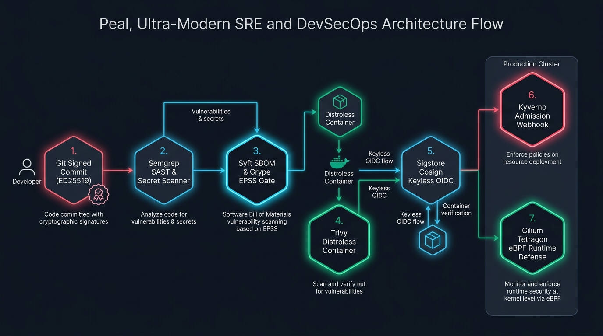
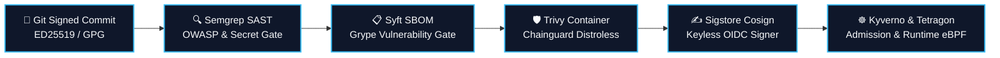
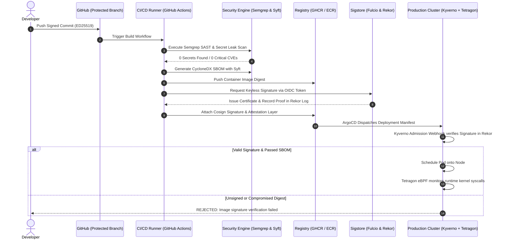

# DevSecOps Portfolio & Visual Flow Specification Guide

> **Author:** Talari Pradeep — Senior SRE & Platform Architect  
> **Target Scope:** Software Supply Chain Security, In-Kernel Runtime Defense, Zero-Trust Access, and AI Safety  
> **Live Visual Workspace:** [https://talaripradeep.info/studios/flow/?template=devsecops](https://talaripradeep.info/studios/flow/?template=devsecops)  
> **Studios Directory:** [https://talaripradeep.info/studios/](https://talaripradeep.info/studios/)

---

## 1. Executive Summary

In modern cloud-native and AI-driven platforms, security cannot be an afterthought or a manual gate at the end of a sprint. The **DevSecOps Architecture** across the Talari Pradeep Engineering Studios establishes an automated, cryptographically verifiable, and observable pipeline spanning:
- **Code Provenance & Attestation:** SLSA Level 3 compliance and keyless signatures via Sigstore Cosign.
- **Continuous Vulnerability Management:** Semantic AST analysis (Semgrep) and zero-CVE base container packaging (Trivy + Chainguard).
- **Automated Policy-as-Code:** Kubernetes admission controllers (Kyverno, OPA Gatekeeper) verifying container image signatures before pod creation.
- **Zero-Trust Runtime Defense:** In-kernel eBPF syscall telemetry (Cilium Tetragon & Falco) isolating compromised workloads in under 50ms.
- **AI/LLM Application Security:** Real-time prompt injection filtering and guardrails protecting agent swarms from adversarial manipulation.

---

## 2. Interactive Visual Flow: DevSecOps Supply Chain Pipeline

The Visual Flow Canvas includes a first-class **`🛡️ DevSecOps & Supply Chain Security Pipeline`** starter template available directly at `/studios/flow/?template=devsecops` or from the left Component Palette.

### DevSecOps Architecture Diagram
Below is the end-to-end cryptographic provenance, vulnerability gating, and in-kernel defense topology:





### Pipeline Node Specification & Parameters

| Stage # | Stage Title | Type | Icon | Default Config Parameters | Architectural Function & Guardrail |
| :--- | :--- | :--- | :--- | :--- | :--- |
| **Stage 1** | **Git Signed Commit & Attestation** | `input` | 🔑 | `gpgKey: ED25519 Verified`<br>`branch: protected-main`<br>`attestation: commit-sig` | Blocks unsigned Git commits from entering CI/CD; verifies committer cryptographic identity against GitHub organization keys. |
| **Stage 2** | **Semgrep SAST & Secret Audit** | `security` | 🔍 | `rules: OWASP Top 10 + CWE Top 25`<br>`leakGate: Zero Secret Leaks`<br>`sarifExport: Enabled` | Performs abstract syntax tree (AST) semantic scanning; blocks pull requests introducing SQL injection, SSRF, or exposed API credentials. |
| **Stage 3** | **Syft SBOM & Grype Scanner** | `transform` | 📋 | `format: CycloneDX 1.5 JSON`<br>`epssCutoff: < 0.05`<br>`cvssThreshold: > 7.0` | Automatically builds a comprehensive Software Bill of Materials (SBOM); matches third-party dependencies against CVE & EPSS databases. |
| **Stage 4** | **Trivy Container & Chainguard Base** | `transform` | 🛡️ | `baseImage: Distroless Non-Root`<br>`cveSeverity: CRITICAL = 0`<br>`user: 65532:65532` | Packages binaries into minimal distroless base images without shell or package managers, enforcing zero CRITICAL/HIGH CVE tolerances. |
| **Stage 5** | **Sigstore Cosign Keyless Signer** | `security` | ✍️ | `oidcProvider: GitHub Actions OIDC`<br>`rekorTransparency: Logged`<br>`fulcioCA: Verified` | Signs container image digests keylessly using ephemeral OIDC tokens; publishes immutable attestation proofs to the Rekor transparency log. |
| **Stage 6** | **Kyverno & Tetragon Admission Gate** | `deploy` | ☸️ | `admissionPolicy: Enforce Cosign Verify`<br>`eBPFMonitor: Active`<br>`runtimeAction: Terminate Abnormal Syscalls` | Admission webhook rejects any unsigned image digest from scheduling onto Kubernetes; Tetragon monitors runtime kernel syscalls. |

---

## 3. Comprehensive DevSecOps Studios Catalog Matrix

Below is an exhaustive matrix of existing DevSecOps, policy, and security studios cataloged across the 334 engineering workspaces:

| # | Studio Name | Route Link | Target GitHub Repository | Primary Focus & Verification |
| :--- | :--- | :--- | :--- | :--- |
| **1** | **SAST Security Studio** | `/tools/sast/` | `Pradeeptalari14/tp-sast` | Static application code analysis & SonarQube rule generation |
| **2** | **Trivy Security Studio** | `/tools/trivy/` | `Pradeeptalari14/tp-trivy` | Multi-target vulnerability scanning for containers and Git repos |
| **3** | **Cilium Tetragon Kernel Security** | `/tools/ebpf-tetragon-security/` | `Pradeeptalari14/tp-ebpf-tetragon` | In-kernel eBPF tracing and real-time security observability |
| **4** | **Falco Security Auditor** | `/tools/falco-auditor/` | `Pradeeptalari14/tp-falco-auditor` | Real-time container threat detection for Kubernetes namespaces |
| **5** | **HashiCorp Vault Secrets Studio** | `/tools/vault-secrets/` | `Pradeeptalari14/tp-vault-secrets` | Dynamic STS secrets, PKI engines, and ephemeral DB tokens |
| **6** | **Production Secrets & Rotation** | `/tools/production-secrets/` | `Pradeeptalari14/tp-production-secrets` | Automated zero-downtime database and TLS secret rotations |
| **7** | **GitOps Secrets Studio** | `/tools/gitops-secrets/` | `Pradeeptalari14/tp-gitops-secrets` | Bitnami SealedSecrets and Kubernetes External Secrets Operator |
| **8** | **Kyverno Policy Studio** | `/tools/kyverno-policy/` | `Pradeeptalari14/tp-kyverno-policy` | Kubernetes-native admission policies enforcing non-root & read-only FS |
| **9** | **Policy-as-Code Compliance** | `/tools/compliance/` | `Pradeeptalari14/tp-compliance` | OPA / Rego policies for cloud infrastructure and Terraform plans |
| **10**| **Cloudflare Zero Trust Studio** | `/tools/cloudflare-zero-trust/` | `Pradeeptalari14/tp-cloudflare-zero-trust` | Cloudflare Access tunnels and identity-aware perimeter proxying |
| **11**| **PromptSecurity Firewall Studio** | `/tools/prompt-security-firewall/` | `Pradeeptalari14/tp-prompt-security-firewall` | LLM prompt injection and data exfiltration guardrail filters |
| **12**| **LLM Red Teaming Scanner** | `/tools/llm-redteaming/` | `Pradeeptalari14/tp-llm-redteaming` | Adversarial jailbreak testing via Garak & PyRIT probes |
| **13**| **Private Intelligence & ZDR Studio** | `/tools/private-intelligence-zdr/` | `Pradeeptalari14/tp-private-intelligence-zdr` | Zero Data Retention (ZDR) enclave execution gateways |
| **14**| **Azure ACR Security Guardrails** | `/tools/azure-acr-secure/` | `Pradeeptalari14/tp-azure-acr-secure` | Azure Container Registry content trust and Microsoft Defender gates |
| **15**| **AWS IAM Policy Analyzer** | `/tools/aws-iam/` | `Pradeeptalari14/tp-aws-iam` | Least-privilege IAM policy generation and wildcard permission auditor |
| **16**| **Codex Security Cloud Scanner** | `/tools/codex-security-cloud/` | `Pradeeptalari14/tp-codex-security-cloud` | Cloud workload posture assessment and MISRA/CWE code auditing |
| **17**| **GitHub Org Governance Studio** | `/tools/github-gov/` | `Pradeeptalari14/tp-github-gov` | Automated CODEOWNERS validation and branch protection rule sets |

---

## 4. Recommended New DevSecOps Studios & Repositories

To expand the engineering catalog with the latest 2026 enterprise DevSecOps standards, the following 5 repositories are recommended for immediate provisioning:

### 1. `sigstore-cosign-slsa` (`Pradeeptalari14/tp-sigstore-cosign-slsa`)
* **Core Technology:** Sigstore Cosign, Fulcio CA, Rekor Transparency Log, SLSA Framework.
* **Problem Solved:** Prevents software supply chain tampering by signing container images keylessly using OpenID Connect (OIDC) identity from GitHub Actions, generating in-toto SLSA Level 3 provenance attestations.
* **Primary Manifest:** `.github/workflows/cosign-attestation.yml`
* **Verification Command:** `cosign verify --certificate-identity-regexp '.*@github\.com' ghcr.io/pradeep/app:sha-latest`

### 2. `sbom-cyclonedx-governance` (`Pradeeptalari14/tp-sbom-cyclonedx-governance`)
* **Core Technology:** Anchore Syft, Grype, OWASP Dependency-Track, CycloneDX 1.5.
* **Problem Solved:** Automates SBOM cataloging for compliance (Executive Order 14028) and scores vulnerabilities using Exploit Prediction Scoring System (EPSS) to filter actionable threats from benign CVEs.
* **Primary Manifest:** `sbom-policy.yaml`
* **Verification Command:** `syft packages dir:. -o cyclonedx-json=sbom.json && grype sbom:sbom.json --fail-on high`

### 3. `semgrep-ast-guardrails` (`Pradeeptalari14/tp-semgrep-ast-guardrails`)
* **Core Technology:** Semgrep CE, Tree-sitter, SARIF, GitHub Security Alerts.
* **Problem Solved:** Fast, language-aware AST security linting that detects complex taint flow vulnerabilities (e.g., untrusted user input directly reaching an unescaped SQL query or exec command) in under 3 seconds.
* **Primary Manifest:** `.semgrep/rules.yml`
* **Verification Command:** `semgrep scan --config=auto --error --sarif --output=semgrep.sarif`

### 4. `owasp-llm-agent-shield` (`Pradeeptalari14/tp-owasp-llm-agent-shield`)
* **Core Technology:** NeMo Guardrails, Llama-Guard, OWASP Top 10 for LLMs, Pydantic V2.
* **Problem Solved:** Defends autonomous agents and RAG pipelines against Prompt Injection (LLM01), Sensitive Information Disclosure (LLM06), and Insecure Tool Hijacking (LLM08).
* **Primary Manifest:** `guardrails_config.yaml`
* **Verification Command:** `python -m shield.evaluator --test-suite adversarial-prompts.json`

### 5. `hashicorp-boundary-zerotrust` (`Pradeeptalari14/tp-boundary-zerotrust`)
* **Core Technology:** HashiCorp Boundary, HashiCorp Vault, WireGuard, OIDC.
* **Problem Solved:** Provides identity-based, ephemeral secure access to private Kubernetes clusters, internal databases, and bare-metal nodes without exposing SSH keys or traditional VPN perimeter risks.
* **Primary Manifest:** `boundary-controller.hcl`
* **Verification Command:** `boundary targets authorize-session -id ttcp_1234567890`

---

## 5. End-to-End DevSecOps Supply Chain Architecture



---

## 6. SRE Operational Runbook: DevSecOps Verification Commands

When auditing and verifying a live cluster against this DevSecOps baseline, execute the following commands:

### A. Keyless Cosign Verification
```bash
# Verify container image signature against GitHub OIDC identity
cosign verify \
  --certificate-identity-regexp '^https://github.com/Pradeeptalari14/.*' \
  --certificate-oidc-issuer 'https://token.actions.githubusercontent.com' \
  ghcr.io/pradeep/service:sha-latest
```

### B. Kyverno Admission Policy Validation
```bash
# Check that unsigned pod scheduling is blocked
kubectl apply -f - <<EOF
apiVersion: v1
kind: Pod
metadata:
  name: untrusted-test-pod
  namespace: default
spec:
  containers:
  - name: untrusted
    image: alpine:latest
EOF
# Expected: Error from server: admission webhook "validate.kyverno.svc" denied the request
```

### C. Tetragon eBPF Kernel Threat Monitoring
```bash
# Stream real-time kernel syscall events filtered by namespace
tetra getevents --namespace production -o compact
```

---

## 7. Automated Provisioning Script: Next-Gen DevSecOps Repositories

Execute this script to automatically create the 5 proposed DevSecOps repositories under `@Pradeeptalari14` on GitHub:

```javascript
// File: scratch/provision-devsecops-repos.js
const { execSync } = require('child_process');

const devSecOpsRepos = [
  {
    name: 'Pradeeptalari14/tp-sigstore-cosign-slsa',
    desc: 'SLSA Level 3 Build Provenance, in-toto attestations, and keyless container signing with GitHub Actions OIDC & Rekor transparency log.'
  },
  {
    name: 'Pradeeptalari14/tp-sbom-cyclonedx-governance',
    desc: 'Automated CycloneDX/SPDX generation via Syft, Dependency-Track integration, and EPSS-scored vulnerability gating.'
  },
  {
    name: 'Pradeeptalari14/tp-semgrep-ast-guardrails',
    desc: 'Custom Semgrep AST security rules, taint analysis for SQLi/SSRF, and automated SARIF publishing to GitHub Security tab.'
  },
  {
    name: 'Pradeeptalari14/tp-owasp-llm-agent-shield',
    desc: 'OWASP Top 10 for LLMs security guardrails, prompt injection shields, and agentic tool-hijacking defenses.'
  },
  {
    name: 'Pradeeptalari14/tp-boundary-zerotrust',
    desc: 'HashiCorp Boundary identity-based ephemeral secure remote access for EKS nodes and Aurora databases without SSH keys.'
  }
];

devSecOpsRepos.forEach((repo, i) => {
  console.log(`[${i + 1}/${devSecOpsRepos.length}] Creating ${repo.name}...`);
  try {
    execSync(`gh repo create "${repo.name}" --public --description "${repo.desc}"`, { stdio: 'inherit' });
    console.log(`✅ Successfully provisioned ${repo.name}`);
  } catch (err) {
    console.warn(`⚠️ Repository ${repo.name} might already exist or needs auth verification.`);
  }
});
```

---

*Document generated and synchronized with the Visual Flow Workspace Engine.*
