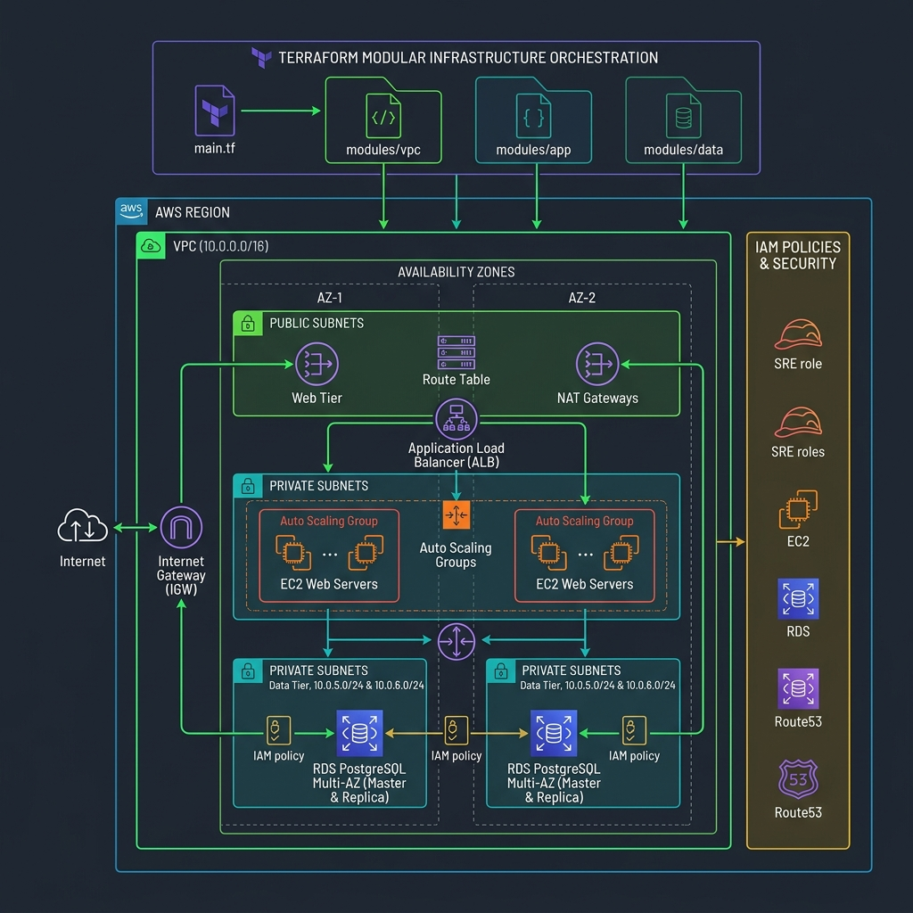
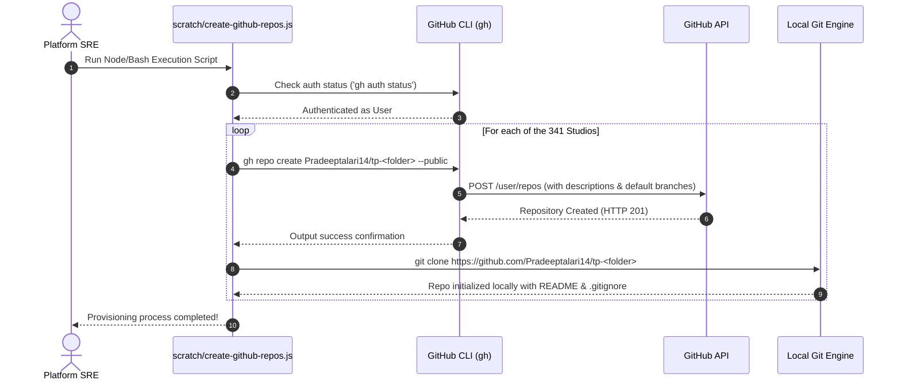
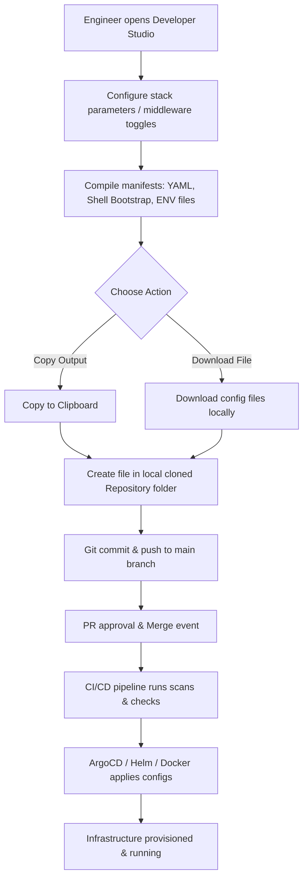

# Developer Studios: GitHub Provisioning & Execution Guide

This handbook provides SREs and Platform Engineers with the exact commands and pipeline flow to bootstrap GitHub repositories and execute compiled configurations for all **341 Developer Studios** in the portfolio.

---

## 1. System Architecture Flows

### SRE Architecture Diagrams by Domain
Each developer studio repository category contains its own tailored SRE architecture diagram in its `docs/` folder:

*   **AI & MLOps (`ai`):** [`sre_architecture_flow_ai.png`](sre_architecture_flow_ai.png)
*   **Cloud & Infrastructure (`cloud`):** [`sre_architecture_flow_cloud.png`](sre_architecture_flow_cloud.png)
*   **CI/CD Pipelines (`cicd`):** [`sre_architecture_flow_cicd.png`](sre_architecture_flow_cicd.png)
*   **Config & Automation (`automation`):** [`sre_architecture_flow_automation.png`](sre_architecture_flow_automation.png)
*   **Telemetry & Observability (`observability`):** [`sre_architecture_flow_observability.png`](sre_architecture_flow_observability.png)

Below is a visual diagram showing the **Cloud & Infrastructure Architecture**:



### A. Repository Provisioning Lifecycle
This sequence illustrates how target repositories are programmatically created using the GitHub CLI:



### B. Configuration Compiler & Run Pipeline
This flowchart shows the development loop: from interactive parameters config in a studio down to Kubernetes/Docker/Cloud execution:



---

## 🌟 Flagship Production Systems & Architecture Center Provisioning

In addition to the 341 developer studios, the 6 core architectural platforms and Architecture Center are provisioned as independent, production-grade repositories:

| Flagship Platform | GitHub Repository | Clone & Verification Command | Architecture Showcase |
| :--- | :--- | :--- | :--- |
| **Enterprise Agentic OS** | [`enterprise-agentic-os`](https://github.com/Pradeeptalari14/enterprise-agentic-os) | `git clone https://github.com/Pradeeptalari14/enterprise-agentic-os.git && cd enterprise-agentic-os && bash scripts/validate.sh` | [Case Study](https://pradeeptalari.me/projects/enterprise-agentic-os.html) |
| **Enterprise Hybrid RAG Platform** | [`enterprise-rag-platform`](https://github.com/Pradeeptalari14/enterprise-rag-platform) | `git clone https://github.com/Pradeeptalari14/enterprise-rag-platform.git && cd enterprise-rag-platform && bash scripts/validate.sh` | [Case Study](https://pradeeptalari.me/projects/enterprise-rag-platform.html) |
| **Multi-Cloud Landing Zone & IaC** | [`multi-cloud-landing-zone`](https://github.com/Pradeeptalari14/multi-cloud-landing-zone) | `git clone https://github.com/Pradeeptalari14/multi-cloud-landing-zone.git && cd multi-cloud-landing-zone && bash scripts/validate.sh` | [Case Study](https://pradeeptalari.me/projects/multi-cloud-landing-zone.html) |
| **AI Infra Monitoring Copilot** | [`ai-infra-monitoring-copilot`](https://github.com/Pradeeptalari14/ai-infra-monitoring-copilot) | `git clone https://github.com/Pradeeptalari14/ai-infra-monitoring-copilot.git && cd ai-infra-monitoring-copilot && bash scripts/validate.sh` | [Case Study](https://pradeeptalari.me/projects/ai-infra-monitoring-copilot.html) |
| **Kubernetes Observability Platform** | [`observability-platform-k8s`](https://github.com/Pradeeptalari14/observability-platform-k8s) | `git clone https://github.com/Pradeeptalari14/observability-platform-k8s.git && cd observability-platform-k8s && bash scripts/validate.sh` | [Case Study](https://pradeeptalari.me/projects/observability-platform-k8s.html) |
| **WhatsApp Multilingual Voice AI** | [`whatsapp-voice-ai-assistant`](https://github.com/Pradeeptalari14/whatsapp-voice-ai-assistant) | `git clone https://github.com/Pradeeptalari14/whatsapp-voice-ai-assistant.git && cd whatsapp-voice-ai-assistant && bash scripts/validate.sh` | [Case Study](https://pradeeptalari.me/projects/whatsapp-voice-ai-assistant.html) |
| **Cloud Architecture Center** | [`architecture/`](https://pradeeptalari.me/architecture/) | Production interactive top-level workbench with live node topology & chaos injection | [Architecture Center](https://pradeeptalari.me/architecture/) |

---

## 2. Batch Repository Creation Automation Script

You can copy and save the script below as `scratch/create-github-repos.js` on your machine, then execute it to automatically create all 341 public repositories under your profile:

```javascript
// File: scratch/create-github-repos.js
const { execSync } = require('child_process');
const fs = require('fs');
const path = require('path');

// Verify GitHub CLI is installed
try {
  execSync('gh --version', { stdio: 'ignore' });
} catch (e) {
  console.error("❌ Error: GitHub CLI ('gh') is not installed. Please download from https://cli.github.com/");
  process.exit(1);
}

// Verify CLI auth status
try {
  execSync('gh auth status', { stdio: 'inherit' });
} catch (e) {
  console.error("❌ Error: Not authenticated with GitHub. Run 'gh auth login' first.");
  process.exit(1);
}

const toolsPath = path.resolve(__dirname, '../tools/tools.json');
const tools = JSON.parse(fs.readFileSync(toolsPath, 'utf8'));

console.log(`🚀 Found ${tools.length} studios. Starting batch creation on GitHub...`);

tools.forEach((tool, index) => {
  const repoName = tool.repository; // Format: Pradeeptalari14/tp-<folder>
  const description = `Developer Studio repository for ${tool.title}. Category: ${tool.category}.`;
  
  console.log(`[${index + 1}/${tools.length}] Creating repository: ${repoName}...`);
  try {
    // Run gh command to create repository
    execSync(`gh repo create "${repoName}" --public --description "${description}"`, { stdio: 'inherit' });
    console.log(`✅ Created ${repoName}`);
  } catch (err) {
    console.warn(`⚠️ Warning: Repository ${repoName} might already exist. Skipping...`);
  }
});

console.log("🎉 All 341 target repositories have been processed!");
```

---

## 3. Exhaustive 341-Repository Execution Matrix

This table lists every studio, its Git repository name, the primary configuration file it compiles, where that file should be committed, and the exact command line strings to apply and verify the setup:

| # | Studio Name | Target GitHub Repository | Primary Config | Commit Destination | Execution Command | Validation Command |
|---|---|---|---|---|---|---|
| 1 | DevOps AI RAG Studio | `Pradeeptalari14/tp-ai` | `rag_engine.py` | `/src` | `python3 rag_engine.py` | `python3 -m py_compile rag_engine.py` |
| 2 | TypeSafe Jev: System 1 AI Studio | `Pradeeptalari14/tp-typesafe-jev` | `jev_engine.py` | `/src` | `python3 jev_engine.py` | `python3 -m py_compile jev_engine.py` |
| 3 | Enterprise LLM Studio | `Pradeeptalari14/tp-llm` | `deployment.yaml` | `/deploy/k8s` | `kubectl apply -f deployment.yaml` | `kubectl get -f deployment.yaml` |
| 4 | Local SLM Studio | `Pradeeptalari14/tp-slm` | `Modelfile` | `/config` | `cat Modelfile` | `ls -la Modelfile` |
| 5 | MLflow Tracking Studio | `Pradeeptalari14/tp-mlflow` | `docker-compose.yml` | `/deploy/compose` | `docker compose -f docker-compose.yml up -d` | `docker compose ps` |
| 6 | Strands SRE Agent Studio | `Pradeeptalari14/tp-strands` | `agent.py` | `/src` | `python3 agent.py` | `python3 -m py_compile agent.py` |
| 7 | LLM Guardrails Studio | `Pradeeptalari14/tp-llm-guardrails` | `config.yaml` | `/deploy/k8s` | `kubectl apply -f config.yaml` | `kubectl get -f config.yaml` |
| 8 | Ray Cluster Studio | `Pradeeptalari14/tp-ray-cluster` | `ray_cluster.yaml` | `/deploy/k8s` | `kubectl apply -f ray_cluster.yaml` | `kubectl get -f ray_cluster.yaml` |
| 9 | AI Evaluation Studio | `Pradeeptalari14/tp-ai-eval` | `eval_pipeline.py` | `/src` | `python3 eval_pipeline.py` | `python3 -m py_compile eval_pipeline.py` |
| 10 | Feature Store Studio | `Pradeeptalari14/tp-feature-store` | `feature_store.yaml` | `/deploy/k8s` | `kubectl apply -f feature_store.yaml` | `kubectl get -f feature_store.yaml` |
| 11 | LLM Gateway & API Router Studio | `Pradeeptalari14/tp-llm-gateway` | `litellm-config.yaml` | `/deploy/k8s` | `kubectl apply -f litellm-config.yaml` | `kubectl get -f litellm-config.yaml` |
| 12 | LLM Observability & Tracing Studio | `Pradeeptalari14/tp-llm-tracing` | `langfuse-compose.yml` | `/deploy/compose` | `docker compose -f langfuse-compose.yml up -d` | `docker compose ps` |
| 13 | Vector Database Optimizer Studio | `Pradeeptalari14/tp-vector-db` | `qdrant-config.yaml` | `/deploy/k8s` | `kubectl apply -f qdrant-config.yaml` | `kubectl get -f qdrant-config.yaml` |
| 14 | SRE AI Agent Simulator | `Pradeeptalari14/tp-sre-simulator` | `triage_agent.py` | `/src` | `python3 triage_agent.py` | `python3 -m py_compile triage_agent.py` |
| 15 | MCP Studio | `Pradeeptalari14/tp-mcp-studio` | `mcp_config.json` | `/config` | `cat mcp_config.json` | `jq . mcp_config.json` |
| 16 | Ansible Playbook Builder | `Pradeeptalari14/tp-ansible` | `playbook.yml` | `/deploy/k8s` | `kubectl apply -f playbook.yml` | `kubectl get -f playbook.yml` |
| 17 | Docker Manager | `Pradeeptalari14/tp-docker` | `Dockerfile` | `/` | `docker build -t app .` | `docker images app` |
| 18 | Git Learning Studio | `Pradeeptalari14/tp-git` | `git_guide.md` | `/docs` | `cat git_guide.md` | `ls -la git_guide.md` |
| 19 | Jenkins CI/CD Pipeline | `Pradeeptalari14/tp-jenkins` | `Jenkinsfile` | `/config` | `cat Jenkinsfile` | `ls -la Jenkinsfile` |
| 20 | Terraform Architect | `Pradeeptalari14/tp-terraform` | `main.tf` | `/infra/terraform` | `terraform init && terraform apply -auto-approve` | `terraform validate` |
| 21 | Advanced k8s Script Generator | `Pradeeptalari14/tp-kubernetes` | `deployment.yaml` | `/deploy/k8s` | `kubectl apply -f deployment.yaml` | `kubectl get -f deployment.yaml` |
| 22 | Advanced Monitoring Script Generator | `Pradeeptalari14/tp-monitoring` | `install.sh` | `/scripts` | `bash install.sh` | `bash -n install.sh` |
| 23 | GitHub Actions Workflow Studio | `Pradeeptalari14/tp-github-actions` | `ci.yml` | `/deploy/k8s` | `kubectl apply -f ci.yml` | `kubectl get -f ci.yml` |
| 24 | Helm Chart Scaffold Studio | `Pradeeptalari14/tp-helm` | `Chart.yaml` | `/deploy/k8s` | `kubectl apply -f Chart.yaml` | `kubectl get -f Chart.yaml` |
| 25 | ArgoCD GitOps App Studio | `Pradeeptalari14/tp-argocd` | `application.yaml` | `/deploy/k8s` | `kubectl apply -f application.yaml` | `kubectl get -f application.yaml` |
| 26 | ELK & Loki Logging Studio | `Pradeeptalari14/tp-logging` | `install.sh` | `/scripts` | `bash install.sh` | `bash -n install.sh` |
| 27 | Linux & PowerShell Studio | `Pradeeptalari14/tp-linux` | `sre-script.sh` | `/scripts` | `bash sre-script.sh` | `bash -n sre-script.sh` |
| 28 | Python SRE Utility Studio | `Pradeeptalari14/tp-python` | `sre_utility.py` | `/src` | `python3 sre_utility.py` | `python3 -m py_compile sre_utility.py` |
| 29 | ShellScript SRE Studio | `Pradeeptalari14/tp-shellscript` | `sre-script.sh` | `/scripts` | `bash sre-script.sh` | `bash -n sre-script.sh` |
| 30 | GitLab CI/CD Pipeline Studio | `Pradeeptalari14/tp-gitlab` | `.gitlab-ci.yml` | `/deploy/k8s` | `kubectl apply -f .gitlab-ci.yml` | `kubectl get -f .gitlab-ci.yml` |
| 31 | Webhooks Studio | `Pradeeptalari14/tp-webhooks` | `receiver.py` | `/src` | `python3 receiver.py` | `python3 -m py_compile receiver.py` |
| 32 | Secret Management Studio | `Pradeeptalari14/tp-secrets` | `policy.hcl` | `/config` | `cat policy.hcl` | `ls -la policy.hcl` |
| 33 | Chaos Engineering Studio | `Pradeeptalari14/tp-chaos` | `experiment.yaml` | `/deploy/k8s` | `kubectl apply -f experiment.yaml` | `kubectl get -f experiment.yaml` |
| 34 | Service Mesh Studio | `Pradeeptalari14/tp-mesh` | `routing.yaml` | `/deploy/k8s` | `kubectl apply -f routing.yaml` | `kubectl get -f routing.yaml` |
| 35 | Distributed Tracing Studio | `Pradeeptalari14/tp-tracing` | `otel_config.yaml` | `/deploy/k8s` | `kubectl apply -f otel_config.yaml` | `kubectl get -f otel_config.yaml` |
| 36 | Policy-as-Code Studio | `Pradeeptalari14/tp-compliance` | `policy.rego` | `/config` | `cat policy.rego` | `ls -la policy.rego` |
| 37 | Database Migration Studio | `Pradeeptalari14/tp-db-migration` | `migration.sql` | `/db` | `psql -f migration.sql` | `cat migration.sql` |
| 38 | Performance Studio | `Pradeeptalari14/tp-performance` | `load_test.js` | `/config` | `cat load_test.js` | `ls -la load_test.js` |
| 39 | SLO & Error Budget Studio | `Pradeeptalari14/tp-slo` | `slo_rules.yaml` | `/deploy/k8s` | `kubectl apply -f slo_rules.yaml` | `kubectl get -f slo_rules.yaml` |
| 40 | SAST Security Studio | `Pradeeptalari14/tp-sast` | `rules.yaml` | `/deploy/k8s` | `kubectl apply -f rules.yaml` | `kubectl get -f rules.yaml` |
| 41 | FinOps Studio | `Pradeeptalari14/tp-finops` | `cleanup.py` | `/src` | `python3 cleanup.py` | `python3 -m py_compile cleanup.py` |
| 42 | DNS & SSL PKI Studio | `Pradeeptalari14/tp-dns-ssl` | `renew_certs.sh` | `/scripts` | `bash renew_certs.sh` | `bash -n renew_certs.sh` |
| 43 | Backup & DR Studio | `Pradeeptalari14/tp-backup-dr` | `backup_job.yaml` | `/deploy/k8s` | `kubectl apply -f backup_job.yaml` | `kubectl get -f backup_job.yaml` |
| 44 | AWS Event-Driven & Messaging SRE Studio | `Pradeeptalari14/tp-event-sre` | `sqs-policy.json` | `/config` | `cat sqs-policy.json` | `jq . sqs-policy.json` |
| 45 | GitHub Org Governance & CodeOwners Studio | `Pradeeptalari14/tp-github-gov` | `CODEOWNERS` | `/config` | `cat CODEOWNERS` | `ls -la CODEOWNERS` |
| 46 | Cloudflare Zero Trust & Tunneling Studio | `Pradeeptalari14/tp-cloudflare-zero-trust` | `config.yml` | `/deploy/k8s` | `kubectl apply -f config.yml` | `kubectl get -f config.yml` |
| 47 | Docker Compose & LocalStack Dev Studio | `Pradeeptalari14/tp-localstack-dev` | `docker-compose.yml` | `/deploy/compose` | `docker compose -f docker-compose.yml up -d` | `docker compose ps` |
| 48 | Docker Compose & Local Cloud Dev Studio | `Pradeeptalari14/tp-local-cloud-dev` | `docker-compose.yml` | `/deploy/compose` | `docker compose -f docker-compose.yml up -d` | `docker compose ps` |
| 49 | Status & Incident Studio | `Pradeeptalari14/tp-status-incident` | `status_page.json` | `/config` | `cat status_page.json` | `jq . status_page.json` |
| 50 | API Gateway Studio | `Pradeeptalari14/tp-api-gateway` | `nginx.conf` | `/config` | `cat nginx.conf` | `ls -la nginx.conf` |
| 51 | GitOps Secrets Studio | `Pradeeptalari14/tp-gitops-secrets` | `.sops.yaml` | `/deploy/k8s` | `kubectl apply -f .sops.yaml` | `kubectl get -f .sops.yaml` |
| 52 | IDP Template Studio | `Pradeeptalari14/tp-idp-template` | `template.yaml` | `/deploy/k8s` | `kubectl apply -f template.yaml` | `kubectl get -f template.yaml` |
| 53 | Progressive Delivery Studio | `Pradeeptalari14/tp-progressive-delivery` | `rollout.yaml` | `/deploy/k8s` | `kubectl apply -f rollout.yaml` | `kubectl get -f rollout.yaml` |
| 54 | Edge WASM Studio | `Pradeeptalari14/tp-edge-wasm` | `spin.toml` | `/config` | `cat spin.toml` | `ls -la spin.toml` |
| 55 | Container Registry Studio | `Pradeeptalari14/tp-container-registry` | `sign_image.sh` | `/scripts` | `bash sign_image.sh` | `bash -n sign_image.sh` |
| 56 | Database Clustering Studio | `Pradeeptalari14/tp-db-clustering` | `patroni.yaml` | `/deploy/k8s` | `kubectl apply -f patroni.yaml` | `kubectl get -f patroni.yaml` |
| 57 | eBPF Tracing Studio | `Pradeeptalari14/tp-ebpf-tracing` | `ebpf_program.c` | `/config` | `cat ebpf_program.c` | `ls -la ebpf_program.c` |
| 58 | GreenOps Studio | `Pradeeptalari14/tp-greenops` | `kepler_policy.yaml` | `/deploy/k8s` | `kubectl apply -f kepler_policy.yaml` | `kubectl get -f kepler_policy.yaml` |
| 59 | Confidential Enclave Studio | `Pradeeptalari14/tp-confidential-enclave` | `enclave_config.json` | `/config` | `cat enclave_config.json` | `jq . enclave_config.json` |
| 60 | Decentralized Infrastructure Studio | `Pradeeptalari14/tp-decentralized-infra` | `ipfs_daemon.json` | `/config` | `cat ipfs_daemon.json` | `jq . ipfs_daemon.json` |
| 61 | DataOps Studio | `Pradeeptalari14/tp-dataops` | `airflow_dag.py` | `/src` | `python3 airflow_dag.py` | `python3 -m py_compile airflow_dag.py` |
| 62 | AIOps Studio | `Pradeeptalari14/tp-aiops` | `prometheus_anomaly.yaml` | `/deploy/k8s` | `kubectl apply -f prometheus_anomaly.yaml` | `kubectl get -f prometheus_anomaly.yaml` |
| 63 | Systemd Service Builder | `Pradeeptalari14/tp-systemd-builder` | `systemd.service` | `/config` | `cat systemd.service` | `ls -la systemd.service` |
| 64 | VPC Subnetting Calculator | `Pradeeptalari14/tp-vpc-subnetter` | `vpc_config.tf` | `/infra/terraform` | `terraform init && terraform apply -auto-approve` | `terraform validate` |
| 65 | Nginx Configurator | `Pradeeptalari14/tp-nginx-config` | `nginx.conf` | `/config` | `cat nginx.conf` | `ls -la nginx.conf` |
| 66 | Kubernetes CRD Studio | `Pradeeptalari14/tp-k8s-crd` | `crd.yaml` | `/deploy/k8s` | `kubectl apply -f crd.yaml` | `kubectl get -f crd.yaml` |
| 67 | Trivy Security Studio | `Pradeeptalari14/tp-trivy` | `trivy.yaml` | `/deploy/k8s` | `kubectl apply -f trivy.yaml` | `kubectl get -f trivy.yaml` |
| 68 | AI Rules Customizer | `Pradeeptalari14/tp-ai-rules-customizer` | `.cursorrules` | `/config` | `cat .cursorrules` | `ls -la .cursorrules` |
| 69 | Falco Security Auditor | `Pradeeptalari14/tp-falco-auditor` | `falco_rules.yaml` | `/deploy/k8s` | `kubectl apply -f falco_rules.yaml` | `kubectl get -f falco_rules.yaml` |
| 70 | Alertmanager Visualizer | `Pradeeptalari14/tp-alertmanager-visualizer` | `alertmanager.yaml` | `/deploy/k8s` | `kubectl apply -f alertmanager.yaml` | `kubectl get -f alertmanager.yaml` |
| 71 | Dagger Pipelines Studio | `Pradeeptalari14/tp-dagger-pipelines` | `dagger.go` | `/config` | `cat dagger.go` | `ls -la dagger.go` |
| 72 | eBPF Tracing Generator | `Pradeeptalari14/tp-ebpf-generator` | `kprobe.bpf.c` | `/config` | `cat kprobe.bpf.c` | `ls -la kprobe.bpf.c` |
| 73 | Crossplane Cloud Studio | `Pradeeptalari14/tp-crossplane-studio` | `composition.yaml` | `/deploy/k8s` | `kubectl apply -f composition.yaml` | `kubectl get -f composition.yaml` |
| 74 | Knative Serverless Studio | `Pradeeptalari14/tp-knative-routing` | `service.yaml` | `/deploy/k8s` | `kubectl apply -f service.yaml` | `kubectl get -f service.yaml` |
| 75 | Karpenter Node Autoscaler | `Pradeeptalari14/tp-karpenter-autoscaler` | `nodepool.yaml` | `/deploy/k8s` | `kubectl apply -f nodepool.yaml` | `kubectl get -f nodepool.yaml` |
| 76 | KEDA Autoscaling Studio | `Pradeeptalari14/tp-keda-scaling` | `scaledobject.yaml` | `/deploy/k8s` | `kubectl apply -f scaledobject.yaml` | `kubectl get -f scaledobject.yaml` |
| 77 | OpenTelemetry Collector | `Pradeeptalari14/tp-otel-configurator` | `otel-collector.yaml` | `/deploy/k8s` | `kubectl apply -f otel-collector.yaml` | `kubectl get -f otel-collector.yaml` |
| 78 | Vector Log Pipeline Studio | `Pradeeptalari14/tp-vector-pipeline` | `vector.toml` | `/config` | `cat vector.toml` | `ls -la vector.toml` |
| 79 | Kyverno Policy Studio | `Pradeeptalari14/tp-kyverno-policy` | `policy.yaml` | `/deploy/k8s` | `kubectl apply -f policy.yaml` | `kubectl get -f policy.yaml` |
| 80 | GitHub ARC Studio | `Pradeeptalari14/tp-github-arc` | `runnerset.yaml` | `/deploy/k8s` | `kubectl apply -f runnerset.yaml` | `kubectl get -f runnerset.yaml` |
| 81 | Terraform Drift Auditor | `Pradeeptalari14/tp-terraform-drift` | `drift_audit.sh` | `/scripts` | `bash drift_audit.sh` | `bash -n drift_audit.sh` |
| 82 | FluxCD GitOps Studio | `Pradeeptalari14/tp-fluxcd-gitops` | `gitrepository.yaml` | `/deploy/k8s` | `kubectl apply -f gitrepository.yaml` | `kubectl get -f gitrepository.yaml` |
| 83 | Cilium Policy Studio | `Pradeeptalari14/tp-cilium-policy` | `cilium-policy.yaml` | `/deploy/k8s` | `kubectl apply -f cilium-policy.yaml` | `kubectl get -f cilium-policy.yaml` |
| 84 | AWS IAM Policy Analyzer | `Pradeeptalari14/tp-aws-iam` | `iam-policy.json` | `/config` | `cat iam-policy.json` | `jq . iam-policy.json` |
| 85 | Vault Secrets Studio | `Pradeeptalari14/tp-vault-secrets` | `vault-policy.hcl` | `/config` | `cat vault-policy.hcl` | `ls -la vault-policy.hcl` |
| 86 | Tekton Pipeline Studio | `Pradeeptalari14/tp-tekton-pipeline` | `pipeline.yaml` | `/deploy/k8s` | `kubectl apply -f pipeline.yaml` | `kubectl get -f pipeline.yaml` |
| 87 | Go SRE Utility Studio | `Pradeeptalari14/tp-go-utility` | `main.go` | `/config` | `cat main.go` | `ls -la main.go` |
| 88 | AWS CloudFormation Studio | `Pradeeptalari14/tp-cloudformation` | `template.yaml` | `/deploy/k8s` | `kubectl apply -f template.yaml` | `kubectl get -f template.yaml` |
| 89 | Bitbucket Pipelines Studio | `Pradeeptalari14/tp-bitbucket` | `bitbucket-pipelines.yml` | `/deploy/k8s` | `kubectl apply -f bitbucket-pipelines.yml` | `kubectl get -f bitbucket-pipelines.yml` |
| 90 | Apache Tomcat Tuning Studio | `Pradeeptalari14/tp-tomcat` | `server.xml` | `/config` | `cat server.xml` | `ls -la server.xml` |
| 91 | Maven Build Studio | `Pradeeptalari14/tp-maven` | `pom.xml` | `/config` | `cat pom.xml` | `ls -la pom.xml` |
| 92 | SonarQube Quality Gate Studio | `Pradeeptalari14/tp-sonarqube` | `sonar-project.properties` | `/config` | `cat sonar-project.properties` | `ls -la sonar-project.properties` |
| 93 | Agile & ITSM Studio | `Pradeeptalari14/tp-agile-itsm` | `servicenow-change.json` | `/config` | `cat servicenow-change.json` | `jq . servicenow-change.json` |
| 94 | Pulumi Infrastructure Studio | `Pradeeptalari14/tp-pulumi` | `Pulumi.yaml` | `/deploy/k8s` | `kubectl apply -f Pulumi.yaml` | `kubectl get -f Pulumi.yaml` |
| 95 | SLM Fine-Tuning & Quantization Studio | `Pradeeptalari14/tp-qlora-tuning` | `finetune.py` | `/src` | `python3 finetune.py` | `python3 -m py_compile finetune.py` |
| 96 | Prompt Registry & Versioning Studio | `Pradeeptalari14/tp-promptops` | `prompts.yaml` | `/deploy/k8s` | `kubectl apply -f prompts.yaml` | `kubectl get -f prompts.yaml` |
| 97 | Hugging Face & GitLFS Sync Studio | `Pradeeptalari14/tp-modelops-gitops` | `sync-model.sh` | `/scripts` | `bash sync-model.sh` | `bash -n sync-model.sh` |
| 98 | LLM Red Teaming & Vulnerability Scanner Studio | `Pradeeptalari14/tp-llm-redteaming` | `garak-config.yaml` | `/deploy/k8s` | `kubectl apply -f garak-config.yaml` | `kubectl get -f garak-config.yaml` |
| 99 | AI Synthetic Data Generator Studio | `Pradeeptalari14/tp-synthetic-data` | `generate-dataset.py` | `/src` | `python3 generate-dataset.py` | `python3 -m py_compile generate-dataset.py` |
| 100 | GPU Scheduler & K8s Allocator Studio | `Pradeeptalari14/tp-gpu-scheduler` | `gpu-policy.yaml` | `/deploy/k8s` | `kubectl apply -f gpu-policy.yaml` | `kubectl get -f gpu-policy.yaml` |
| 101 | MCP Server Builder Studio | `Pradeeptalari14/tp-mcp-server` | `mcp-server.py` | `/src` | `python3 mcp-server.py` | `python3 -m py_compile mcp-server.py` |
| 102 | AI Agentic Workflow Compiler Studio | `Pradeeptalari14/tp-agent-workflow` | `agent-workflow.py` | `/src` | `python3 agent-workflow.py` | `python3 -m py_compile agent-workflow.py` |
| 103 | Azure Cognitive Search AI Studio | `Pradeeptalari14/tp-azure-search-ai` | `search_config.json` | `/config` | `cat search_config.json` | `jq . search_config.json` |
| 104 | GCP Vertex AI Model Registry Studio | `Pradeeptalari14/tp-gcp-vertex-ai` | `vertex_deploy.py` | `/src` | `python3 vertex_deploy.py` | `python3 -m py_compile vertex_deploy.py` |
| 105 | Azure AKS Cluster Studio | `Pradeeptalari14/tp-azure-aks` | `aks_cluster.tf` | `/infra/terraform` | `terraform init && terraform apply -auto-approve` | `terraform validate` |
| 106 | Azure App Service Deployer | `Pradeeptalari14/tp-azure-app-service` | `webapp_config.tf` | `/infra/terraform` | `terraform init && terraform apply -auto-approve` | `terraform validate` |
| 107 | Azure Arc Hybrid Management Studio | `Pradeeptalari14/tp-azure-arc` | `arc_onboard.sh` | `/scripts` | `bash arc_onboard.sh` | `bash -n arc_onboard.sh` |
| 108 | GCP GKE Autopilot Cluster Studio | `Pradeeptalari14/tp-gcp-gke-autopilot` | `gke_autopilot.tf` | `/infra/terraform` | `terraform init && terraform apply -auto-approve` | `terraform validate` |
| 109 | GCP Cloud Run Serverless Studio | `Pradeeptalari14/tp-gcp-cloud-run` | `cloud_run.tf` | `/infra/terraform` | `terraform init && terraform apply -auto-approve` | `terraform validate` |
| 110 | GCP Anthos Service Mesh Studio | `Pradeeptalari14/tp-gcp-anthos` | `asm_policy.yaml` | `/deploy/k8s` | `kubectl apply -f asm_policy.yaml` | `kubectl get -f asm_policy.yaml` |
| 111 | Azure DevOps Pipelines Studio | `Pradeeptalari14/tp-azure-devops-pipelines` | `azure-pipelines.yml` | `/deploy/k8s` | `kubectl apply -f azure-pipelines.yml` | `kubectl get -f azure-pipelines.yml` |
| 112 | GCP Cloud Build Studio | `Pradeeptalari14/tp-gcp-cloud-build` | `cloudbuild.yaml` | `/deploy/k8s` | `kubectl apply -f cloudbuild.yaml` | `kubectl get -f cloudbuild.yaml` |
| 113 | Azure Bicep/ARM Studio | `Pradeeptalari14/tp-azure-bicep-arm` | `main.bicep` | `/config` | `cat main.bicep` | `ls -la main.bicep` |
| 114 | Azure ACR Security Guardrails | `Pradeeptalari14/tp-azure-acr-secure` | `acr_policy.tf` | `/infra/terraform` | `terraform init && terraform apply -auto-approve` | `terraform validate` |
| 115 | Azure Key Vault Secret Manager | `Pradeeptalari14/tp-azure-key-vault` | `keyvault.tf` | `/infra/terraform` | `terraform init && terraform apply -auto-approve` | `terraform validate` |
| 116 | Azure Functions Studio | `Pradeeptalari14/tp-azure-functions` | `function.json` | `/config` | `cat function.json` | `jq . function.json` |
| 117 | GCP Deployment Manager Studio | `Pradeeptalari14/tp-gcp-deployment-manager` | `deployment.yaml` | `/deploy/k8s` | `kubectl apply -f deployment.yaml` | `kubectl get -f deployment.yaml` |
| 118 | GCP Secret Manager Studio | `Pradeeptalari14/tp-gcp-secret-manager` | `secret_config.tf` | `/infra/terraform` | `terraform init && terraform apply -auto-approve` | `terraform validate` |
| 119 | GCP Cloud Functions Studio | `Pradeeptalari14/tp-gcp-cloud-functions` | `main.py` | `/src` | `python3 main.py` | `python3 -m py_compile main.py` |
| 120 | GCP Cloud Spanner Studio | `Pradeeptalari14/tp-gcp-cloud-spanner` | `spanner_ddl.sql` | `/db` | `psql -f spanner_ddl.sql` | `cat spanner_ddl.sql` |
| 121 | Azure Monitor & Log Analytics Studio | `Pradeeptalari14/tp-azure-monitor` | `monitor_rules.tf` | `/infra/terraform` | `terraform init && terraform apply -auto-approve` | `terraform validate` |
| 122 | GCP Cloud Operations Monitoring Studio | `Pradeeptalari14/tp-gcp-cloud-operations` | `metrics_dashboard.json` | `/config` | `cat metrics_dashboard.json` | `jq . metrics_dashboard.json` |
| 123 | User Genie (Enhanced Agentic RAG) | `Pradeeptalari14/tp-user-genie` | `rag_engine.py` | `/src` | `python3 rag_engine.py` | `python3 -m py_compile rag_engine.py` |
| 124 | KnowledgeOps AI | `Pradeeptalari14/tp-knowledgeops-ai` | `observability_config.yaml` | `/deploy/k8s` | `kubectl apply -f observability_config.yaml` | `kubectl get -f observability_config.yaml` |
| 125 | MonVisor | `Pradeeptalari14/tp-monvisor` | `alerts_config.yaml` | `/deploy/k8s` | `kubectl apply -f alerts_config.yaml` | `kubectl get -f alerts_config.yaml` |
| 126 | RAGrificant | `Pradeeptalari14/tp-ragrificant` | `docker-compose.yml` | `/deploy/compose` | `docker compose -f docker-compose.yml up -d` | `docker compose ps` |
| 127 | KubeRAG Operator | `Pradeeptalari14/tp-kuberag-operator` | `operator_deployment.yaml` | `/deploy/k8s` | `kubectl apply -f operator_deployment.yaml` | `kubectl get -f operator_deployment.yaml` |
| 128 | bifrost-rag | `Pradeeptalari14/tp-bifrost-rag` | `retrieval_harness.py` | `/src` | `python3 retrieval_harness.py` | `python3 -m py_compile retrieval_harness.py` |
| 129 | rag-select | `Pradeeptalari14/tp-rag-select` | `architecture_compare.py` | `/src` | `python3 architecture_compare.py` | `python3 -m py_compile architecture_compare.py` |
| 130 | RAG Educational Microservices | `Pradeeptalari14/tp-rag-edu` | `chroma_indexer.py` | `/src` | `python3 chroma_indexer.py` | `python3 -m py_compile chroma_indexer.py` |
| 131 | RetroRAG | `Pradeeptalari14/tp-retrorag` | `recall_diagnostics.py` | `/src` | `python3 recall_diagnostics.py` | `python3 -m py_compile recall_diagnostics.py` |
| 132 | RecallBoost | `Pradeeptalari14/tp-recallboost` | `tuner_params.json` | `/config` | `cat tuner_params.json` | `jq . tuner_params.json` |
| 133 | DeepEval + Pytest | `Pradeeptalari14/tp-deepeval-pytest` | `eval_test.py` | `/src` | `python3 eval_test.py` | `python3 -m py_compile eval_test.py` |
| 134 | RAGAS Evaluator | `Pradeeptalari14/tp-ragas` | `ragas_eval.py` | `/src` | `python3 ragas_eval.py` | `python3 -m py_compile ragas_eval.py` |
| 135 | Cleanlab RAG Evaluator | `Pradeeptalari14/tp-cleanlab-evaluator` | `trust_evaluator.py` | `/src` | `python3 trust_evaluator.py` | `python3 -m py_compile trust_evaluator.py` |
| 136 | TruthTeller Evaluator | `Pradeeptalari14/tp-truthteller` | `evaluator_config.yaml` | `/deploy/k8s` | `kubectl apply -f evaluator_config.yaml` | `kubectl get -f evaluator_config.yaml` |
| 137 | RAG-Bench | `Pradeeptalari14/tp-rag-bench` | `benchmark_runner.py` | `/src` | `python3 benchmark_runner.py` | `python3 -m py_compile benchmark_runner.py` |
| 138 | Four-i Level-1 Observability (AWS) | `Pradeeptalari14/tp-aws-level1-observability` | `cloudwatch_dashboard.json` | `/config` | `cat cloudwatch_dashboard.json` | `jq . cloudwatch_dashboard.json` |
| 139 | Open Monitor AI Agent Monitoring | `Pradeeptalari14/tp-open-monitor-agent` | `grafana_dashboard.json` | `/config` | `cat grafana_dashboard.json` | `jq . grafana_dashboard.json` |
| 140 | OpenLIT-RAG & Stack | `Pradeeptalari14/tp-openlit-rag` | `openlit_telemetry.py` | `/src` | `python3 openlit_telemetry.py` | `python3 -m py_compile openlit_telemetry.py` |
| 141 | RAG Radar | `Pradeeptalari14/tp-rag-radar` | `drift_detector.py` | `/src` | `python3 drift_detector.py` | `python3 -m py_compile drift_detector.py` |
| 142 | VigilRAG | `Pradeeptalari14/tp-vigilrag` | `monitoring_dashboard.py` | `/src` | `python3 monitoring_dashboard.py` | `python3 -m py_compile monitoring_dashboard.py` |
| 143 | tclp Text Fingerprinting | `Pradeeptalari14/tp-tclp` | `fingerprint_utils.rs` | `/config` | `cat fingerprint_utils.rs` | `ls -la fingerprint_utils.rs` |
| 144 | dedup4pg | `Pradeeptalari14/tp-dedup4pg` | `dedup_trigger.sql` | `/db` | `psql -f dedup_trigger.sql` | `cat dedup_trigger.sql` |
| 145 | DedupFlow | `Pradeeptalari14/tp-dedupflow` | `dedup_workflow.json` | `/config` | `cat dedup_workflow.json` | `jq . dedup_workflow.json` |
| 146 | SemanticClean | `Pradeeptalari14/tp-semantic-clean` | `celery_task.py` | `/src` | `python3 celery_task.py` | `python3 -m py_compile celery_task.py` |
| 147 | Multi-Tenant RAG with Metadata Filtering (AWS) | `Pradeeptalari14/tp-aws-multitenant-rag` | `cognito_policy.json` | `/config` | `cat cognito_policy.json` | `jq . cognito_policy.json` |
| 148 | SharePoint Document Permissions Pipeline | `Pradeeptalari14/tp-sharepoint-permissions-pipeline` | `entra_permissions.json` | `/config` | `cat entra_permissions.json` | `jq . entra_permissions.json` |
| 149 | Metadata-Aware RAG for RBAC | `Pradeeptalari14/tp-metadata-aware-rbac` | `rbac_metadata.json` | `/config` | `cat rbac_metadata.json` | `jq . rbac_metadata.json` |
| 150 | OPAL & OPA Policy Controller | `Pradeeptalari14/tp-opal-opa` | `policy.rego` | `/config` | `cat policy.rego` | `ls -la policy.rego` |
| 151 | Permify RAG Filter | `Pradeeptalari14/tp-permify-filter` | `permify_rules.json` | `/config` | `cat permify_rules.json` | `jq . permify_rules.json` |
| 152 | Role-Based Filtering in Vector DBs | `Pradeeptalari14/tp-vector-db-rbac` | `vector_filter.json` | `/config` | `cat vector_filter.json` | `jq . vector_filter.json` |
| 153 | Amazon Bedrock Knowledge Bases Filtering | `Pradeeptalari14/tp-bedrock-metadata-filtering` | `kb_filter.json` | `/config` | `cat kb_filter.json` | `jq . kb_filter.json` |
| 154 | MetaGuard | `Pradeeptalari14/tp-metaguard` | `schema_validation.py` | `/src` | `python3 schema_validation.py` | `python3 -m py_compile schema_validation.py` |
| 155 | Filter Optimizer | `Pradeeptalari14/tp-filter-optimizer` | `filter_recommendation.py` | `/src` | `python3 filter_recommendation.py` | `python3 -m py_compile filter_recommendation.py` |
| 156 | rag-fallback (Adaptive Thresholding) | `Pradeeptalari14/tp-rag-fallback-adaptive` | `adaptive_thresholds.py` | `/src` | `python3 adaptive_thresholds.py` | `python3 -m py_compile adaptive_thresholds.py` |
| 157 | superRAG | `Pradeeptalari14/tp-superrag` | `hybrid_search.py` | `/src` | `python3 hybrid_search.py` | `python3 -m py_compile hybrid_search.py` |
| 158 | Adaptive-RAG | `Pradeeptalari14/tp-adaptive-rag` | `complexity_classifier.py` | `/src` | `python3 complexity_classifier.py` | `python3 -m py_compile complexity_classifier.py` |
| 159 | Threshold Tuner | `Pradeeptalari14/tp-threshold-tuner` | `grid_search.py` | `/src` | `python3 grid_search.py` | `python3 -m py_compile grid_search.py` |
| 160 | Cohere Rerank (API-based) | `Pradeeptalari14/tp-cohere-rerank` | `cohere_rerank.py` | `/src` | `python3 cohere_rerank.py` | `python3 -m py_compile cohere_rerank.py` |
| 161 | BGE Reranker v2-gte3 | `Pradeeptalari14/tp-bge-reranker` | `bge_reranker.py` | `/src` | `python3 bge_reranker.py` | `python3 -m py_compile bge_reranker.py` |
| 162 | Synthesis Reranking Service | `Pradeeptalari14/tp-synthesis-reranking-service` | `hybrid_reranker.py` | `/src` | `python3 hybrid_reranker.py` | `python3 -m py_compile hybrid_reranker.py` |
| 163 | FlashRank Studio | `Pradeeptalari14/tp-flashrank` | `flashrank_onnx.py` | `/src` | `python3 flashrank_onnx.py` | `python3 -m py_compile flashrank_onnx.py` |
| 164 | Rerank Gateway | `Pradeeptalari14/tp-rerank-gateway` | `rerank_gateway.py` | `/src` | `python3 rerank_gateway.py` | `python3 -m py_compile rerank_gateway.py` |
| 165 | ProtecRAG | `Pradeeptalari14/tp-protecrag` | `guardrails_rules.yaml` | `/deploy/k8s` | `kubectl apply -f guardrails_rules.yaml` | `kubectl get -f guardrails_rules.yaml` |
| 166 | PromptSecurity (Firewall) | `Pradeeptalari14/tp-prompt-security-firewall` | `firewall_config.json` | `/config` | `cat firewall_config.json` | `jq . firewall_config.json` |
| 167 | RAG Guardrails Action (GitHub Action) | `Pradeeptalari14/tp-rag-guardrails-action` | `action.yml` | `/deploy/k8s` | `kubectl apply -f action.yml` | `kubectl get -f action.yml` |
| 168 | Injection Catcher | `Pradeeptalari14/tp-injection-catcher` | `injection_detector.py` | `/src` | `python3 injection_detector.py` | `python3 -m py_compile injection_detector.py` |
| 169 | Guardian Shield Proxy | `Pradeeptalari14/tp-guardian-shield` | `nginx_shield.conf` | `/config` | `cat nginx_shield.conf` | `ls -la nginx_shield.conf` |
| 170 | Awesome-Chunker | `Pradeeptalari14/tp-awesome-chunker` | `chunking_harness.py` | `/src` | `python3 chunking_harness.py` | `python3 -m py_compile chunking_harness.py` |
| 171 | Late Chunking with Jina | `Pradeeptalari14/tp-late-chunking-jina` | `late_chunking.py` | `/src` | `python3 late_chunking.py` | `python3 -m py_compile late_chunking.py` |
| 172 | RAG Finance Chunking | `Pradeeptalari14/tp-rag-finance-chunking` | `finance_chunking.py` | `/src` | `python3 finance_chunking.py` | `python3 -m py_compile finance_chunking.py` |
| 173 | ChunkViz | `Pradeeptalari14/tp-chunkviz` | `boundary_viz.py` | `/src` | `python3 boundary_viz.py` | `python3 -m py_compile boundary_viz.py` |
| 174 | SmartChunk | `Pradeeptalari14/tp-smartchunk` | `smart_chunker.py` | `/src` | `python3 smart_chunker.py` | `python3 -m py_compile smart_chunker.py` |
| 175 | Q-Embed (Quantized Embedding) | `Pradeeptalari14/tp-q-embed` | `quantized_embedding.py` | `/src` | `python3 quantized_embedding.py` | `python3 -m py_compile quantized_embedding.py` |
| 176 | bge-telecom (Telecom Embedding) | `Pradeeptalari14/tp-bge-telecom` | `telecom_triplet.py` | `/src` | `python3 telecom_triplet.py` | `python3 -m py_compile telecom_triplet.py` |
| 177 | CSH-v2 Models | `Pradeeptalari14/tp-csh-v2-models` | `domain_embeddings.py` | `/src` | `python3 domain_embeddings.py` | `python3 -m py_compile domain_embeddings.py` |
| 178 | Embedding Registry | `Pradeeptalari14/tp-embedding-registry` | `registry_schema.sql` | `/db` | `psql -f registry_schema.sql` | `cat registry_schema.sql` |
| 179 | Model Drift Detector | `Pradeeptalari14/tp-model-drift-detector` | `drift_detector.py` | `/src` | `python3 drift_detector.py` | `python3 -m py_compile drift_detector.py` |
| 180 | Redis-CESC | `Pradeeptalari14/tp-redis-cesc` | `semantic_cache.py` | `/src` | `python3 semantic_cache.py` | `python3 -m py_compile semantic_cache.py` |
| 181 | LangChain + n8n Template | `Pradeeptalari14/tp-langchain-n8n-template` | `workflow_cache.json` | `/config` | `cat workflow_cache.json` | `jq . workflow_cache.json` |
| 182 | Enterprise-Grade RAG with Semantic Cache | `Pradeeptalari14/tp-enterprise-semantic-cache` | `redis_cache.py` | `/src` | `python3 redis_cache.py` | `python3 -m py_compile redis_cache.py` |
| 183 | GPTSafe (Semantic Cache) | `Pradeeptalari14/tp-gptsafe-cache` | `semantic_cache.py` | `/src` | `python3 semantic_cache.py` | `python3 -m py_compile semantic_cache.py` |
| 184 | CacheWarmer | `Pradeeptalari14/tp-cachewarmer` | `cache_warmer.py` | `/src` | `python3 cache_warmer.py` | `python3 -m py_compile cache_warmer.py` |
| 185 | Langfuse | `Pradeeptalari14/tp-langfuse-observability` | `docker-compose.yml` | `/deploy/compose` | `docker compose -f docker-compose.yml up -d` | `docker compose ps` |
| 186 | RAG Logger | `Pradeeptalari14/tp-rag-logger` | `rag_logger.py` | `/src` | `python3 rag_logger.py` | `python3 -m py_compile rag_logger.py` |
| 187 | Opal (Comet) | `Pradeeptalari14/tp-opal-comet` | `comet_eval.py` | `/src` | `python3 comet_eval.py` | `python3 -m py_compile comet_eval.py` |
| 188 | TraceRAG | `Pradeeptalari14/tp-tracerag` | `opentelemetry_traces.py` | `/src` | `python3 opentelemetry_traces.py` | `python3 -m py_compile opentelemetry_traces.py` |
| 189 | SRE logging Decorator | `Pradeeptalari14/tp-sre-logging-decorator` | `json_logger.py` | `/src` | `python3 json_logger.py` | `python3 -m py_compile json_logger.py` |
| 190 | modelab | `Pradeeptalari14/tp-modelab` | `ab_testing.py` | `/src` | `python3 ab_testing.py` | `python3 -m py_compile ab_testing.py` |
| 191 | Raindrop Experiments | `Pradeeptalari14/tp-raindrop-experiments` | `posthog_config.json` | `/config` | `cat posthog_config.json` | `jq . posthog_config.json` |
| 192 | RAG Splitter | `Pradeeptalari14/tp-rag-splitter` | `traffic_splitter.json` | `/config` | `cat traffic_splitter.json` | `jq . traffic_splitter.json` |
| 193 | ConductRAG | `Pradeeptalari14/tp-conductrag` | `stats_calculator.py` | `/src` | `python3 stats_calculator.py` | `python3 -m py_compile stats_calculator.py` |
| 194 | Real-Time CDC Pipeline for RAG | `Pradeeptalari14/tp-realtime-cdc-pipeline` | `cdc_pipeline.yaml` | `/deploy/k8s` | `kubectl apply -f cdc_pipeline.yaml` | `kubectl get -f cdc_pipeline.yaml` |
| 195 | LiveVector Lake | `Pradeeptalari14/tp-livevector-lake` | `versioned_index.py` | `/src` | `python3 versioned_index.py` | `python3 -m py_compile versioned_index.py` |
| 196 | vpage3-core | `Pradeeptalari14/tp-vpage3-core` | `change_detector.ts` | `/config` | `cat change_detector.ts` | `ls -la change_detector.ts` |
| 197 | CleanVector | `Pradeeptalari14/tp-cleanvector` | `cleanup_cron.py` | `/src` | `python3 cleanup_cron.py` | `python3 -m py_compile cleanup_cron.py` |
| 198 | WebWatcher | `Pradeeptalari14/tp-webwatcher` | `url_watcher.py` | `/src` | `python3 url_watcher.py` | `python3 -m py_compile url_watcher.py` |
| 199 | Fastest-Multimodal-Rag | `Pradeeptalari14/tp-fastest-multimodal-rag` | `multimodal_rag.py` | `/src` | `python3 multimodal_rag.py` | `python3 -m py_compile multimodal_rag.py` |
| 200 | PDF-RAG | `Pradeeptalari14/tp-pdf-rag` | `pdf_rag.py` | `/src` | `python3 pdf_rag.py` | `python3 -m py_compile pdf_rag.py` |
| 201 | Multimodal RAG Chatbot (AWS) | `Pradeeptalari14/tp-aws-multimodal-chatbot` | `textract_pipeline.py` | `/src` | `python3 textract_pipeline.py` | `python3 -m py_compile textract_pipeline.py` |
| 202 | ChartRAG | `Pradeeptalari14/tp-chartrag` | `chart_retriever.py` | `/src` | `python3 chart_retriever.py` | `python3 -m py_compile chart_retriever.py` |
| 203 | AudioRAG | `Pradeeptalari14/tp-audiorag` | `audio_retriever.py` | `/src` | `python3 audio_retriever.py` | `python3 -m py_compile audio_retriever.py` |
| 204 | AdaGate | `Pradeeptalari14/tp-adagate` | `evidence_controller.py` | `/src` | `python3 evidence_controller.py` | `python3 -m py_compile evidence_controller.py` |
| 205 | Context-Engine | `Pradeeptalari14/tp-context-engine` | `context_manager.py` | `/src` | `python3 context_manager.py` | `python3 -m py_compile context_manager.py` |
| 206 | RAG-Cost-OS | `Pradeeptalari14/tp-rag-cost-os` | `cost_tracker.ts` | `/config` | `cat cost_tracker.ts` | `ls -la cost_tracker.ts` |
| 207 | BudgetGuard | `Pradeeptalari14/tp-budgetguard` | `budget_decorator.py` | `/src` | `python3 budget_decorator.py` | `python3 -m py_compile budget_decorator.py` |
| 208 | Cost-Aware Router | `Pradeeptalari14/tp-cost-aware-router` | `cost_router.py` | `/src` | `python3 cost_router.py` | `python3 -m py_compile cost_router.py` |
| 209 | EU PII Anonymization (Multilingual) | `Pradeeptalari14/tp-eu-pii-anonymization` | `pii_redactor.py` | `/src` | `python3 pii_redactor.py` | `python3 -m py_compile pii_redactor.py` |
| 210 | gdpr-safe-rag | `Pradeeptalari14/tp-gdpr-safe-rag` | `gdpr_toolkit.py` | `/src` | `python3 gdpr_toolkit.py` | `python3 -m py_compile gdpr_toolkit.py` |
| 211 | Enforcer-Reg-Patterns | `Pradeeptalari14/tp-enforcer-reg-patterns` | `regulatory_enforcer.py` | `/src` | `python3 regulatory_enforcer.py` | `python3 -m py_compile regulatory_enforcer.py` |
| 212 | Anonymizer Proxy | `Pradeeptalari14/tp-anonymizer-proxy` | `envoy_proxy.yaml` | `/deploy/k8s` | `kubectl apply -f envoy_proxy.yaml` | `kubectl get -f envoy_proxy.yaml` |
| 213 | AuditRAG | `Pradeeptalari14/tp-auditrag` | `immutable_log.py` | `/src` | `python3 immutable_log.py` | `python3 -m py_compile immutable_log.py` |
| 214 | Granite Guardian | `Pradeeptalari14/tp-granite-guardian` | `guardian_eval.py` | `/src` | `python3 guardian_eval.py` | `python3 -m py_compile guardian_eval.py` |
| 215 | doxa | `Pradeeptalari14/tp-doxa` | `provenance_checker.py` | `/src` | `python3 provenance_checker.py` | `python3 -m py_compile provenance_checker.py` |
| 216 | HalluGuard | `Pradeeptalari14/tp-halluguard` | `hallucination_mitigator.py` | `/src` | `python3 hallucination_mitigator.py` | `python3 -m py_compile hallucination_mitigator.py` |
| 217 | RefusaRAG | `Pradeeptalari14/tp-refusarag` | `refusal_prompts.py` | `/src` | `python3 refusal_prompts.py` | `python3 -m py_compile refusal_prompts.py` |
| 218 | CitationEnforcer | `Pradeeptalari14/tp-citationenforcer` | `citation_verifier.py` | `/src` | `python3 citation_verifier.py` | `python3 -m py_compile citation_verifier.py` |
| 219 | ragfallback (Full Pipeline Fallback) | `Pradeeptalari14/tp-ragfallback-pipeline` | `pipeline_fallback.py` | `/src` | `python3 pipeline_fallback.py` | `python3 -m py_compile pipeline_fallback.py` |
| 220 | Production-Ready RAG with FAISS | `Pradeeptalari14/tp-production-faiss-rag` | `faiss_fallback.py` | `/src` | `python3 faiss_fallback.py` | `python3 -m py_compile faiss_fallback.py` |
| 221 | Query Regeneration Fallback | `Pradeeptalari14/tp-query-regeneration-fallback` | `query_regenerator.py` | `/src` | `python3 query_regenerator.py` | `python3 -m py_compile query_regenerator.py` |
| 222 | CircuitBreakerRAG | `Pradeeptalari14/tp-circuitbreaker-rag` | `circuit_breaker.py` | `/src` | `python3 circuit_breaker.py` | `python3 -m py_compile circuit_breaker.py` |
| 223 | Hybrid Fallback | `Pradeeptalari14/tp-hybrid-fallback` | `hybrid_fallback.py` | `/src` | `python3 hybrid_fallback.py` | `python3 -m py_compile hybrid_fallback.py` |
| 224 | Agentic RAG Security Lab | `Pradeeptalari14/tp-agentic-rag-security-lab` | `security_lab.py` | `/src` | `python3 security_lab.py` | `python3 -m py_compile security_lab.py` |
| 225 | RAG Pipeline Stress Tester | `Pradeeptalari14/tp-rag-stress-tester` | `stress_tester.py` | `/src` | `python3 stress_tester.py` | `python3 -m py_compile stress_tester.py` |
| 226 | Chaos Engineering for GenAI | `Pradeeptalari14/tp-chaos-genai` | `chaos_mesh.yaml` | `/deploy/k8s` | `kubectl apply -f chaos_mesh.yaml` | `kubectl get -f chaos_mesh.yaml` |
| 227 | RAG-Chaos | `Pradeeptalari14/tp-rag-chaos` | `chaos_experiment.yaml` | `/deploy/k8s` | `kubectl apply -f chaos_experiment.yaml` | `kubectl get -f chaos_experiment.yaml` |
| 228 | PoisonPill | `Pradeeptalari14/tp-poisonpill` | `poison_pill_test.py` | `/src` | `python3 poison_pill_test.py` | `python3 -m py_compile poison_pill_test.py` |
| 229 | RAG-Pipeline Documentation Template | `Pradeeptalari14/tp-rag-pipeline-docs-template` | `pipeline_docs.md` | `/docs` | `cat pipeline_docs.md` | `ls -la pipeline_docs.md` |
| 230 | Architecture Decision Record (ADR) | `Pradeeptalari14/tp-architecture-decision-record` | `adr_decision.md` | `/docs` | `cat adr_decision.md` | `ls -la adr_decision.md` |
| 231 | AI Orchestration Layer Diagram | `Pradeeptalari14/tp-ai-orchestration-diagram` | `architecture_diagram.md` | `/docs` | `cat architecture_diagram.md` | `ls -la architecture_diagram.md` |
| 232 | Doc-RAG | `Pradeeptalari14/tp-doc-rag` | `doc_generator.py` | `/src` | `python3 doc_generator.py` | `python3 -m py_compile doc_generator.py` |
| 233 | Knowledge Base Exporter | `Pradeeptalari14/tp-knowledge-base-exporter` | `kb_exporter.py` | `/src` | `python3 kb_exporter.py` | `python3 -m py_compile kb_exporter.py` |
| 234 | Multi-Agent Regulatory Compliance (NIC) | `Pradeeptalari14/tp-multiagent-regulatory-compliance` | `compliance_agent.py` | `/src` | `python3 compliance_agent.py` | `python3 -m py_compile compliance_agent.py` |
| 235 | Civic Sight | `Pradeeptalari14/tp-civic-sight` | `whatsapp_grievance.json` | `/config` | `cat whatsapp_grievance.json` | `jq . whatsapp_grievance.json` |
| 236 | Agentic AI for Forest Applications | `Pradeeptalari14/tp-forest-sensing-agent` | `forest_sensing.py` | `/src` | `python3 forest_sensing.py` | `python3 -m py_compile forest_sensing.py` |
| 237 | SABHAPATI: Multi-Agent for Judicial Deliberation | `Pradeeptalari14/tp-sabhapati-judicial-deliberation` | `court_deliberation.py` | `/src` | `python3 court_deliberation.py` | `python3 -m py_compile court_deliberation.py` |
| 238 | NyayaRAG (Indian SC Judgments) | `Pradeeptalari14/tp-nyayarag` | `nyaya_graph_rag.py` | `/src` | `python3 nyaya_graph_rag.py` | `python3 -m py_compile nyaya_graph_rag.py` |
| 239 | NyayaAI | `Pradeeptalari14/tp-nyaya-ai` | `nyaya_assistant.py` | `/src` | `python3 nyaya_assistant.py` | `python3 -m py_compile nyaya_assistant.py` |
| 240 | VakilGPT - IPC Legal Copilot | `Pradeeptalari14/tp-vakilgpt` | `vakil_copilot.py` | `/src` | `python3 vakil_copilot.py` | `python3 -m py_compile vakil_copilot.py` |
| 241 | nyaya-gpt (Constitution & BNS) | `Pradeeptalari14/tp-nyaya-gpt` | `nyaya_gpt.py` | `/src` | `python3 nyaya_gpt.py` | `python3 -m py_compile nyaya_gpt.py` |
| 242 | Intelligent Agents for Tamil Law | `Pradeeptalari14/tp-tamil-law-agents` | `tamil_law_agent.py` | `/src` | `python3 tamil_law_agent.py` | `python3 -m py_compile tamil_law_agent.py` |
| 243 | Agentic AI OS for BFSI (Indian Context) | `Pradeeptalari14/tp-bfsi-regulatory-os` | `bfsi_agent_os.py` | `/src` | `python3 bfsi_agent_os.py` | `python3 -m py_compile bfsi_agent_os.py` |
| 244 | AI-Powered Assistant for Chartered Accountants | `Pradeeptalari14/tp-icai-ca-assistant` | `icai_assistant.py` | `/src` | `python3 icai_assistant.py` | `python3 -m py_compile icai_assistant.py` |
| 245 | Generative AI Healthcare Chatbot (Minds of India) | `Pradeeptalari14/tp-haryapada-healthcare-chatbot` | `healthcare_chatbot.py` | `/src` | `python3 healthcare_chatbot.py` | `python3 -m py_compile healthcare_chatbot.py` |
| 246 | Krishi Bodh (Indian Agriculture Chatbot) | `Pradeeptalari14/tp-krishi-bodh` | `krishi_bodh.py` | `/src` | `python3 krishi_bodh.py` | `python3 -m py_compile krishi_bodh.py` |
| 247 | Nayanpay Unified Agent | `Pradeeptalari14/tp-nayanpay-agent` | `nayanpay_agent.py` | `/src` | `python3 nayanpay_agent.py` | `python3 -m py_compile nayanpay_agent.py` |
| 248 | RupeeLink | `Pradeeptalari14/tp-rupeelink` | `rupeelink_framework.py` | `/src` | `python3 rupeelink_framework.py` | `python3 -m py_compile rupeelink_framework.py` |
| 249 | BharatAPI Gateway | `Pradeeptalari14/tp-bharatapi-gateway` | `bharat_gateway.py` | `/src` | `python3 bharat_gateway.py` | `python3 -m py_compile bharat_gateway.py` |
| 250 | Vernacular Robot for Indian Farmers | `Pradeeptalari14/tp-vernacular-farming-robot` | `vernacular_robot.py` | `/src` | `python3 vernacular_robot.py` | `python3 -m py_compile vernacular_robot.py` |
| 251 | All-India Citizen Grievance Chatbot | `Pradeeptalari14/tp-citizen-grievance-chatbot` | `citizen_grievance.json` | `/config` | `cat citizen_grievance.json` | `jq . citizen_grievance.json` |
| 252 | Multi-Lingual RAG for Indian Citizen Services | `Pradeeptalari14/tp-multilingual-citizen-services` | `citizen_services_rag.py` | `/src` | `python3 citizen_services_rag.py` | `python3 -m py_compile citizen_services_rag.py` |
| 253 | LifeSave Assistant for Indian Rural Communities | `Pradeeptalari14/tp-lifesave-rural-assistant` | `lifesave_assistant.py` | `/src` | `python3 lifesave_assistant.py` | `python3 -m py_compile lifesave_assistant.py` |
| 254 | Personalized AI Tutor for Indian Local Languages | `Pradeeptalari14/tp-regional-accent-tutor` | `vernacular_tutor.py` | `/src` | `python3 vernacular_tutor.py` | `python3 -m py_compile vernacular_tutor.py` |
| 255 | Offline AI for Indian Legal Information (Rural) | `Pradeeptalari14/tp-offline-rural-legal-advisor` | `offline_legal_advisor.py` | `/src` | `python3 offline_legal_advisor.py` | `python3 -m py_compile offline_legal_advisor.py` |
| 256 | Kisan-Seva (Indian Agriculture RAG) | `Pradeeptalari14/tp-kisan-seva-rag` | `kisan_seva.py` | `/src` | `python3 kisan_seva.py` | `python3 -m py_compile kisan_seva.py` |
| 257 | Indian Local Language Issue Reporting via WhatsApp | `Pradeeptalari14/tp-whatsapp-grievance-reporter` | `whatsapp_issue_reporter.py` | `/src` | `python3 whatsapp_issue_reporter.py` | `python3 -m py_compile whatsapp_issue_reporter.py` |
| 258 | Multi-Agent Legal Dispute Resolver | `Pradeeptalari14/tp-nyaya-mediation-resolver` | `mediation_resolver.py` | `/src` | `python3 mediation_resolver.py` | `python3 -m py_compile mediation_resolver.py` |
| 259 | Agentic AI OS for Indian BFSI (Customer) | `Pradeeptalari14/tp-customer-banking-copilot` | `customer_bfsi.py` | `/src` | `python3 customer_bfsi.py` | `python3 -m py_compile customer_bfsi.py` |
| 260 | TaxGPT | `Pradeeptalari14/tp-taxgpt` | `tax_gpt.py` | `/src` | `python3 tax_gpt.py` | `python3 -m py_compile tax_gpt.py` |
| 261 | Aadhaar-authenticated Agentic Workflow System | `Pradeeptalari14/tp-aadhaar-agentic-workflows` | `aadhaar_verification.py` | `/src` | `python3 aadhaar_verification.py` | `python3 -m py_compile aadhaar_verification.py` |
| 262 | Ayush RAG (Traditional Medicine Advisor) | `Pradeeptalari14/tp-ayush-rag-advisor` | `ayush_advisor.py` | `/src` | `python3 ayush_advisor.py` | `python3 -m py_compile ayush_advisor.py` |
| 263 | Bharat Shikshak (Vernacular AI Tutor) | `Pradeeptalari14/tp-bharat-shikshak` | `bharat_shikshak.py` | `/src` | `python3 bharat_shikshak.py` | `python3 -m py_compile bharat_shikshak.py` |
| 264 | RTI Query Assistant for Indian Citizens | `Pradeeptalari14/tp-rti-assistant` | `rti_assistant.py` | `/src` | `python3 rti_assistant.py` | `python3 -m py_compile rti_assistant.py` |
| 265 | Swasthya Mitra (Rural Health Companion) | `Pradeeptalari14/tp-swasthya-mitra` | `swasthya_mitra.py` | `/src` | `python3 swasthya_mitra.py` | `python3 -m py_compile swasthya_mitra.py` |
| 266 | Agentic Fleet Manager for Indian Roads | `Pradeeptalari14/tp-indian-roads-fleet-manager` | `fleet_manager.py` | `/src` | `python3 fleet_manager.py` | `python3 -m py_compile fleet_manager.py` |
| 267 | Kirana Assistant (Inventory & Sales) | `Pradeeptalari14/tp-kirana-assistant` | `kirana_assistant.py` | `/src` | `python3 kirana_assistant.py` | `python3 -m py_compile kirana_assistant.py` |
| 268 | Campus Counsel (AI Admission Guide) | `Pradeeptalari14/tp-campus-counsel` | `campus_counsel.py` | `/src` | `python3 campus_counsel.py` | `python3 -m py_compile campus_counsel.py` |
| 269 | School Bus Tracking System Studio | `Pradeeptalari14/tp-school-bus-tracker` | `bus_tracker.py` | `/src` | `python3 bus_tracker.py` | `python3 -m py_compile bus_tracker.py` |
| 270 | Enterprise AI Infrastructure Integration Studio | `Pradeeptalari14/tp-enterprise-ai-infrastructure` | `integration_plan.md` | `/docs` | `cat integration_plan.md` | `ls -la integration_plan.md` |
| 271 | LLM Fundamentals & Runtime Studio | `Pradeeptalari14/tp-llm-fundamentals` | `Modelfile` | `/config` | `cat Modelfile` | `ls -la Modelfile` |
| 272 | LangChain & LlamaIndex Studio | `Pradeeptalari14/tp-langchain-llamaindex` | `pipeline.py` | `/src` | `python3 pipeline.py` | `python3 -m py_compile pipeline.py` |
| 273 | Vector RAG Optimizer Studio | `Pradeeptalari14/tp-rag-optimization` | `rag_config.json` | `/config` | `cat rag_config.json` | `jq . rag_config.json` |
| 274 | MCP & Tool Integration Studio | `Pradeeptalari14/tp-mcp-integration` | `mcp_tools.json` | `/config` | `cat mcp_tools.json` | `jq . mcp_tools.json` |
| 275 | LangGraph & Multi-Agent Swarm Studio | `Pradeeptalari14/tp-langgraph-agent` | `swarm_graph.py` | `/src` | `python3 swarm_graph.py` | `python3 -m py_compile swarm_graph.py` |
| 276 | AI Observability & Trace Studio | `Pradeeptalari14/tp-ai-observability` | `langfuse_otel.yaml` | `/deploy/k8s` | `kubectl apply -f langfuse_otel.yaml` | `kubectl get -f langfuse_otel.yaml` |
| 277 | AI Security & Governance Studio | `Pradeeptalari14/tp-ai-security` | `security_rules.yaml` | `/deploy/k8s` | `kubectl apply -f security_rules.yaml` | `kubectl get -f security_rules.yaml` |
| 278 | Enterprise K8s AI Platform Studio | `Pradeeptalari14/tp-enterprise-ai-k8s` | `k8s_platform.yaml` | `/deploy/k8s` | `kubectl apply -f k8s_platform.yaml` | `kubectl get -f k8s_platform.yaml` |
| 279 | Enterprise AI Stack Blueprint Studio | `Pradeeptalari14/tp-enterprise-ai-stack` | `stack_blueprint.yaml` | `/deploy/k8s` | `kubectl apply -f stack_blueprint.yaml` | `kubectl get -f stack_blueprint.yaml` |
| 280 | Snowflake Data Warehouse Studio | `Pradeeptalari14/tp-snowflake-warehouse` | `snowflake_ddl.sql` | `/db` | `psql -f snowflake_ddl.sql` | `cat snowflake_ddl.sql` |
| 281 | Databricks Lakehouse Studio | `Pradeeptalari14/tp-databricks-lakehouse` | `databricks.yml` | `/deploy/k8s` | `kubectl apply -f databricks.yml` | `kubectl get -f databricks.yml` |
| 282 | Google BigQuery Studio | `Pradeeptalari14/tp-google-bigquery` | `bigquery_schema.sql` | `/db` | `psql -f bigquery_schema.sql` | `cat bigquery_schema.sql` |
| 283 | Amazon Redshift ML Studio | `Pradeeptalari14/tp-amazon-redshift` | `redshift_ml.sql` | `/db` | `psql -f redshift_ml.sql` | `cat redshift_ml.sql` |
| 284 | GraphRAG & Neo4j Database Studio | `Pradeeptalari14/tp-neo4j-graphrag` | `schema_import.cypher` | `/config` | `cat schema_import.cypher` | `ls -la schema_import.cypher` |
| 285 | Supabase & pgvector Developer Studio | `Pradeeptalari14/tp-supabase-pgvector` | `supabase_schema.sql` | `/db` | `psql -f supabase_schema.sql` | `cat supabase_schema.sql` |
| 286 | Kafka & Flink Streaming Studio | `Pradeeptalari14/tp-kafka-flink-streaming` | `flink_job.sql` | `/db` | `psql -f flink_job.sql` | `cat flink_job.sql` |
| 287 | Milvus & Weaviate Vector DB Clustering Studio | `Pradeeptalari14/tp-milvus-weaviate-cluster` | `cluster_values.yaml` | `/deploy/k8s` | `kubectl apply -f cluster_values.yaml` | `kubectl get -f cluster_values.yaml` |
| 288 | Pinecone Serverless Vector DB Studio | `Pradeeptalari14/tp-pinecone-serverless` | `index_setup.py` | `/src` | `python3 index_setup.py` | `python3 -m py_compile index_setup.py` |
| 289 | Knowledge Graph & Entity Extraction Studio | `Pradeeptalari14/tp-knowledge-graph` | `entity_extractor.py` | `/src` | `python3 entity_extractor.py` | `python3 -m py_compile entity_extractor.py` |
| 290 | Vectorless RAG & Sparse Search Studio | `Pradeeptalari14/tp-vectorless-rag` | `bm25_retriever.py` | `/src` | `python3 bm25_retriever.py` | `python3 -m py_compile bm25_retriever.py` |
| 291 | Production Secrets & Rotation Studio | `Pradeeptalari14/tp-production-secrets` | `vault_rotation.tf` | `/infra/terraform` | `terraform init && terraform apply -auto-approve` | `terraform validate` |
| 292 | Prompt Caching & Cost Optimization Studio | `Pradeeptalari14/tp-prompt-caching` | `prompt_caching.py` | `/src` | `python3 prompt_caching.py` | `python3 -m py_compile prompt_caching.py` |
| 293 | DeepSeek-R1 Speculative Decoding & Reasoning Studio | `Pradeeptalari14/tp-deepseek-speculative-decoding` | `speculative_engine.py` | `/src` | `python3 speculative_engine.py` | `python3 -m py_compile speculative_engine.py` |
| 294 | SGLang RadixAttention & Prefix-Caching Studio | `Pradeeptalari14/tp-sglang-radix-attention` | `SGLang KV-Cache` | `/config` | `cat SGLang KV-Cache` | `ls -la SGLang KV-Cache` |
| 295 | DeepSeek-V3 DualPipe & MoE Router Studio | `Pradeeptalari14/tp-deepseek-v3-moe-router` | `DeepSeek-V3 MoE` | `/config` | `cat DeepSeek-V3 MoE` | `ls -la DeepSeek-V3 MoE` |
| 296 | WebGPU In-Browser Small LM Studio | `Pradeeptalari14/tp-webgpu-browser-slm` | `WebGPU Zero-Server` | `/config` | `cat WebGPU Zero-Server` | `ls -la WebGPU Zero-Server` |
| 297 | vLLM PagedAttention & Chunked Prefill Studio | `Pradeeptalari14/tp-vllm-paged-attention` | `paged_cache_engine.py` | `/src` | `python3 paged_cache_engine.py` | `python3 -m py_compile paged_cache_engine.py` |
| 298 | BitNet 1.58-bit Ternary LLM Inference Studio | `Pradeeptalari14/tp-bitnet-ternary-inference` | `bitlinear_kernel.py` | `/src` | `python3 bitlinear_kernel.py` | `python3 -m py_compile bitlinear_kernel.py` |
| 299 | DSPy Algorithmic Prompt Optimizer (MIPROv2) Studio | `Pradeeptalari14/tp-dspy-optimizer` | `dspy_compiler.py` | `/src` | `python3 dspy_compiler.py` | `python3 -m py_compile dspy_compiler.py` |
| 300 | Agentic Temporal Memory & Episodic Graph Studio | `Pradeeptalari14/tp-agentic-temporal-memory` | `temporal_memory_engine.py` | `/src` | `python3 temporal_memory_engine.py` | `python3 -m py_compile temporal_memory_engine.py` |
| 301 | Multi-Agent Swarm RAFT Consensus Studio | `Pradeeptalari14/tp-agent-swarm-consensus` | `raft_node_agent.py` | `/src` | `python3 raft_node_agent.py` | `python3 -m py_compile raft_node_agent.py` |
| 302 | TensorRT-LLM Multi-GPU Tensor Parallelism Studio | `Pradeeptalari14/tp-tensorrt-llm-engine` | `trtllm_engine_builder.py` | `/src` | `python3 trtllm_engine_builder.py` | `python3 -m py_compile trtllm_engine_builder.py` |
| 303 | Continuous eBPF Kernel Profiler & FlameGraph Studio | `Pradeeptalari14/tp-ebpf-continuous-profiler` | `ebpf_profiler_daemon.py` | `/src` | `python3 ebpf_profiler_daemon.py` | `python3 -m py_compile ebpf_profiler_daemon.py` |
| 304 | Anthropic Model Context Protocol (MCP) Multi-Agent Gateway Studio | `Pradeeptalari14/tp-mcp-agentic-bridge` | `mcp_gateway_router.py` | `/src` | `python3 mcp_gateway_router.py` | `python3 -m py_compile mcp_gateway_router.py` |
| 305 | Speculative RAG & Self-Correction Studio | `Pradeeptalari14/tp-speculative-rag-verifier` | `speculative_rag_engine.py` | `/src` | `python3 speculative_rag_engine.py` | `python3 -m py_compile speculative_rag_engine.py` |
| 306 | Microsoft DeepSpeed ZeRO-3 & NVMe Offload Studio | `Pradeeptalari14/tp-deepspeed-zero-offload` | `zero3_offload_engine.py` | `/src` | `python3 zero3_offload_engine.py` | `python3 -m py_compile zero3_offload_engine.py` |
| 307 | Confidential AI & NVIDIA H100 TEE Attestation Studio | `Pradeeptalari14/tp-confidential-ai-tee` | `tee_attestation_verifier.py` | `/src` | `python3 tee_attestation_verifier.py` | `python3 -m py_compile tee_attestation_verifier.py` |
| 308 | Quantum-Classical Hybrid RAG & Embedding Studio | `Pradeeptalari14/tp-quantum-hybrid-rag` | `quantum_kernel_rag.py` | `/src` | `python3 quantum_kernel_rag.py` | `python3 -m py_compile quantum_kernel_rag.py` |
| 309 | KubeRay Operator Studio | `Pradeeptalari14/tp-kuberay` | `kuberay.yaml` | `/deploy/k8s` | `kubectl apply -f kuberay.yaml` | `kubectl get -f kuberay.yaml` |
| 310 | ColPali Vision-Language Multi-Vector RAG Studio | `Pradeeptalari14/tp-colpali-rag` | `colpali_retriever.py` | `/src` | `python3 colpali_retriever.py` | `python3 -m py_compile colpali_retriever.py` |
| 311 | Disaggregated Prefill & Decode Serving Studio | `Pradeeptalari14/tp-disaggregated-serving` | `pd_disaggregated_router.py` | `/src` | `python3 pd_disaggregated_router.py` | `python3 -m py_compile pd_disaggregated_router.py` |
| 312 | Cilium Tetragon eBPF Kernel Runtime Security Studio | `Pradeeptalari14/tp-ebpf-tetragon` | `tracingpolicy-k8s.yaml` | `/deploy/k8s` | `kubectl apply -f tracingpolicy-k8s.yaml` | `kubectl get -f tracingpolicy-k8s.yaml` |
| 313 | Autonomous Computer-Use & OS Operator Agent Studio | `Pradeeptalari14/tp-computer-use-agent` | `computer_use_agent.py` | `/src` | `python3 computer_use_agent.py` | `python3 -m py_compile computer_use_agent.py` |
| 314 | AMD ROCm 6.2 & Instinct MI300X AI Studio | `Pradeeptalari14/tp-rocm-mi300x` | `vllm_mi300x_serve.py` | `/src` | `python3 vllm_mi300x_serve.py` | `python3 -m py_compile vllm_mi300x_serve.py` |
| 315 | Claude 3.7 Sonnet Hybrid Reasoning Studio | `Pradeeptalari14/tp-claude-hybrid-reasoning` | `claude_reasoner.py` | `/src` | `python3 claude_reasoner.py` | `python3 -m py_compile claude_reasoner.py` |
| 316 | OpenAI Realtime WebRTC Voice Studio | `Pradeeptalari14/tp-openai-realtime-voice` | `openai_realtime_webrtc.py` | `/src` | `python3 openai_realtime_webrtc.py` | `python3 -m py_compile openai_realtime_webrtc.py` |
| 317 | DeepSeek-R1 Multi-Head Latent Attention & DualPipe Studio | `Pradeeptalari14/tp-deepseek-mla-dualpipe` | `deepseek_mla_engine.py` | `/src` | `python3 deepseek_mla_engine.py` | `python3 -m py_compile deepseek_mla_engine.py` |
| 318 | Qwen2.5-Coder-32B Enterprise Agentic Coding Studio | `Pradeeptalari14/tp-qwen-agentic-coder` | `qwen_coder_agent.py` | `/src` | `python3 qwen_coder_agent.py` | `python3 -m py_compile qwen_coder_agent.py` |
| 319 | Moonshot Kimi K1.5 2M Ultra-Long Context Studio | `Pradeeptalari14/tp-kimi-long-context` | `kimi_long_context_engine.py` | `/src` | `python3 kimi_long_context_engine.py` | `python3 -m py_compile kimi_long_context_engine.py` |
| 320 | OpenAI GPT-6.1 Sol Computer Control & Software Engineering Studio | `Pradeeptalari14/tp-gpt-6-sol-computer-control` | `gpt6_sol_agent.py` | `/src` | `python3 gpt6_sol_agent.py` | `python3 -m py_compile gpt6_sol_agent.py` |
| 321 | OpenAI Dots 24/7 Autonomous Cloud Agents Studio | `Pradeeptalari14/tp-dots-autonomous-agents` | `dots_agent_worker.py` | `/src` | `python3 dots_agent_worker.py` | `python3 -m py_compile dots_agent_worker.py` |
| 322 | OpenAI GPT-6 Luna Decisions API & Structural Router Studio | `Pradeeptalari14/tp-gpt-6-luna-decisions` | `luna_decisions_router.py` | `/src` | `python3 luna_decisions_router.py` | `python3 -m py_compile luna_decisions_router.py` |
| 323 | OpenAI Private Intelligence & Zero Data Retention (ZDR) Studio | `Pradeeptalari14/tp-private-intelligence-zdr` | `zdr_enclave_gateway.py` | `/src` | `python3 zdr_enclave_gateway.py` | `python3 -m py_compile zdr_enclave_gateway.py` |
| 324 | OpenAI Codex in the Cloud & Ultrafast Sandboxes Studio | `Pradeeptalari14/tp-codex-cloud-sandboxes` | `codex_cloud_runner.py` | `/src` | `python3 codex_cloud_runner.py` | `python3 -m py_compile codex_cloud_runner.py` |
| 325 | GPT Live Voice API Studio | `Pradeeptalari14/tp-gpt-live-voice-api` | `voice-api.json` | `/config` | `cat voice-api.json` | `jq . voice-api.json` |
| 326 | Codex Security Cloud Scanner Studio | `Pradeeptalari14/tp-codex-security-cloud` | `security-scan.sarif` | `/config` | `cat security-scan.sarif` | `ls -la security-scan.sarif` |
| 327 | ChatGPT Space Collaboration Studio | `Pradeeptalari14/tp-chatgpt-space-collab` | `space-crdt.json` | `/config` | `cat space-crdt.json` | `jq . space-crdt.json` |
| 328 | AI Pages Dynamic Canvas Studio | `Pradeeptalari14/tp-ai-pages-canvas` | `canvas-runtime.json` | `/config` | `cat canvas-runtime.json` | `jq . canvas-runtime.json` |
| 329 | Sign in with ChatGPT Identity Studio | `Pradeeptalari14/tp-signin-chatgpt-identity` | `oidc-config.json` | `/config` | `cat oidc-config.json` | `jq . oidc-config.json` |
| 330 | Gemini 2.0 Flash Live API Studio | `Pradeeptalari14/tp-gemini-2-flash-live` | `live-session.json` | `/config` | `cat live-session.json` | `jq . live-session.json` |
| 331 | Claude 3.7 Computer Use Operator Studio | `Pradeeptalari14/tp-claude-37-computer-use` | `operator-sandbox.yaml` | `/deploy/k8s` | `kubectl apply -f operator-sandbox.yaml` | `kubectl get -f operator-sandbox.yaml` |
| 332 | Mistral Pixtral 12B VLM Studio | `Pradeeptalari14/tp-mistral-pixtral-vlm` | `pixtral-serving.yaml` | `/deploy/k8s` | `kubectl apply -f pixtral-serving.yaml` | `kubectl get -f pixtral-serving.yaml` |
| 333 | 01.AI Yi-Lightning MoE Studio | `Pradeeptalari14/tp-yi-lightning-moe` | `moe-router.json` | `/config` | `cat moe-router.json` | `jq . moe-router.json` |
| 334 | OpenAI Compute & Quota Broker Studio | `Pradeeptalari14/tp-openai-marketplace-broker` | `broker-policy.json` | `/config` | `cat broker-policy.json` | `jq . broker-policy.json` |
| 335 | Sigstore Cosign SLSA Provenance Studio | `Pradeeptalari14/tp-sigstore-cosign-slsa` | `cosign-attestation.yml` | `/deploy/k8s` | `kubectl apply -f cosign-attestation.yml` | `kubectl get -f cosign-attestation.yml` |
| 336 | SBOM & CycloneDX Vulnerability Governance Studio | `Pradeeptalari14/tp-sbom-cyclonedx-governance` | `sbom-policy.yaml` | `/deploy/k8s` | `kubectl apply -f sbom-policy.yaml` | `kubectl get -f sbom-policy.yaml` |
| 337 | Semgrep AST Policy Guardrails Studio | `Pradeeptalari14/tp-semgrep-ast-guardrails` | `semgrep-rules.yml` | `/deploy/k8s` | `kubectl apply -f semgrep-rules.yml` | `kubectl get -f semgrep-rules.yml` |
| 338 | OWASP Top 10 for LLMs & AI Agent Shield Studio | `Pradeeptalari14/tp-owasp-llm-agent-shield` | `guardrails-config.yaml` | `/deploy/k8s` | `kubectl apply -f guardrails-config.yaml` | `kubectl get -f guardrails-config.yaml` |
| 339 | HashiCorp Boundary Zero-Trust Access Studio | `Pradeeptalari14/tp-boundary-zerotrust` | `boundary-controller.hcl` | `/config` | `cat boundary-controller.hcl` | `ls -la boundary-controller.hcl` |
| 340 | Enterprise Backend Ecosystem & Lifecycle Studio | `Pradeeptalari14/tp-backend-ecosystem` | `backend-lifecycle.yaml` | `/deploy/k8s` | `kubectl apply -f backend-lifecycle.yaml` | `kubectl get -f backend-lifecycle.yaml` |
| 341 | Unified Repository Learning Workspace & Real Project Studio | `Pradeeptalari14/tp-repo-learning` | `repository-workspace.yaml` | `/deploy/k8s` | `kubectl apply -f repository-workspace.yaml` | `kubectl get -f repository-workspace.yaml` |
---

## 4. Key Learning & Quick Reference Points

To help you learn and adopt the Developer Studios ecosystem quickly, follow these simplified, step-by-step principles:

### A. Recommended Learning Path (Easiest to Hardest)
If you are onboarding or teaching new engineers, guide them through the tool groups in this order:
1. **Level 1: Local Emulation & Containers (Easiest)**
   - Start with **Docker Compose & LocalStack Dev Studio** (`tp-localstack-dev`) to understand how mock S3 buckets and databases compile and run offline.
2. **Level 2: Scripting & Automation**
   - Use **Python SRE Utility Studio** (`tp-python`) or **Ansible Playbook Builder** (`tp-ansible`) to see how automated task scripts are structured.
3. **Level 3: Infrastructure-as-Code**
   - Move to **Terraform Architect** (`tp-terraform`) or **VPC Subnetting Calculator** (`tp-vpc-subnetter`) to understand cloud provisioning logic.
4. **Level 4: Advanced Orchestration & AI (Hardest)**
   - Graduate to **KEDA Autoscaling** (`tp-keda-scaling`), **eBPF Tracing** (`tp-ebpf-tracing`), and **LLM Gateway & API Router** (`tp-llm-gateway`) platforms.

### B. Core Concept: How the Studios Sync to the Repositories
Every Developer Studio is the **"Compiler"**, and its target repository is the **"Runtime Environment"**:
* **Studio UI:** Select options, toggle features, check inputs, and compile templates client-side (no cloud costs).
* **Git Repository:** Houses the output configuration. Pushing changes triggers standard CI/CD linting, scans, and deployment.

### C. 3-Step Repository Update Workflow (Easy Reference)
Whenever a configuration needs an update:
1. **Scaffold:** Open the corresponding Developer Studio in the dashboard, adjust the settings cards, and click **Download file** or **Copy Output**.
2. **Commit:** Replace the outdated config file in your local cloned git repository (following the *Commit Destination* in the matrix above).
3. **Verify:** Commit and push the file to your `main` branch. Run the *Validation Command* locally or let your CI pipeline verify the output.

### D. SRE Best Practices: Managing 341 Repositories at Scale

As your platform scales to 341 micro-repositories, manually configuring each repository becomes an operational bottleneck. Implement the following automation practices:
1. **GitHub Org-Level Secrets:**
   - Instead of configuring secrets (e.g. `SONAR_TOKEN`, `DOCKER_PASSWORD`, `AWS_ACCESS_KEY_ID`) inside all 341 repositories individually, define them at the **GitHub Organization level**.
   - Set the visibility of these secrets to `Selected repositories` and apply the pattern `tp-*` so all studio repositories inherit them automatically.
2. **Standard Repository Template:**
   - Create a base template repository (e.g., `tp-template-base`) pre-configured with the standard `.gitignore`, `LICENSE`, and default security linter workflows.
   - When running the repository creation loop, pass the `--template` flag to GitHub CLI:
     `gh repo create "Pradeeptalari14/tp-ai" --template "Pradeeptalari14/tp-template-base" --public`
3. **Branch Protection Rules via CLI:**
   - Automate branch protection across all repositories to block direct pushes to `main` and require pull requests with passing checks:
     `gh api -X PUT /repos/Pradeeptalari14/tp-ai/branches/main/protection --input protection-rules.json`


