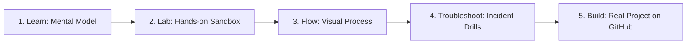

# Master Interactive Studios & Learning Catalogue

This master catalogue provides complete documentation, interactive web laboratories, and source repositories for all **348 interactive studios** across DevOps, SRE, Cloud, Platform Engineering, AI, RAG, and Agentic Systems.

## Core Experience Workflow

