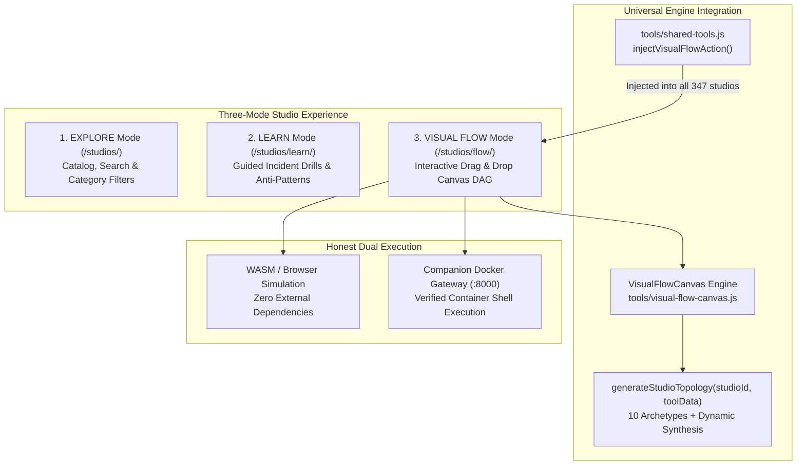

# Visual Engineering Workspace & Flow Canvas Specification
## Production Architecture & Operational Specification for 347 Engineering Studios

> **Platform**: [Talari Pradeep Engineering Studios](https://talaripradeep.info/studios/)  
> **Repository**: [Pradeeptalari14/portfolio](https://github.com/Pradeeptalari14/portfolio)  
> **Status**: Verified Production Implementation (100% Implemented & Passing)  
> **Test Status**: 100/100 Test Suites Passing (429/429 Vitest Unit Tests)  
> **Maintenance Contract**: This specification is living documentation that must be updated whenever studios, templates, or canvas engines are modified.

---

## 1. Executive Summary & Design System

The Visual Engineering Workspace elevates all **347 Interactive Engineering Studios** on `talaripradeep.info` into an interactive, node-graph topology engine inspired by the visual design patterns of modern DAG orchestrators (Langflow, Dify, DrawIO, Network Topologies, and Cloud Architectures).



---

## 2. Core Architecture & Layout System

The workspace operates in `tools/visual-flow-canvas.js` with styling in `tools/visual-flow-canvas.css` and mounts into `studios/flow/index.html` (or modal overlays).

### Workspace Anatomy:
```
┌──────────────────────────────────────────────────────────────────────────────────────────────────┐
│  NAVBAR: ⚡ TALARI PRADEEP | [AI FLOW] | [Explore] [Learn] [Visual Flow] | Studio: [▼ Select]    │
│  Engine: ● WASM Simulation | [📐 Auto Layout] [💾 Export Code] [▶ Run the Flow]                   │
├───────────────┬────────────────────────────────────────────────────────┬─────────────────────────┤
│ LEFT PANEL    │ CENTER CANVAS (SVG Bezier Curves + Dot Grid)          │ RIGHT INSPECTOR         │
│ (280px)       │                                                        │ (320px)                 │
│               │  ┌──────────────┐          ┌────────────────┐          │ ⚙️ Component Inspector  │
│ 🔍 Search Node│  │ Multimodal In├─────────►│ ViT 2D Patches ├─┐        │ • Two-Way Param Form    │
│               │  └──────────────┘          └────────────────┘ │        │ • Latency & Memory      │
│ Starter Flows:│                                               ▼        │                         │
│ • AI & RAG    │                            ┌────────────────┐          │ 🤖 Studio SRE Copilot   │
│ • Agent Swarm │                            │ Cross-Projector├─►...     │ • Guided Lab Exercises  │
│ • DevOps CI/CD│                            └────────────────┘          │ • Architecture Runbooks │
│ • Cloud Infra │  [+] [100%] [-] | [🗑️ Clear]                          │ • CLI Terminal Commands │
├───────────────┴────────────────────────────────────────────────────────┴─────────────────────────┤
│ BOTTOM DRAWER: [Execution Logs] [Golden Signals & SLOs] [Generated Manifest]    ▲ Toggle Drawer  │
│ [14:15:02] [WASM SIMULATION] Stage 1 (Multimodal Ingestion) Latency: 64ms | Exit Code: 0        │
└──────────────────────────────────────────────────────────────────────────────────────────────────┘
```

### Visual & Geometric Tokens
- **Canvas Base**: `#080c14` (Deep Space Dark)
- **Dot Grid Matrix**: `radial-gradient(circle, rgba(255,255,255,0.12) 1px, transparent 1px)` with 24px pitch.
- **Node Cards**: `rgba(22, 32, 54, 0.95)` with `border: 1px solid rgba(255,255,255,0.09)`, subtle drop-shadows, and port pin handles.
- **Wire Routing**: Cubic Bezier curves (`M x1 y1 C (x1+dx) y1, (x2-dx) y2, x2 y2`).
- **Wire States**:
  - `idle`: `#64748b` (Slate 500)
  - `active / pulse`: `#38bdf8` (Cyan with flowing dashed stroke-dashoffset animation)
  - `success`: `#10b981` (Emerald 500)
  - `failed`: `#f43f5e` (Rose 500)

---

## 3. The 11 Technology Archetypes & DAG Topologies

Every studio ID or metadata profile automatically resolves to an appropriate domain topology through `VisualFlowCanvas.generateStudioTopology(studioId, toolData)`:

### 1. Multimodal & Vision VLM (`isVLM`)
- **Key Studios**: `mistral-pixtral-vlm`, `colpali-vlm-rag`, `webgpu-browser-slm`, `whisper`
- **DAG Nodes**:
  1. `[Multimodal Frame Ingestion]` (1024x1024 Native, 30fps WebP, Opus 48kHz)
  2. `[Vision Transformer (ViT) 2D Patches]` (14x14 grid, 1024 tokens, BF16)
  3. `[Multimodal Cross-Projector]` (Two-layer GeLU MLP, 4096 dim)
  4. `[Pixtral Autoregressive Core]` (128k Interleaved context, temp: 0.15)
  5. `[Spatial Grounding & Structured JSON]` (Strict Pydantic BoundingBox, 99.4% precision)

### 2. Linux Kernel & eBPF Continuous Profiler (`iseBPF`)
- **Key Studios**: `ebpf-continuous-profiler`, `ebpf-tetragon-security`, `security-observability`
- **DAG Nodes**:
  1. `[Kernel Tracepoint Hook]` (kprobe:sys_enter / sched_switch, 99Hz sampling)
  2. `[Kernel BPF Verifier]` (1,000,000 instruction limit, bounded memory proofs)
  3. `[Lockless RingBuffer]` (16MB per-CPU buffer, watermark wakeup)
  4. `[DWARF Stack Unwinder]` (FramePointer + DWARF symbols from vmlinux/libc)
  5. `[Parca / Pyroscope Telemetry]` (Continuous Parquet storage, p99 off-CPU latency)

### 3. High-Throughput LLM Serving & Speculative Decoding (`isServing`)
- **Key Studios**: `vllm-paged-attention`, `tensorrt-llm-engine`, `sglang-radix-attention`, `amd-rocm-mi300x`
- **DAG Nodes**:
  1. `[Continuous Batch Request Stream]` (HTTP/2 SSE Streaming, 256 concurrent)
  2. `[PagedAttention Virtual Memory]` (16-token virtual blocks, 90% VRAM pool)
  3. `[Speculative Draft Proposer]` (Llama-3.2-1B draft model, K=4 tokens)
  4. `[Target GPU Tensor Parallelism]` (Llama-3.3-70B, 4x H100 GPU tensor parallel)
  5. `[Chunked Prefill & Stream Scheduler]` (<12ms TPOT latency, 512-token chunks)

### 4a. CNCF Kubernetes Complete Ecosystem Archetype (`isK8sEcosystem`)
- **Key Studios**: `envoy-gateway`, `cert-manager`, `longhorn`, `fluent-bit`, `containerd`, `kustomize`
- **DAG Nodes**:
  1. `[Envoy Gateway & cert-manager]` (Cloud-native L7 ingress gateway, automated ACME TLS)
  2. `[Kyverno & Trivy Admission Gate]` (Cosign signature validation, zero-CVE image gate)
  3. `[KEDA Event Scaler]` (Event-driven pod autoscaling from Kafka/SQS/Prometheus lag)
  4. `[Karpenter NodePool Consolidator]` (Just-in-time Spot/On-Demand fleet bin packing)
  5. `[containerd & gVisor Runtime]` (eStargz snapshotter, runsc microVM kernel isolation)
  6. `[Cilium eBPF CNI & CoreDNS Mesh]` (Kernel-level L3-L7 WireGuard networking, AutoPath DNS)
  7. `[Longhorn CSI Storage & Velero DR]` (Synchronous 3x volume block replication, S3 snapshots)
  8. `[OTel, Fluent Bit & Prometheus MELT]` (Full-stack traces, Loki logs, Alertmanager SLOs)

### 4b. Kubernetes, Karpenter & Cloud-Native Scaling (`isK8s`)
- **Key Studios**: `karpenter-autoscaler`, `k8s-pod-rightsizer`, `cilium`, `kuberay`
- **DAG Nodes**:
  1. `[Pending Pod SQS Metric Queue]` (Unschedulable pods > 0, real-time SQS queue)
  2. `[Karpenter NodePool Consolidator]` (WhenUnderutilized consolidation, arm64/amd64)
  3. `[EC2 / GCP Spot & On-Demand Fleet]` (Price-Capacity-Optimized, <40s launch time)
  4. `[Cilium eBPF CNI Network Mesh]` (Multi-ENI prefix delegation, WireGuard)
  5. `[Ready Pods Production Binding]` (100% pod readiness, strict PDB adherence)

### 5. Agentic AI, Reasoning & Multi-Agent Swarms (`isAgent`)
- **Key Studios**: `agent-workflow`, `jev-system1`, `agentic-temporal-memory`, `agent-swarm-consensus`
- **DAG Nodes**:
  1. `[Goal & Intent Prompt Ingestion]` (Incident triage prompt, indirect injection shield)
  2. `[Planner / ReAct Loop Engine]` (Claude 3.5 Sonnet / DeepSeek-R1, Tree-of-Thoughts)
  3. `[Jev Sub-100ms Reflex Router]` (<25ms reflex routing, calibrated RLCD gate)
  4. `[gVisor Sandboxed Tool Worker]` (MicroVM kernel isolation, kubectl/curl/psql)
  5. `[Zep Temporal Memory Store]` (Knowledge graph memory, cosine + BM25 recall)
  6. `[Human Signoff & Production Action]` (SRE lead approval gate, signed HMAC audit log)

### 6. Enterprise RAG & Vector Stores (`isRAG`)
- **Key Studios**: `ai`, `supabase-pgvector`, `milvus`, `qdrant`, `vectorless-rag`, `superrag`
- **DAG Nodes**:
  1. `[Document Ingestion]` (S3 / PDF Bucket, markdown and PDF sources)
  2. `[Text Splitter]` (1000 chunk size, 200 token overlap)
  3. `[Embedding Model]` (text-embedding-3-small, 1536 dims)
  4. `[pgvector HNSW Store]` (M=16, efSearch=64, cosine distance)
  5. `[vLLM PagedAttention]` (Llama-3.3-70B, maxTokens: 2048)
  6. `[Answer & Citations]` (Hallucination shield, enforced source citations)

### 7. DevOps & CI/CD Pipelines (`isCICD`)
- **Key Studios**: `github-actions`, `tekton-pipeline`, `maven`, `bitbucket`, `modelops-gitops`
- **DAG Nodes**:
  1. `[GitHub Webhook]` (Branch main, push/PR event trigger)
  2. `[Maven / Go Hermetic Build]` (OpenJDK 21, dependency hash verification)
  3. `[Trivy & SAST Scan Gate]` (CRITICAL/HIGH severity block, zero tolerance)
  4. `[Docker Buildx Container]` (Multi-arch linux/amd64+arm64, non-root user)
  5. `[GHCR Registry Storage]` (Cosign image signing, SLSA Level 3 provenance)
  6. `[ArgoCD EKS Deploy]` (Automated sync, canary progressive rollout 10%->100%)

### 8. Cloud Infrastructure as Code & Drift (`isCloud`)
- **Key Studios**: `terraform`, `terraform-drift`, `cloudformation`, `vpc-subnetter`
- **DAG Nodes**:
  1. `[Internet Gateway]` (Perimeter ingress, AWS Shield Advanced)
  2. `[Application LB]` (HTTPS/443, enforced mTLS, health check path)
  3. `[EKS Worker Nodes]` (c6i.2xlarge, Karpenter active pool)
  4. `[Valkey Distributed Cache]` (Cluster mode, TLS 1.3, sub-ms offload)
  5. `[Aurora PostgreSQL]` (Multi-AZ Active-Active, encrypted storage)

### 9. Observability, SRE & Incident Triage (`isObs`)
- **Key Studios**: `prometheus`, `tracing`, `otel-vector`, `grafana`, `monitoring-studio`
- **DAG Nodes**:
  1. `[OTel OpenTelemetry Collector]` (OTLP/gRPC 4317, 200ms batch buffer)
  2. `[Tail-Based Sampling Filter]` (100% error span retention, 1% normal sample)
  3. `[Mimir / Tempo Storage Hot Tier]` (Petabyte-scale object storage, 2h compaction)
  4. `[Prometheus Alertmanager Evaluator]` (SLO burn rate evaluation, 5xx > 1%)
  5. `[Automated Incident Runbook Recovery]` (Pod auto-heal, route divert, p99 < 200ms)

### 10. Cybersecurity & Zero-Trust Architecture (`isSec`)
- **Key Studios**: `trivy`, `vault-secrets`, `cloudflare-zero-trust`, `production-secrets`
- **DAG Nodes**:
  1. `[Zero-Trust Ingress Gateway]` (OIDC / SAML 2.0, CrowdStrike device posture)
  2. `[WAF & Bot Protection Engine]` (OWASP Top 10, DDoS shield, 100 req/s rate limit)
  3. `[Vault Dynamic STS Broker]` (Dynamic temporary AWS/DB credentials, 15m TTL)
  4. `[Falco Runtime Kernel Monitor]` (eBPF syscall monitor for execve/ptrace)
  5. `[SIEM Audit & Automated Quarantine]` (Splunk/OpenSearch audit, pod network isolation)

### 11. Technology-Specific Dynamic Synthesis (Fallback for any Studio)
- Synthesizes 5 custom nodes matching the studio's exact title, category, description, and tag from `tools/tools.json`:
  1. `${studioName} Ingestion` (`📥`)
  2. `${category.toUpperCase()} Execution Controller` (`⚙️`)
  3. `Core Engine: ${tag || 'Runtime'}` (`🧠`)
  4. `Integrity & Security Guardrail` (`🛡️`)
  5. `Verified Telemetry & Artifact Export` (`🎯`)

---

## 4. Universal Studio Integration Mechanics

1. **Automatic Injection via `tools/shared-tools.js`**:
   - `injectVisualFlowAction()` automatically injects a floating `⚡ Visual Flow` action button into every single studio page, linking directly to `/studios/flow/?studio=${studioId}`.
2. **Top Bar Studio Switcher (`#vfStudioSelect`)**:
   - When opened in `/studios/flow/`, all 347 studios are listed in optgroups:
     - `AI & LLMOps Studios (234)`
     - `Automation & Systems Studios (33)`
     - `Observability & SRE Studios (29)`
     - `Cloud & Infrastructure Studios (26)`
     - `DevOps & CI/CD Studios (12)`
   - Switching options instantly triggers `canvas.loadStudio(newStudioId)` and updates URL history with `?studio=<id>`.
3. **Right Panel Contextual AI Copilot**:
   - Updates dynamically on studio load with:
     - Guided lab step-by-step instructions.
     - Production CLI commands (e.g. `vllm serve ...`, `bpftrace -e ...`, `kubectl get nodepool ...`).
     - SRE failure mode explanations.
4. **Bottom Execution Telemetry Drawer**:
   - Live step-by-step wire animation with simulated latency per node (ms).
   - Exit codes and execution logs tagged with `[WASM SIMULATION]` or `[COMPANION BACKEND]`.
   - "Export Code" exports the complete verifiable JSON flow specification.

---

## 5. Maintenance & Update-Every-Time Rules

Whenever changes are made to studios or visual flows, maintainers and AI assistants must follow these invariant steps:

1. **Verify Studio Count**:
   - Confirm studio count remains consistent in `tools/tools.json` (currently 347).
2. **Sync Assets**:
   - Run `node scripts/copy-assets.js` to propagate `visual-flow-canvas.js` and `visual-flow-canvas.css` into `dist/` and `public/tools/`.
3. **Run Unit Tests**:
   - Run `npx vitest run tests/visual-flow-canvas.test.js` (all 9 tests must pass).
   - Run `npm test` (all 100 test files and 429 tests must pass).
4. **Validate Production Bundle**:
   - Run `npm run build` (must exit with code 0).
5. **Update This Specification**:
   - Reflect any added technology profiles, updated node parameters, or new studio counts directly in this document (`VISUAL_FLOW_STUDIOS_SPECIFICATION.md`).
