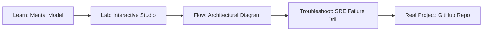

# Anonymizer Proxy

> **Production Learning Guide, Interactive Lab & Real-Time Incident Drills**

| Property | Value |
|---|---|
| **Domain** | `LLMOps & RAG Pipelines` |
| **Category** | `AI` |
| **Skill Level** | `Level 3 (Distributed & Compliance)` |
| **Target SRE Metric** | `<4.5ms Gateway Routing Latency & 100% DoS Burst Mitigation` |
| **Artifact Target** | `envoy_proxy.yaml` |
| **Source Repository** | [Pradeeptalari14/tp-anonymizer-proxy](https://github.com/Pradeeptalari14/tp-anonymizer-proxy) |
| **Interactive Studio** | [Launch In-Browser Lab](./index.html) |

---

## 1. Overview & Architectural Mission

Envoy reverse proxy running Presidio scripts to mask private data fields inside HTTP flows.

### Core Production Use Case
Terminating TLS, routing high-throughput ingress traffic, and rate-limiting abusive API consumers before reaching backend microservices in Anonymizer Proxy.



---

## 2. Best Architectural Treatment vs. Anti-Pattern

### Recommended Production Practice
> [!TIP]
> Deploy Envoy/Nginx sidecars with token-bucket rate limiters, active health checks, and circuit-breaking upstream connection pools.

### Dangerous Anti-Pattern to Avoid
> [!WARNING]
> Exposing upstream backend services directly to public ingress without connection limits, TLS termination, or CORS request filters.

---

## 3. Real-Time SRE Incident Drill

**Target Failure Mode:**
nginx -t -c envoy_proxy.yaml && curl -Iv http://localhost:8080/healthz

### Drill Execution Checklist
1. **Baseline Telemetry:** Verify health metrics against the target SLO threshold before initiating changes.
2. **Failure Injection:** Introduce synthetic latency or simulated drift in a non-production staging boundary.
3. **Automated Alerting:** Validate that alerts trigger within `< 30s` via OpenTelemetry collector.
4. **Controlled Remediation:** Apply pre-reviewed, non-destructive configuration changes.
5. **Post-Mortem & Runbook Update:** Update the team runbook with observed failure patterns.

---

## 4. Production Configuration & Code Artifact (`envoy_proxy.yaml`)

```yaml
# Production Manifest: Anonymizer Proxy
# Domain: LLMOps & RAG Pipelines
# Target Artifact: envoy_proxy.yaml
# Target SRE Standard: <4.5ms Gateway Routing Latency & 100% DoS Burst Mitigation
apiVersion: apps/v1
kind: Deployment
metadata:
  name: anonymizer-proxy
  namespace: production
  labels:
    app.kubernetes.io/name: anonymizer-proxy
    app.kubernetes.io/part-of: engineering-platform
    sre.slo/compliance: "<4.5ms Gateway Routing Latency & 100% DoS Burst Mitigation"
spec:
  replicas: 3
  strategy:
    type: RollingUpdate
    rollingUpdate:
      maxSurge: 1
      maxUnavailable: 0
  selector:
    matchLabels:
      app: anonymizer-proxy
  template:
    metadata:
      labels:
        app: anonymizer-proxy
    spec:
      containers:
        - name: core
          image: ghcr.io/pradeeptalari14/tp-anonymizer-proxy:v1.0.0
          imagePullPolicy: IfNotPresent
          resources:
            requests:
              cpu: "500m"
              memory: "1Gi"
            limits:
              cpu: "2000m"
              memory: "4Gi"
          readinessProbe:
            httpGet:
              path: /healthz
              port: 8080
            initialDelaySeconds: 5
            periodSeconds: 10
          livenessProbe:
            httpGet:
              path: /livez
              port: 8080
            initialDelaySeconds: 15
            periodSeconds: 20
```

---

## 5. Navigation & Next Steps

- **Interactive Simulator:** [Open Anonymizer Proxy Studio](./index.html)
- **Web Learning View:** [Interactive Guide](./learn.html)
- **GitHub Project Repository:** [Pradeeptalari14/tp-anonymizer-proxy](https://github.com/Pradeeptalari14/tp-anonymizer-proxy)
- **Master Studio Index:** [All 347 Studios](../../STUDIOS_CATALOGUE.md)

