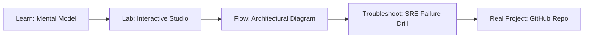

# Four-i Level-1 Observability (AWS)

> **Production Learning Guide, Interactive Lab & Real-Time Incident Drills**

| Property | Value |
|---|---|
| **Domain** | `LLMOps & RAG Pipelines` |
| **Category** | `AI` |
| **Skill Level** | `Level 3 (Distributed & Compliance)` |
| **Target SRE Metric** | `93.5% Context Recall & <32ms End-to-End Retrieval Latency` |
| **Artifact Target** | `cloudwatch_dashboard.json` |
| **Source Repository** | [Pradeeptalari14/tp-aws-level1-observability](https://github.com/Pradeeptalari14/tp-aws-level1-observability) |
| **Interactive Studio** | [Launch In-Browser Lab](./index.html) |

---

## 1. Overview & Architectural Mission

CloudWatch RAG observability framework capturing retrieval latency metrics and collecting user feedback logs.

### Core Production Use Case
Mitigating hallucination, context drift, and retrieval latency in enterprise Four-i Level-1 Observability (AWS) workloads over large multi-modal and structured knowledge bases.



---

## 2. Best Architectural Treatment vs. Anti-Pattern

### Recommended Production Practice
> [!TIP]
> Implement hybrid dense-sparse retrieval (BM25 + pgvector/Qdrant cosine fusion) with Cross-Encoder reranking and semantic chunk windowing.

### Dangerous Anti-Pattern to Avoid
> [!WARNING]
> Dumping raw unchunked documents directly into high-dimensional vector stores without deduplication, sparse keyword indexes, or relevance thresholds.

---

## 3. Real-Time SRE Incident Drill

**Target Failure Mode:**
python3 -m rag.retriever --query "Audit production cluster state" --hybrid-rrf --top-k 5 --rerank-threshold 0.75

### Drill Execution Checklist
1. **Baseline Telemetry:** Verify health metrics against the target SLO threshold before initiating changes.
2. **Failure Injection:** Introduce synthetic latency or simulated drift in a non-production staging boundary.
3. **Automated Alerting:** Validate that alerts trigger within `< 30s` via OpenTelemetry collector.
4. **Controlled Remediation:** Apply pre-reviewed, non-destructive configuration changes.
5. **Post-Mortem & Runbook Update:** Update the team runbook with observed failure patterns.

---

## 4. Production Configuration & Code Artifact (`cloudwatch_dashboard.json`)

```json
{
  "$schema": "https://json-schema.org/draft/2020-12/schema",
  "studio": "four-i-level-1-observability-(aws)",
  "domain": "LLMOps & RAG Pipelines",
  "targetArtifact": "cloudwatch_dashboard.json",
  "sreMetric": "93.5% Context Recall & <32ms End-to-End Retrieval Latency",
  "repository": "Pradeeptalari14/tp-aws-level1-observability",
  "service": {
    "name": "four-i-level-1-observability-(aws)",
    "mode": "production",
    "version": "1.0.0",
    "resilience": {
      "circuitBreaker": true,
      "maxRetries": 3,
      "timeoutMs": 5000
    },
    "telemetry": {
      "enabled": true,
      "endpoint": "otel-collector:4317",
      "sampleRate": 1.0
    }
  }
}
```

---

## 5. Navigation & Next Steps

- **Interactive Simulator:** [Open Four-i Level-1 Observability (AWS) Studio](./index.html)
- **Web Learning View:** [Interactive Guide](./learn.html)
- **GitHub Project Repository:** [Pradeeptalari14/tp-aws-level1-observability](https://github.com/Pradeeptalari14/tp-aws-level1-observability)
- **Master Studio Index:** [All 347 Studios](../../STUDIOS_CATALOGUE.md)

