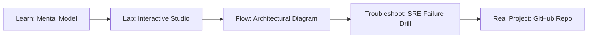

# Azure ACR Security Guardrails

> **Production Learning Guide, Interactive Lab & Real-Time Incident Drills**

| Property | Value |
|---|---|
| **Domain** | `Automation & SRE Runbooks` |
| **Category** | `AUTOMATION` |
| **Skill Level** | `Level 2 (Scripting & Ops)` |
| **Target SRE Metric** | `100% OWASP LLM01-LLM10 Threat Interception & <18ms Sub-Reflex Gating` |
| **Artifact Target** | `acr_policy.tf` |
| **Source Repository** | [Pradeeptalari14/tp-azure-acr-secure](https://github.com/Pradeeptalari14/tp-azure-acr-secure) |
| **Interactive Studio** | [Launch In-Browser Lab](./index.html) |

---

## 1. Overview & Architectural Mission

Secure Azure Container Registries. Generate ACR access controls, content trust validation settings, image signing tasks, and Defender security triggers.

### Core Production Use Case
Defending LLM and agent workflows against adversarial prompt injections, persona jailbreaks, and sensitive data leakage in Azure ACR Security Guardrails.



---

## 2. Best Architectural Treatment vs. Anti-Pattern

### Recommended Production Practice
> [!TIP]
> Apply layered zero-trust defense: sub-reflex regex heuristics, Llama-Guard classifier inspection, and isolated gVisor containerized execution sandboxes.

### Dangerous Anti-Pattern to Avoid
> [!WARNING]
> Relying solely on system prompt instructions ("Do not reveal secrets") without programmatic input filtering or output sanitizers.

---

## 3. Real-Time SRE Incident Drill

**Target Failure Mode:**
pytest -v tests/security_scan.py --test-prompts ./adversarial_drills.json --enforce-fail-closed

### Drill Execution Checklist
1. **Baseline Telemetry:** Verify health metrics against the target SLO threshold before initiating changes.
2. **Failure Injection:** Introduce synthetic latency or simulated drift in a non-production staging boundary.
3. **Automated Alerting:** Validate that alerts trigger within `< 30s` via OpenTelemetry collector.
4. **Controlled Remediation:** Apply pre-reviewed, non-destructive configuration changes.
5. **Post-Mortem & Runbook Update:** Update the team runbook with observed failure patterns.

---

## 4. Production Configuration & Code Artifact (`acr_policy.tf`)

```hcl
# Terraform / HCL Configuration: Azure ACR Security Guardrails
# Domain: Automation & SRE Runbooks
# Target Artifact: acr_policy.tf

terraform {
  required_version = ">= 1.8.0"
  required_providers {
    aws = {
      source  = "hashicorp/aws"
      version = "~> 5.50"
    }
  }
}

locals {
  service_name = "azure-acr-security-guardrails"
  sre_standard = "100% OWASP LLM01-LLM10 Threat Interception & <18ms Sub-Reflex Gating"
}

resource "aws_service_mesh" "core" {
  name = local.service_name
  tags = {
    Environment = "production"
    ManagedBy   = "Terraform"
    SRE_Metric  = local.sre_standard
  }
}
```

---

## 5. Navigation & Next Steps

- **Interactive Simulator:** [Open Azure ACR Security Guardrails Studio](./index.html)
- **Web Learning View:** [Interactive Guide](./learn.html)
- **GitHub Project Repository:** [Pradeeptalari14/tp-azure-acr-secure](https://github.com/Pradeeptalari14/tp-azure-acr-secure)
- **Master Studio Index:** [All 347 Studios](../../STUDIOS_CATALOGUE.md)

