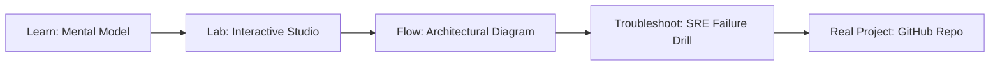

# Azure Bicep/ARM Studio

> **Production Learning Guide, Interactive Lab & Real-Time Incident Drills**

| Property | Value |
|---|---|
| **Domain** | `Automation & SRE Runbooks` |
| **Category** | `AUTOMATION` |
| **Skill Level** | `Level 2 (Scripting & Ops)` |
| **Target SRE Metric** | `Sub-10m Developer Onboarding & 100% Golden Path Architectural Adherence` |
| **Artifact Target** | `main.bicep` |
| **Source Repository** | [Pradeeptalari14/tp-azure-bicep-arm](https://github.com/Pradeeptalari14/tp-azure-bicep-arm) |
| **Interactive Studio** | [Launch In-Browser Lab](./index.html) |

---

## 1. Overview & Architectural Mission

Design modular declarative configurations for Azure. Generate Bicep templates, nested parameter configuration files, and target resource group scopes definitions.

### Core Production Use Case
Empowering developers to self-service scaffold production-grade microservices and cloud resources with built-in compliance templates in Azure Bicep/ARM Studio.



---

## 2. Best Architectural Treatment vs. Anti-Pattern

### Recommended Production Practice
> [!TIP]
> Publish standardized Internal Developer Portal (IDP) templates with golden paths, pre-configured CI/CD pipelines, and security guardrails.

### Dangerous Anti-Pattern to Avoid
> [!WARNING]
> Requiring engineering teams to manually file Jira tickets and wait weeks for DevOps engineers to provision standard infrastructure.

---

## 3. Real-Time SRE Incident Drill

**Target Failure Mode:**
cookiecutter gh:Pradeeptalari14/Pradeeptalari14/tp-azure-bicep-arm --no-input && cd * && tree .

### Drill Execution Checklist
1. **Baseline Telemetry:** Verify health metrics against the target SLO threshold before initiating changes.
2. **Failure Injection:** Introduce synthetic latency or simulated drift in a non-production staging boundary.
3. **Automated Alerting:** Validate that alerts trigger within `< 30s` via OpenTelemetry collector.
4. **Controlled Remediation:** Apply pre-reviewed, non-destructive configuration changes.
5. **Post-Mortem & Runbook Update:** Update the team runbook with observed failure patterns.

---

## 4. Production Configuration & Code Artifact (`main.bicep`)

```toml
# Configuration Artifact: main.bicep
# Studio: Azure Bicep/ARM Studio
# Domain: Automation & SRE Runbooks
# Target SRE Standard: Sub-10m Developer Onboarding & 100% Golden Path Architectural Adherence

[service]
name = "azure-bicep/arm-studio"
domain = "Automation & SRE Runbooks"
mode = "production"
slo_target = "Sub-10m Developer Onboarding & 100% Golden Path Architectural Adherence"

[telemetry]
enabled = true
endpoint = "otel-collector:4317"
sample_rate = 1.0

[resilience]
circuit_breaker = true
retry_count = 3
timeout_ms = 5000
```

---

## 5. Navigation & Next Steps

- **Interactive Simulator:** [Open Azure Bicep/ARM Studio Studio](./index.html)
- **Web Learning View:** [Interactive Guide](./learn.html)
- **GitHub Project Repository:** [Pradeeptalari14/tp-azure-bicep-arm](https://github.com/Pradeeptalari14/tp-azure-bicep-arm)
- **Master Studio Index:** [All 347 Studios](../../STUDIOS_CATALOGUE.md)

