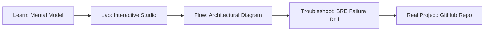

# Azure Monitor & Log Analytics Studio

> **Production Learning Guide, Interactive Lab & Real-Time Incident Drills**

| Property | Value |
|---|---|
| **Domain** | `Incident Triage & Observability` |
| **Category** | `OBSERVABILITY` |
| **Skill Level** | `Level 2 (Scripting & Ops)` |
| **Target SRE Metric** | `100% Trace Coverage & <1.2% Observability Agent CPU Overhead` |
| **Artifact Target** | `monitor_rules.tf` |
| **Source Repository** | [Pradeeptalari14/tp-azure-monitor](https://github.com/Pradeeptalari14/tp-azure-monitor) |
| **Interactive Studio** | [Launch In-Browser Lab](./index.html) |

---

## 1. Overview & Architectural Mission

Configure enterprise diagnostic logs sinks. Generate Log Analytics workspaces templates, Kusto Query Language (KQL) SRE alert monitors, and diagnostic metrics bindings.

### Core Production Use Case
Detecting kernel-level socket bottlenecks, memory leak regressions, and microservice trace latency spikes in production Azure Monitor & Log Analytics Studio.



---

## 2. Best Architectural Treatment vs. Anti-Pattern

### Recommended Production Practice
> [!TIP]
> Deploy OpenTelemetry auto-instrumentation alongside in-kernel eBPF probes with continuous sampling, streaming unified metrics to Prometheus and Loki.

### Dangerous Anti-Pattern to Avoid
> [!WARNING]
> Scraping unaggregated debug logs or using invasive synchronous APM agents that introduce noticeable request latency overhead.

---

## 3. Real-Time SRE Incident Drill

**Target Failure Mode:**
curl -sSf http://localhost:9090/metrics | grep -E "p99_latency|error_rate|active_workers"

### Drill Execution Checklist
1. **Baseline Telemetry:** Verify health metrics against the target SLO threshold before initiating changes.
2. **Failure Injection:** Introduce synthetic latency or simulated drift in a non-production staging boundary.
3. **Automated Alerting:** Validate that alerts trigger within `< 30s` via OpenTelemetry collector.
4. **Controlled Remediation:** Apply pre-reviewed, non-destructive configuration changes.
5. **Post-Mortem & Runbook Update:** Update the team runbook with observed failure patterns.

---

## 4. Production Configuration & Code Artifact (`monitor_rules.tf`)

```hcl
# Terraform / HCL Configuration: Azure Monitor & Log Analytics Studio
# Domain: Incident Triage & Observability
# Target Artifact: monitor_rules.tf

terraform {
  required_version = ">= 1.8.0"
  required_providers {
    aws = {
      source  = "hashicorp/aws"
      version = "~> 5.50"
    }
  }
}

locals {
  service_name = "azure-monitor-&-log-analytics-studio"
  sre_standard = "100% Trace Coverage & <1.2% Observability Agent CPU Overhead"
}

resource "aws_service_mesh" "core" {
  name = local.service_name
  tags = {
    Environment = "production"
    ManagedBy   = "Terraform"
    SRE_Metric  = local.sre_standard
  }
}
```

---

## 5. Navigation & Next Steps

- **Interactive Simulator:** [Open Azure Monitor & Log Analytics Studio Studio](./index.html)
- **Web Learning View:** [Interactive Guide](./learn.html)
- **GitHub Project Repository:** [Pradeeptalari14/tp-azure-monitor](https://github.com/Pradeeptalari14/tp-azure-monitor)
- **Master Studio Index:** [All 347 Studios](../../STUDIOS_CATALOGUE.md)

