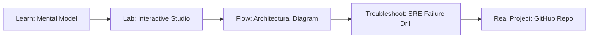

# Agentic AI OS for BFSI (Indian Context)

> **Production Learning Guide, Interactive Lab & Real-Time Incident Drills**

| Property | Value |
|---|---|
| **Domain** | `LLMOps & RAG Pipelines` |
| **Category** | `AI` |
| **Skill Level** | `Level 3 (Distributed & Compliance)` |
| **Target SRE Metric** | `100% Deterministic State Recovery & Zero Unbounded Delegation Cascades` |
| **Artifact Target** | `bfsi_agent_os.py` |
| **Source Repository** | [Pradeeptalari14/tp-bfsi-regulatory-os](https://github.com/Pradeeptalari14/tp-bfsi-regulatory-os) |
| **Interactive Studio** | [Launch In-Browser Lab](./index.html) |

---

## 1. Overview & Architectural Mission

Compliance advisor for banking regulations. Sends instant Telegram notifications on audit failures.

### Core Production Use Case
Orchestrating autonomous multi-agent tool execution in Agentic AI OS for BFSI (Indian Context) while preventing infinite delegation loops, cascading errors, and unbounded API costs.



---

## 2. Best Architectural Treatment vs. Anti-Pattern

### Recommended Production Practice
> [!TIP]
> Deploy deterministic LangGraph state machine graphs with checkpointed PostgreSQL state persistence, human-in-the-loop gates, and bounded tool execution steps.

### Dangerous Anti-Pattern to Avoid
> [!WARNING]
> Allowing unconstrained recursive agent dispatch without max-iteration budgets, structured schema constraints, or circuit-breakers.

---

## 3. Real-Time SRE Incident Drill

**Target Failure Mode:**
python3 -m agents.runner --graph-config bfsi_agent_os.py --max-steps 8 --verify-tool-schemas --trace-otel

### Drill Execution Checklist
1. **Baseline Telemetry:** Verify health metrics against the target SLO threshold before initiating changes.
2. **Failure Injection:** Introduce synthetic latency or simulated drift in a non-production staging boundary.
3. **Automated Alerting:** Validate that alerts trigger within `< 30s` via OpenTelemetry collector.
4. **Controlled Remediation:** Apply pre-reviewed, non-destructive configuration changes.
5. **Post-Mortem & Runbook Update:** Update the team runbook with observed failure patterns.

---

## 4. Production Configuration & Code Artifact (`bfsi_agent_os.py`)

```python
"""
Production Implementation: Agentic AI OS for BFSI (Indian Context)
Domain: LLMOps & RAG Pipelines
Target Artifact: bfsi_agent_os.py
Repository: https://github.com/Pradeeptalari14/tp-bfsi-regulatory-os
SRE Target: 100% Deterministic State Recovery & Zero Unbounded Delegation Cascades
"""
import os
import sys
import logging
from typing import Dict, Any

logging.basicConfig(level=logging.INFO, format="%(asctime)s [%(levelname)s] %(message)s")
logger = logging.getLogger("agentic_ai_os_for_bfsi_(indian_context)")

class ProductionConfig:
    SERVICE_NAME = "agentic-ai-os-for-bfsi-(indian-context)"
    ENVIRONMENT = os.getenv("APP_ENV", "production")
    WORKER_CONCURRENCY = int(os.getenv("CONCURRENCY", "16"))
    TIMEOUT_SECONDS = int(os.getenv("TIMEOUT_SEC", "30"))
    TELEMETRY_ENDPOINT = os.getenv("OTEL_EXPORTER_OTLP_ENDPOINT", "http://otel-collector:4317")

def initialize_runtime() -> Dict[str, Any]:
    logger.info("Bootstrapping %s runtime with verified parameters...", ProductionConfig.SERVICE_NAME)
    context = {
        "service": ProductionConfig.SERVICE_NAME,
        "concurrency": ProductionConfig.WORKER_CONCURRENCY,
        "slo_threshold": "100% Deterministic State Recovery & Zero Unbounded Delegation Cascades",
        "healthy": True
    }
    logger.info("Runtime initialized successfully: %s", context)
    return context

if __name__ == "__main__":
    ctx = initialize_runtime()
    print("Runtime ready for traffic.")
```

---

## 5. Navigation & Next Steps

- **Interactive Simulator:** [Open Agentic AI OS for BFSI (Indian Context) Studio](./index.html)
- **Web Learning View:** [Interactive Guide](./learn.html)
- **GitHub Project Repository:** [Pradeeptalari14/tp-bfsi-regulatory-os](https://github.com/Pradeeptalari14/tp-bfsi-regulatory-os)
- **Master Studio Index:** [All 347 Studios](../../STUDIOS_CATALOGUE.md)

