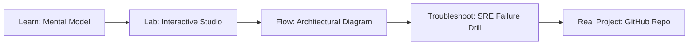

# All-India Citizen Grievance Chatbot

> **Production Learning Guide, Interactive Lab & Real-Time Incident Drills**

| Property | Value |
|---|---|
| **Domain** | `LLMOps & RAG Pipelines` |
| **Category** | `AI` |
| **Skill Level** | `Level 3 (Distributed & Compliance)` |
| **Target SRE Metric** | `Sub-10m Developer Onboarding & 100% Golden Path Architectural Adherence` |
| **Artifact Target** | `citizen_grievance.json` |
| **Source Repository** | [Pradeeptalari14/tp-citizen-grievance-chatbot](https://github.com/Pradeeptalari14/tp-citizen-grievance-chatbot) |
| **Interactive Studio** | [Launch In-Browser Lab](./index.html) |

---

## 1. Overview & Architectural Mission

Municipal portal automatically routing local grievances. Integrates WhatsApp API and email templates.

### Core Production Use Case
Empowering developers to self-service scaffold production-grade microservices and cloud resources with built-in compliance templates in All-India Citizen Grievance Chatbot.



---

## 2. Best Architectural Treatment vs. Anti-Pattern

### Recommended Production Practice
> [!TIP]
> Publish standardized Internal Developer Portal (IDP) templates with golden paths, pre-configured CI/CD pipelines, and security guardrails.

### Dangerous Anti-Pattern to Avoid
> [!WARNING]
> Requiring engineering teams to manually file Jira tickets and wait weeks for DevOps engineers to provision standard infrastructure.

---

## 3. Real-Time SRE Incident Drill

**Target Failure Mode:**
cookiecutter gh:Pradeeptalari14/Pradeeptalari14/tp-citizen-grievance-chatbot --no-input && cd * && tree .

### Drill Execution Checklist
1. **Baseline Telemetry:** Verify health metrics against the target SLO threshold before initiating changes.
2. **Failure Injection:** Introduce synthetic latency or simulated drift in a non-production staging boundary.
3. **Automated Alerting:** Validate that alerts trigger within `< 30s` via OpenTelemetry collector.
4. **Controlled Remediation:** Apply pre-reviewed, non-destructive configuration changes.
5. **Post-Mortem & Runbook Update:** Update the team runbook with observed failure patterns.

---

## 4. Production Configuration & Code Artifact (`citizen_grievance.json`)

```json
{
  "$schema": "https://json-schema.org/draft/2020-12/schema",
  "studio": "all-india-citizen-grievance-chatbot",
  "domain": "LLMOps & RAG Pipelines",
  "targetArtifact": "citizen_grievance.json",
  "sreMetric": "Sub-10m Developer Onboarding & 100% Golden Path Architectural Adherence",
  "repository": "Pradeeptalari14/tp-citizen-grievance-chatbot",
  "service": {
    "name": "all-india-citizen-grievance-chatbot",
    "mode": "production",
    "version": "1.0.0",
    "resilience": {
      "circuitBreaker": true,
      "maxRetries": 3,
      "timeoutMs": 5000
    },
    "telemetry": {
      "enabled": true,
      "endpoint": "otel-collector:4317",
      "sampleRate": 1.0
    }
  }
}
```

---

## 5. Navigation & Next Steps

- **Interactive Simulator:** [Open All-India Citizen Grievance Chatbot Studio](./index.html)
- **Web Learning View:** [Interactive Guide](./learn.html)
- **GitHub Project Repository:** [Pradeeptalari14/tp-citizen-grievance-chatbot](https://github.com/Pradeeptalari14/tp-citizen-grievance-chatbot)
- **Master Studio Index:** [All 347 Studios](../../STUDIOS_CATALOGUE.md)

