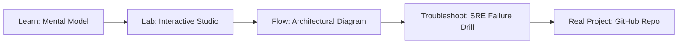

# Policy-as-Code Studio

> **Production Learning Guide, Interactive Lab & Real-Time Incident Drills**

| Property | Value |
|---|---|
| **Domain** | `Incident Triage & Observability` |
| **Category** | `OBSERVABILITY` |
| **Skill Level** | `Level 2 (Scripting & Ops)` |
| **Target SRE Metric** | `Sub-45s Node Autoscaling & Zero Unplanned Service Disruption` |
| **Artifact Target** | `policy.rego` |
| **Source Repository** | [Pradeeptalari14/tp-compliance](https://github.com/Pradeeptalari14/tp-compliance) |
| **Interactive Studio** | [Launch In-Browser Lab](./index.html) |

---

## 1. Overview & Architectural Mission

Scaffold OPA Rego security policies, Kyverno Kubernetes validation rules, and automated compliance scan runners.

### Core Production Use Case
Eliminating node provisioning lag, pod scheduling starvation, and network policy drift in enterprise Policy-as-Code Studio Kubernetes environments.



---

## 2. Best Architectural Treatment vs. Anti-Pattern

### Recommended Production Practice
> [!TIP]
> Standardize on declarative GitOps manifests with Karpenter fast node consolidation, eBPF Cilium network policies, and rolling zero-downtime updates.

### Dangerous Anti-Pattern to Avoid
> [!WARNING]
> Manually editing live cluster resources with kubectl edit or running static oversized node groups that waste idle cloud compute.

---

## 3. Real-Time SRE Incident Drill

**Target Failure Mode:**
kubectl apply -f policy.rego --dry-run=server && kubectl get pods -l app=policy-as-code-studio -w

### Drill Execution Checklist
1. **Baseline Telemetry:** Verify health metrics against the target SLO threshold before initiating changes.
2. **Failure Injection:** Introduce synthetic latency or simulated drift in a non-production staging boundary.
3. **Automated Alerting:** Validate that alerts trigger within `< 30s` via OpenTelemetry collector.
4. **Controlled Remediation:** Apply pre-reviewed, non-destructive configuration changes.
5. **Post-Mortem & Runbook Update:** Update the team runbook with observed failure patterns.

---

## 4. Production Configuration & Code Artifact (`policy.rego`)

```toml
# Configuration Artifact: policy.rego
# Studio: Policy-as-Code Studio
# Domain: Incident Triage & Observability
# Target SRE Standard: Sub-45s Node Autoscaling & Zero Unplanned Service Disruption

[service]
name = "policy-as-code-studio"
domain = "Incident Triage & Observability"
mode = "production"
slo_target = "Sub-45s Node Autoscaling & Zero Unplanned Service Disruption"

[telemetry]
enabled = true
endpoint = "otel-collector:4317"
sample_rate = 1.0

[resilience]
circuit_breaker = true
retry_count = 3
timeout_ms = 5000
```

---

## 5. Navigation & Next Steps

- **Interactive Simulator:** [Open Policy-as-Code Studio Studio](./index.html)
- **Web Learning View:** [Interactive Guide](./learn.html)
- **GitHub Project Repository:** [Pradeeptalari14/tp-compliance](https://github.com/Pradeeptalari14/tp-compliance)
- **Master Studio Index:** [All 347 Studios](../../STUDIOS_CATALOGUE.md)

