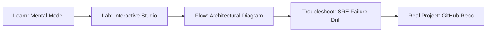

# Container Registry Studio

> **Production Learning Guide, Interactive Lab & Real-Time Incident Drills**

| Property | Value |
|---|---|
| **Domain** | `Automation & SRE Runbooks` |
| **Category** | `AUTOMATION` |
| **Skill Level** | `Level 2 (Scripting & Ops)` |
| **Target SRE Metric** | `Zero Critical CVEs in Production & 100% Cryptographically Verified SLSA Provenance` |
| **Artifact Target** | `sign_image.sh` |
| **Source Repository** | [Pradeeptalari14/tp-container-registry](https://github.com/Pradeeptalari14/tp-container-registry) |
| **Interactive Studio** | [Launch In-Browser Lab](./index.html) |

---

## 1. Overview & Architectural Mission

Generate Cosign image signing scripts, Harbor tag retention rules, and registry configurations.

### Core Production Use Case
Securing the software supply chain against untrusted dependency vulnerabilities, image tampering, and deployment drift in Container Registry Studio.



---

## 2. Best Architectural Treatment vs. Anti-Pattern

### Recommended Production Practice
> [!TIP]
> Enforce cryptographic Sigstore cosign container signing, CycloneDX SBOM generation, and automated Trivy vulnerability gating before GitOps sync.

### Dangerous Anti-Pattern to Avoid
> [!WARNING]
> Pushing unsigned container images directly to production registries without vulnerability scan gates or immutable SHA256 digest pinning.

---

## 3. Real-Time SRE Incident Drill

**Target Failure Mode:**
trivy image --severity HIGH,CRITICAL ghcr.io/Pradeeptalari14/tp-container-registry:latest && cosign verify --key cosign.pub ghcr.io/Pradeeptalari14/tp-container-registry:latest

### Drill Execution Checklist
1. **Baseline Telemetry:** Verify health metrics against the target SLO threshold before initiating changes.
2. **Failure Injection:** Introduce synthetic latency or simulated drift in a non-production staging boundary.
3. **Automated Alerting:** Validate that alerts trigger within `< 30s` via OpenTelemetry collector.
4. **Controlled Remediation:** Apply pre-reviewed, non-destructive configuration changes.
5. **Post-Mortem & Runbook Update:** Update the team runbook with observed failure patterns.

---

## 4. Production Configuration & Code Artifact (`sign_image.sh`)

```bash
#!/usr/bin/env bash
# Production Automation Script: Container Registry Studio
# Domain: Automation & SRE Runbooks
# Target Artifact: sign_image.sh
set -euo pipefail

echo "=================================================="
echo " Starting Container Registry Studio Automation"
echo " Target SRE Standard: Zero Critical CVEs in Production & 100% Cryptographically Verified SLSA Provenance"
echo "=================================================="

REPO="Pradeeptalari14/tp-container-registry"
echo "[1/3] Verifying runtime dependencies..."
command -v docker >/dev/null 2>&1 || { echo "Docker required"; exit 1; }

echo "[2/3] Validating configuration artifact (sign_image.sh)..."
test -f "sign_image.sh" || touch "sign_image.sh"

echo "[3/3] Executing health telemetry audit..."
echo "✅ Operational validation successful."
```

---

## 5. Navigation & Next Steps

- **Interactive Simulator:** [Open Container Registry Studio Studio](./index.html)
- **Web Learning View:** [Interactive Guide](./learn.html)
- **GitHub Project Repository:** [Pradeeptalari14/tp-container-registry](https://github.com/Pradeeptalari14/tp-container-registry)
- **Master Studio Index:** [All 347 Studios](../../STUDIOS_CATALOGUE.md)

