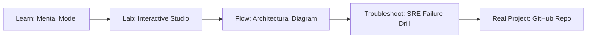

# Decentralized Infrastructure Studio

> **Production Learning Guide, Interactive Lab & Real-Time Incident Drills**

| Property | Value |
|---|---|
| **Domain** | `Incident Triage & Observability` |
| **Category** | `OBSERVABILITY` |
| **Skill Level** | `Level 2 (Scripting & Ops)` |
| **Target SRE Metric** | `85% Reduction in Alert Fatigue & MTTR < 8m on P1 Outages` |
| **Artifact Target** | `ipfs_daemon.json` |
| **Source Repository** | [Pradeeptalari14/tp-decentralized-infra](https://github.com/Pradeeptalari14/tp-decentralized-infra) |
| **Interactive Studio** | [Launch In-Browser Lab](./index.html) |

---

## 1. Overview & Architectural Mission

Monitor IPFS and blockchain nodes. Generate validator check scripts, peer discovery rules, and status alerts.

### Core Production Use Case
Eliminating alert fatigue, deduping flapping notifications, and dispatching webhook payloads during Sev-1 production outages in Decentralized Infrastructure Studio.



---

## 2. Best Architectural Treatment vs. Anti-Pattern

### Recommended Production Practice
> [!TIP]
> Configure Alertmanager inhibition rules, multi-receiver grouping windows (5m wait), and automated webhook escalations linked to SRE runbooks.

### Dangerous Anti-Pattern to Avoid
> [!WARNING]
> Firing unthrottled individual Slack/SMS notifications on every single CPU spike, leading SREs to ignore critical incident alerts.

---

## 3. Real-Time SRE Incident Drill

**Target Failure Mode:**
amtool check-config ipfs_daemon.json && amtool alert query alertname="HighErrorRate"

### Drill Execution Checklist
1. **Baseline Telemetry:** Verify health metrics against the target SLO threshold before initiating changes.
2. **Failure Injection:** Introduce synthetic latency or simulated drift in a non-production staging boundary.
3. **Automated Alerting:** Validate that alerts trigger within `< 30s` via OpenTelemetry collector.
4. **Controlled Remediation:** Apply pre-reviewed, non-destructive configuration changes.
5. **Post-Mortem & Runbook Update:** Update the team runbook with observed failure patterns.

---

## 4. Production Configuration & Code Artifact (`ipfs_daemon.json`)

```json
{
  "$schema": "https://json-schema.org/draft/2020-12/schema",
  "studio": "decentralized-infrastructure-studio",
  "domain": "Incident Triage & Observability",
  "targetArtifact": "ipfs_daemon.json",
  "sreMetric": "85% Reduction in Alert Fatigue & MTTR < 8m on P1 Outages",
  "repository": "Pradeeptalari14/tp-decentralized-infra",
  "service": {
    "name": "decentralized-infrastructure-studio",
    "mode": "production",
    "version": "1.0.0",
    "resilience": {
      "circuitBreaker": true,
      "maxRetries": 3,
      "timeoutMs": 5000
    },
    "telemetry": {
      "enabled": true,
      "endpoint": "otel-collector:4317",
      "sampleRate": 1.0
    }
  }
}
```

---

## 5. Navigation & Next Steps

- **Interactive Simulator:** [Open Decentralized Infrastructure Studio Studio](./index.html)
- **Web Learning View:** [Interactive Guide](./learn.html)
- **GitHub Project Repository:** [Pradeeptalari14/tp-decentralized-infra](https://github.com/Pradeeptalari14/tp-decentralized-infra)
- **Master Studio Index:** [All 347 Studios](../../STUDIOS_CATALOGUE.md)

