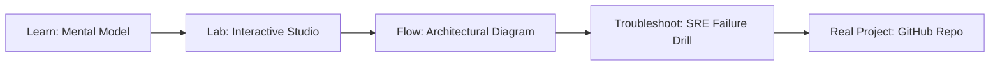

# dedup4pg

> **Production Learning Guide, Interactive Lab & Real-Time Incident Drills**

| Property | Value |
|---|---|
| **Domain** | `LLMOps & RAG Pipelines` |
| **Category** | `AI` |
| **Skill Level** | `Level 3 (Distributed & Compliance)` |
| **Target SRE Metric** | `P99 Query Latency < 12ms & Zero Schema Migration Downtime` |
| **Artifact Target** | `dedup_trigger.sql` |
| **Source Repository** | [Pradeeptalari14/tp-dedup4pg](https://github.com/Pradeeptalari14/tp-dedup4pg) |
| **Interactive Studio** | [Launch In-Browser Lab](./index.html) |

---

## 1. Overview & Architectural Mission

Database-level duplicate chunk reducer using PostgreSQL LSH buckets and Jaccard threshold SQL queries.

### Core Production Use Case
Preventing connection pool exhaustion, slow unindexed queries, and schema migration locking in mission-critical dedup4pg databases.



---

## 2. Best Architectural Treatment vs. Anti-Pattern

### Recommended Production Practice
> [!TIP]
> Implement asynchronous connection pooling (PgBouncer/SQLAlchemy), automated zero-downtime Alembic migrations, and pgvector HNSW indexing.

### Dangerous Anti-Pattern to Avoid
> [!WARNING]
> Executing unindexed multi-table JOINs and synchronous blocking DDL alter commands during peak business traffic.

---

## 3. Real-Time SRE Incident Drill

**Target Failure Mode:**
alembic upgrade head && psql -U postgres -d studios_hub -c "EXPLAIN ANALYZE SELECT * FROM pgvector_store LIMIT 10;"

### Drill Execution Checklist
1. **Baseline Telemetry:** Verify health metrics against the target SLO threshold before initiating changes.
2. **Failure Injection:** Introduce synthetic latency or simulated drift in a non-production staging boundary.
3. **Automated Alerting:** Validate that alerts trigger within `< 30s` via OpenTelemetry collector.
4. **Controlled Remediation:** Apply pre-reviewed, non-destructive configuration changes.
5. **Post-Mortem & Runbook Update:** Update the team runbook with observed failure patterns.

---

## 4. Production Configuration & Code Artifact (`dedup_trigger.sql`)

```sql
-- Production SQL Schema & Tuning: dedup4pg
-- Domain: LLMOps & RAG Pipelines
-- Target Artifact: dedup_trigger.sql

CREATE TABLE IF NOT EXISTS dedup4pg (
    id UUID PRIMARY KEY DEFAULT gen_random_uuid(),
    session_id VARCHAR(64) NOT NULL,
    payload JSONB NOT NULL,
    status VARCHAR(32) DEFAULT 'PENDING',
    created_at TIMESTAMPTZ DEFAULT NOW(),
    updated_at TIMESTAMPTZ DEFAULT NOW()
);

CREATE INDEX IF NOT EXISTS idx_dedup4pg_session ON dedup4pg(session_id);
CREATE INDEX IF NOT EXISTS idx_dedup4pg_status ON dedup4pg(status);
```

---

## 5. Navigation & Next Steps

- **Interactive Simulator:** [Open dedup4pg Studio](./index.html)
- **Web Learning View:** [Interactive Guide](./learn.html)
- **GitHub Project Repository:** [Pradeeptalari14/tp-dedup4pg](https://github.com/Pradeeptalari14/tp-dedup4pg)
- **Master Studio Index:** [All 347 Studios](../../STUDIOS_CATALOGUE.md)

