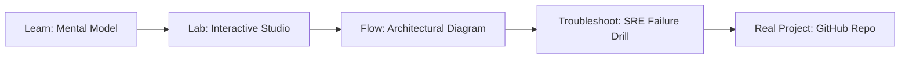

# DedupFlow

> **Production Learning Guide, Interactive Lab & Real-Time Incident Drills**

| Property | Value |
|---|---|
| **Domain** | `FinOps & Cost Optimization` |
| **Category** | `AI` |
| **Skill Level** | `Level 2 (Scripting & Ops)` |
| **Target SRE Metric** | `P99 Query Latency < 12ms & Zero Schema Migration Downtime` |
| **Artifact Target** | `dedup_workflow.json` |
| **Source Repository** | [Pradeeptalari14/tp-dedupflow](https://github.com/Pradeeptalari14/tp-dedupflow) |
| **Interactive Studio** | [Launch In-Browser Lab](./index.html) |

---

## 1. Overview & Architectural Mission

n8n workflow for exact and semantic document deduplication using MD5 hashes and Redis caches.

### Core Production Use Case
Preventing connection pool exhaustion, slow unindexed queries, and schema migration locking in mission-critical DedupFlow databases.



---

## 2. Best Architectural Treatment vs. Anti-Pattern

### Recommended Production Practice
> [!TIP]
> Implement asynchronous connection pooling (PgBouncer/SQLAlchemy), automated zero-downtime Alembic migrations, and pgvector HNSW indexing.

### Dangerous Anti-Pattern to Avoid
> [!WARNING]
> Executing unindexed multi-table JOINs and synchronous blocking DDL alter commands during peak business traffic.

---

## 3. Real-Time SRE Incident Drill

**Target Failure Mode:**
alembic upgrade head && psql -U postgres -d studios_hub -c "EXPLAIN ANALYZE SELECT * FROM pgvector_store LIMIT 10;"

### Drill Execution Checklist
1. **Baseline Telemetry:** Verify health metrics against the target SLO threshold before initiating changes.
2. **Failure Injection:** Introduce synthetic latency or simulated drift in a non-production staging boundary.
3. **Automated Alerting:** Validate that alerts trigger within `< 30s` via OpenTelemetry collector.
4. **Controlled Remediation:** Apply pre-reviewed, non-destructive configuration changes.
5. **Post-Mortem & Runbook Update:** Update the team runbook with observed failure patterns.

---

## 4. Production Configuration & Code Artifact (`dedup_workflow.json`)

```json
{
  "$schema": "https://json-schema.org/draft/2020-12/schema",
  "studio": "dedupflow",
  "domain": "FinOps & Cost Optimization",
  "targetArtifact": "dedup_workflow.json",
  "sreMetric": "P99 Query Latency < 12ms & Zero Schema Migration Downtime",
  "repository": "Pradeeptalari14/tp-dedupflow",
  "service": {
    "name": "dedupflow",
    "mode": "production",
    "version": "1.0.0",
    "resilience": {
      "circuitBreaker": true,
      "maxRetries": 3,
      "timeoutMs": 5000
    },
    "telemetry": {
      "enabled": true,
      "endpoint": "otel-collector:4317",
      "sampleRate": 1.0
    }
  }
}
```

---

## 5. Navigation & Next Steps

- **Interactive Simulator:** [Open DedupFlow Studio](./index.html)
- **Web Learning View:** [Interactive Guide](./learn.html)
- **GitHub Project Repository:** [Pradeeptalari14/tp-dedupflow](https://github.com/Pradeeptalari14/tp-dedupflow)
- **Master Studio Index:** [All 347 Studios](../../STUDIOS_CATALOGUE.md)

