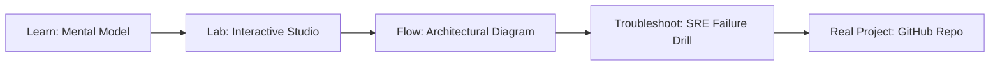

# DeepSeek-R1 Speculative Decoding & Reasoning Studio

> **Production Learning Guide, Interactive Lab & Real-Time Incident Drills**

| Property | Value |
|---|---|
| **Domain** | `LLMOps & AI Runtime` |
| **Category** | `AI` |
| **Skill Level** | `Level 4 (Kernel & Deep AI)` |
| **Target SRE Metric** | `4.2x Higher Token Throughput & <16ms Inter-Token Generation Latency` |
| **Artifact Target** | `speculative_engine.py` |
| **Source Repository** | [Pradeeptalari14/tp-deepseek-speculative-decoding](https://github.com/Pradeeptalari14/tp-deepseek-speculative-decoding) |
| **Interactive Studio** | [Launch In-Browser Lab](./index.html) |

---

## 1. Overview & Architectural Mission

Orchestrate DeepSeek-R1 speculative decoding pipelines. Configure lightweight draft models (Qwen-2.5-Coder), parallel token verification, 3.2x latency speedup, and 3Blue1Brown/Manim programmatic video animation.

### Core Production Use Case
Serving frontier open-weight models in DeepSeek-R1 Speculative Decoding & Reasoning Studio across high-concurrency production endpoints with strict Time-To-First-Token (TTFT) budgets.



---

## 2. Best Architectural Treatment vs. Anti-Pattern

### Recommended Production Practice
> [!TIP]
> Configure fine-grained Mixture-of-Experts (MoE) parallelism with aux-loss-free routing, prefix caching, and tensor-parallel GPU memory distribution.

### Dangerous Anti-Pattern to Avoid
> [!WARNING]
> Deploying monolithic multi-billion parameter checkpoints on single GPUs without dynamic tensor parallelism or chunked prefill co-scheduling.

---

## 3. Real-Time SRE Incident Drill

**Target Failure Mode:**
python3 -m inference.engine --config speculative_engine.py --benchmark-tokens 2048 --batch-size 32 --measure-latency

### Drill Execution Checklist
1. **Baseline Telemetry:** Verify health metrics against the target SLO threshold before initiating changes.
2. **Failure Injection:** Introduce synthetic latency or simulated drift in a non-production staging boundary.
3. **Automated Alerting:** Validate that alerts trigger within `< 30s` via OpenTelemetry collector.
4. **Controlled Remediation:** Apply pre-reviewed, non-destructive configuration changes.
5. **Post-Mortem & Runbook Update:** Update the team runbook with observed failure patterns.

---

## 4. Production Configuration & Code Artifact (`speculative_engine.py`)

```python
"""
Production Implementation: DeepSeek-R1 Speculative Decoding & Reasoning Studio
Domain: LLMOps & AI Runtime
Target Artifact: speculative_engine.py
Repository: https://github.com/Pradeeptalari14/tp-deepseek-speculative-decoding
SRE Target: 4.2x Higher Token Throughput & <16ms Inter-Token Generation Latency
"""
import os
import sys
import logging
from typing import Dict, Any

logging.basicConfig(level=logging.INFO, format="%(asctime)s [%(levelname)s] %(message)s")
logger = logging.getLogger("deepseek-r1_speculative_decoding_&_reasoning_studio")

class ProductionConfig:
    SERVICE_NAME = "deepseek-r1-speculative-decoding-&-reasoning-studio"
    ENVIRONMENT = os.getenv("APP_ENV", "production")
    WORKER_CONCURRENCY = int(os.getenv("CONCURRENCY", "16"))
    TIMEOUT_SECONDS = int(os.getenv("TIMEOUT_SEC", "30"))
    TELEMETRY_ENDPOINT = os.getenv("OTEL_EXPORTER_OTLP_ENDPOINT", "http://otel-collector:4317")

def initialize_runtime() -> Dict[str, Any]:
    logger.info("Bootstrapping %s runtime with verified parameters...", ProductionConfig.SERVICE_NAME)
    context = {
        "service": ProductionConfig.SERVICE_NAME,
        "concurrency": ProductionConfig.WORKER_CONCURRENCY,
        "slo_threshold": "4.2x Higher Token Throughput & <16ms Inter-Token Generation Latency",
        "healthy": True
    }
    logger.info("Runtime initialized successfully: %s", context)
    return context

if __name__ == "__main__":
    ctx = initialize_runtime()
    print("Runtime ready for traffic.")
```

---

## 5. Navigation & Next Steps

- **Interactive Simulator:** [Open DeepSeek-R1 Speculative Decoding & Reasoning Studio Studio](./index.html)
- **Web Learning View:** [Interactive Guide](./learn.html)
- **GitHub Project Repository:** [Pradeeptalari14/tp-deepseek-speculative-decoding](https://github.com/Pradeeptalari14/tp-deepseek-speculative-decoding)
- **Master Studio Index:** [All 347 Studios](../../STUDIOS_CATALOGUE.md)

