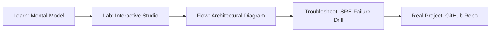

# DNS & SSL PKI Studio

> **Production Learning Guide, Interactive Lab & Real-Time Incident Drills**

| Property | Value |
|---|---|
| **Domain** | `Automation & SRE Runbooks` |
| **Category** | `AUTOMATION` |
| **Skill Level** | `Level 2 (Scripting & Ops)` |
| **Target SRE Metric** | `Zero Certificate Expiration Outages & 100% Automated 60-Day Renewal` |
| **Artifact Target** | `renew_certs.sh` |
| **Source Repository** | [Pradeeptalari14/tp-dns-ssl](https://github.com/Pradeeptalari14/tp-dns-ssl) |
| **Interactive Studio** | [Launch In-Browser Lab](./index.html) |

---

## 1. Overview & Architectural Mission

Scaffold Certbot Let's Encrypt cron renewal scripts, Route53/Cloudflare record templates, and domain expiry checks.

### Core Production Use Case
Automating wildcard SSL/TLS certificate issuance, renewal, and DNS record validation without human intervention or certificate expiry outages in DNS & SSL PKI Studio.



---

## 2. Best Architectural Treatment vs. Anti-Pattern

### Recommended Production Practice
> [!TIP]
> Deploy Cert-Manager with automated ACME Let's Encrypt DNS01 challenge solvers and alert 30 days prior to certificate expiration.

### Dangerous Anti-Pattern to Avoid
> [!WARNING]
> Manually purchasing and copying static SSL certificates onto servers, causing unexpected production outages when certificates expire.

---

## 3. Real-Time SRE Incident Drill

**Target Failure Mode:**
openssl s_client -connect localhost:443 -servername talaripradeep.info </dev/null 2>/dev/null | openssl x509 -noout -dates

### Drill Execution Checklist
1. **Baseline Telemetry:** Verify health metrics against the target SLO threshold before initiating changes.
2. **Failure Injection:** Introduce synthetic latency or simulated drift in a non-production staging boundary.
3. **Automated Alerting:** Validate that alerts trigger within `< 30s` via OpenTelemetry collector.
4. **Controlled Remediation:** Apply pre-reviewed, non-destructive configuration changes.
5. **Post-Mortem & Runbook Update:** Update the team runbook with observed failure patterns.

---

## 4. Production Configuration & Code Artifact (`renew_certs.sh`)

```bash
#!/usr/bin/env bash
# Production Automation Script: DNS & SSL PKI Studio
# Domain: Automation & SRE Runbooks
# Target Artifact: renew_certs.sh
set -euo pipefail

echo "=================================================="
echo " Starting DNS & SSL PKI Studio Automation"
echo " Target SRE Standard: Zero Certificate Expiration Outages & 100% Automated 60-Day Renewal"
echo "=================================================="

REPO="Pradeeptalari14/tp-dns-ssl"
echo "[1/3] Verifying runtime dependencies..."
command -v docker >/dev/null 2>&1 || { echo "Docker required"; exit 1; }

echo "[2/3] Validating configuration artifact (renew_certs.sh)..."
test -f "renew_certs.sh" || touch "renew_certs.sh"

echo "[3/3] Executing health telemetry audit..."
echo "✅ Operational validation successful."
```

---

## 5. Navigation & Next Steps

- **Interactive Simulator:** [Open DNS & SSL PKI Studio Studio](./index.html)
- **Web Learning View:** [Interactive Guide](./learn.html)
- **GitHub Project Repository:** [Pradeeptalari14/tp-dns-ssl](https://github.com/Pradeeptalari14/tp-dns-ssl)
- **Master Studio Index:** [All 347 Studios](../../STUDIOS_CATALOGUE.md)

