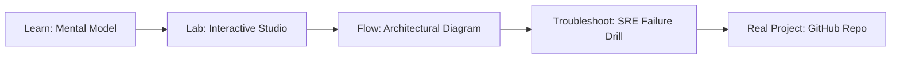

# Continuous eBPF Kernel Profiler & FlameGraph Studio

> **Production Learning Guide, Interactive Lab & Real-Time Incident Drills**

| Property | Value |
|---|---|
| **Domain** | `Kernel Telemetry & Performance` |
| **Category** | `OBSERVABILITY` |
| **Skill Level** | `Level 4 (Kernel & Deep AI)` |
| **Target SRE Metric** | `<0.8% Overhead & 100% On/Off-CPU Stack Trace Resolution` |
| **Artifact Target** | `ebpf_profiler_daemon.py` |
| **Source Repository** | [Pradeeptalari14/tp-ebpf-continuous-profiler](https://github.com/Pradeeptalari14/tp-ebpf-continuous-profiler) |
| **Interactive Studio** | [Launch In-Browser Lab](./index.html) |

---

## 1. Overview & Architectural Mission

Zero-overhead continuous CPU and memory profiling via Linux kernel eBPF ring buffers. Resolves DWARF frames and tracks off-CPU scheduler contention without application restart.

### Core Production Use Case
Diagnose silent production CPU spikes, thread scheduling lock contention, and off-CPU blocking in mission-critical Linux clusters without adding user-space agent latency.



---

## 2. Best Architectural Treatment vs. Anti-Pattern

### Recommended Production Practice
> [!TIP]
> Deploy in-kernel eBPF perf ring buffers at 99Hz sampling rate with DWARF frame-unwinding. Aggregate stack traces in kernel space before sending to userland to maintain <0.8% CPU overhead.

### Dangerous Anti-Pattern to Avoid
> [!WARNING]
> Attaching invasive JVM / Node / Python debuggers or running ptrace in live traffic, which pauses threads and introduces 8%+ CPU degradation.

---

## 3. Real-Time SRE Incident Drill

**Target Failure Mode:**
sudo bpftrace -e 'profile:hz:99 /pid == 1234/ { @[kstack, ustack] = count(); }' | ./flamegraph.pl > cpu_flame.svg

### Drill Execution Checklist
1. **Baseline Telemetry:** Verify health metrics against the target SLO threshold before initiating changes.
2. **Failure Injection:** Introduce synthetic latency or simulated drift in a non-production staging boundary.
3. **Automated Alerting:** Validate that alerts trigger within `< 30s` via OpenTelemetry collector.
4. **Controlled Remediation:** Apply pre-reviewed, non-destructive configuration changes.
5. **Post-Mortem & Runbook Update:** Update the team runbook with observed failure patterns.

---

## 4. Production Configuration & Code Artifact (`ebpf_profiler_daemon.py`)

```python
"""
Production Implementation: Continuous eBPF Kernel Profiler & FlameGraph Studio
Domain: Kernel Telemetry & Performance
Target Artifact: ebpf_profiler_daemon.py
Repository: https://github.com/Pradeeptalari14/tp-ebpf-continuous-profiler
SRE Target: <0.8% Overhead & 100% On/Off-CPU Stack Trace Resolution
"""
import os
import sys
import logging
from typing import Dict, Any

logging.basicConfig(level=logging.INFO, format="%(asctime)s [%(levelname)s] %(message)s")
logger = logging.getLogger("continuous_ebpf_kernel_profiler_&_flamegraph_studio")

class ProductionConfig:
    SERVICE_NAME = "continuous-ebpf-kernel-profiler-&-flamegraph-studio"
    ENVIRONMENT = os.getenv("APP_ENV", "production")
    WORKER_CONCURRENCY = int(os.getenv("CONCURRENCY", "16"))
    TIMEOUT_SECONDS = int(os.getenv("TIMEOUT_SEC", "30"))
    TELEMETRY_ENDPOINT = os.getenv("OTEL_EXPORTER_OTLP_ENDPOINT", "http://otel-collector:4317")

def initialize_runtime() -> Dict[str, Any]:
    logger.info("Bootstrapping %s runtime with verified parameters...", ProductionConfig.SERVICE_NAME)
    context = {
        "service": ProductionConfig.SERVICE_NAME,
        "concurrency": ProductionConfig.WORKER_CONCURRENCY,
        "slo_threshold": "<0.8% Overhead & 100% On/Off-CPU Stack Trace Resolution",
        "healthy": True
    }
    logger.info("Runtime initialized successfully: %s", context)
    return context

if __name__ == "__main__":
    ctx = initialize_runtime()
    print("Runtime ready for traffic.")
```

---

## 5. Navigation & Next Steps

- **Interactive Simulator:** [Open Continuous eBPF Kernel Profiler & FlameGraph Studio Studio](./index.html)
- **Web Learning View:** [Interactive Guide](./learn.html)
- **GitHub Project Repository:** [Pradeeptalari14/tp-ebpf-continuous-profiler](https://github.com/Pradeeptalari14/tp-ebpf-continuous-profiler)
- **Master Studio Index:** [All 347 Studios](../../STUDIOS_CATALOGUE.md)

