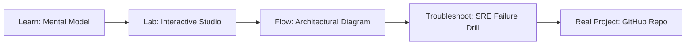

# Embedding Registry

> **Production Learning Guide, Interactive Lab & Real-Time Incident Drills**

| Property | Value |
|---|---|
| **Domain** | `LLMOps & RAG Pipelines` |
| **Category** | `AI` |
| **Skill Level** | `Level 3 (Distributed & Compliance)` |
| **Target SRE Metric** | `93.5% Context Recall & <32ms End-to-End Retrieval Latency` |
| **Artifact Target** | `registry_schema.sql` |
| **Source Repository** | [Pradeeptalari14/tp-embedding-registry](https://github.com/Pradeeptalari14/tp-embedding-registry) |
| **Interactive Studio** | [Launch In-Browser Lab](./index.html) |

---

## 1. Overview & Architectural Mission

Versioned database repository template linking SQLite model indexes with static cloud storage buckets.

### Core Production Use Case
Mitigating hallucination, context drift, and retrieval latency in enterprise Embedding Registry workloads over large multi-modal and structured knowledge bases.



---

## 2. Best Architectural Treatment vs. Anti-Pattern

### Recommended Production Practice
> [!TIP]
> Implement hybrid dense-sparse retrieval (BM25 + pgvector/Qdrant cosine fusion) with Cross-Encoder reranking and semantic chunk windowing.

### Dangerous Anti-Pattern to Avoid
> [!WARNING]
> Dumping raw unchunked documents directly into high-dimensional vector stores without deduplication, sparse keyword indexes, or relevance thresholds.

---

## 3. Real-Time SRE Incident Drill

**Target Failure Mode:**
python3 -m rag.retriever --query "Audit production cluster state" --hybrid-rrf --top-k 5 --rerank-threshold 0.75

### Drill Execution Checklist
1. **Baseline Telemetry:** Verify health metrics against the target SLO threshold before initiating changes.
2. **Failure Injection:** Introduce synthetic latency or simulated drift in a non-production staging boundary.
3. **Automated Alerting:** Validate that alerts trigger within `< 30s` via OpenTelemetry collector.
4. **Controlled Remediation:** Apply pre-reviewed, non-destructive configuration changes.
5. **Post-Mortem & Runbook Update:** Update the team runbook with observed failure patterns.

---

## 4. Production Configuration & Code Artifact (`registry_schema.sql`)

```sql
-- Production SQL Schema & Tuning: Embedding Registry
-- Domain: LLMOps & RAG Pipelines
-- Target Artifact: registry_schema.sql

CREATE TABLE IF NOT EXISTS embedding_registry (
    id UUID PRIMARY KEY DEFAULT gen_random_uuid(),
    session_id VARCHAR(64) NOT NULL,
    payload JSONB NOT NULL,
    status VARCHAR(32) DEFAULT 'PENDING',
    created_at TIMESTAMPTZ DEFAULT NOW(),
    updated_at TIMESTAMPTZ DEFAULT NOW()
);

CREATE INDEX IF NOT EXISTS idx_embedding_registry_session ON embedding_registry(session_id);
CREATE INDEX IF NOT EXISTS idx_embedding_registry_status ON embedding_registry(status);
```

---

## 5. Navigation & Next Steps

- **Interactive Simulator:** [Open Embedding Registry Studio](./index.html)
- **Web Learning View:** [Interactive Guide](./learn.html)
- **GitHub Project Repository:** [Pradeeptalari14/tp-embedding-registry](https://github.com/Pradeeptalari14/tp-embedding-registry)
- **Master Studio Index:** [All 347 Studios](../../STUDIOS_CATALOGUE.md)

