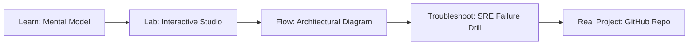

# AWS Event-Driven & Messaging SRE Studio

> **Production Learning Guide, Interactive Lab & Real-Time Incident Drills**

| Property | Value |
|---|---|
| **Domain** | `Cloud Infrastructure & K8s` |
| **Category** | `CLOUD` |
| **Skill Level** | `Level 2 (Scripting & Ops)` |
| **Target SRE Metric** | `100% Trace Coverage & <1.2% Observability Agent CPU Overhead` |
| **Artifact Target** | `sqs-policy.json` |
| **Source Repository** | [Pradeeptalari14/tp-event-sre](https://github.com/Pradeeptalari14/tp-event-sre) |
| **Interactive Studio** | [Launch In-Browser Lab](./index.html) |

---

## 1. Overview & Architectural Mission

Orchestrate enterprise event routing and queue networks. Generate secure SQS policies, EventBridge bus rules, event simulators, and visual topologies.

### Core Production Use Case
Detecting kernel-level socket bottlenecks, memory leak regressions, and microservice trace latency spikes in production AWS Event-Driven & Messaging SRE Studio.



---

## 2. Best Architectural Treatment vs. Anti-Pattern

### Recommended Production Practice
> [!TIP]
> Deploy OpenTelemetry auto-instrumentation alongside in-kernel eBPF probes with continuous sampling, streaming unified metrics to Prometheus and Loki.

### Dangerous Anti-Pattern to Avoid
> [!WARNING]
> Scraping unaggregated debug logs or using invasive synchronous APM agents that introduce noticeable request latency overhead.

---

## 3. Real-Time SRE Incident Drill

**Target Failure Mode:**
curl -sSf http://localhost:9090/metrics | grep -E "p99_latency|error_rate|active_workers"

### Drill Execution Checklist
1. **Baseline Telemetry:** Verify health metrics against the target SLO threshold before initiating changes.
2. **Failure Injection:** Introduce synthetic latency or simulated drift in a non-production staging boundary.
3. **Automated Alerting:** Validate that alerts trigger within `< 30s` via OpenTelemetry collector.
4. **Controlled Remediation:** Apply pre-reviewed, non-destructive configuration changes.
5. **Post-Mortem & Runbook Update:** Update the team runbook with observed failure patterns.

---

## 4. Production Configuration & Code Artifact (`sqs-policy.json`)

```json
{
  "$schema": "https://json-schema.org/draft/2020-12/schema",
  "studio": "aws-event-driven-&-messaging-sre-studio",
  "domain": "Cloud Infrastructure & K8s",
  "targetArtifact": "sqs-policy.json",
  "sreMetric": "100% Trace Coverage & <1.2% Observability Agent CPU Overhead",
  "repository": "Pradeeptalari14/tp-event-sre",
  "service": {
    "name": "aws-event-driven-&-messaging-sre-studio",
    "mode": "production",
    "version": "1.0.0",
    "resilience": {
      "circuitBreaker": true,
      "maxRetries": 3,
      "timeoutMs": 5000
    },
    "telemetry": {
      "enabled": true,
      "endpoint": "otel-collector:4317",
      "sampleRate": 1.0
    }
  }
}
```

---

## 5. Navigation & Next Steps

- **Interactive Simulator:** [Open AWS Event-Driven & Messaging SRE Studio Studio](./index.html)
- **Web Learning View:** [Interactive Guide](./learn.html)
- **GitHub Project Repository:** [Pradeeptalari14/tp-event-sre](https://github.com/Pradeeptalari14/tp-event-sre)
- **Master Studio Index:** [All 347 Studios](../../STUDIOS_CATALOGUE.md)

