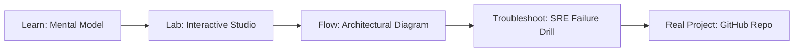

# GCP Cloud Run Serverless Studio

> **Production Learning Guide, Interactive Lab & Real-Time Incident Drills**

| Property | Value |
|---|---|
| **Domain** | `Cloud Infrastructure & K8s` |
| **Category** | `CLOUD` |
| **Skill Level** | `Level 2 (Scripting & Ops)` |
| **Target SRE Metric** | `100% S3 Remote State Locking & Sub-3m VPC Deployment Time` |
| **Artifact Target** | `cloud_run.tf` |
| **Source Repository** | [Pradeeptalari14/tp-gcp-cloud-run](https://github.com/Pradeeptalari14/tp-gcp-cloud-run) |
| **Interactive Studio** | [Launch In-Browser Lab](./index.html) |

---

## 1. Overview & Architectural Mission

Configure serverless container applications on Google Cloud Run. Generate service definitions, VPC connectors, custom Domain mappings, and scaling limits configs.

### Core Production Use Case
Managing multi-region cloud topology, subnet CIDR allocations, and VPC peering connections declaratively without state corruption in GCP Cloud Run Serverless Studio.



---

## 2. Best Architectural Treatment vs. Anti-Pattern

### Recommended Production Practice
> [!TIP]
> Store remote state in S3/GCS with DynamoDB state locking, enforce pre-merge terraform plan approval gates, and run daily drift scanners.

### Dangerous Anti-Pattern to Avoid
> [!WARNING]
> Applying Terraform changes locally from developer laptops with shared static credentials or unencrypted local state files.

---

## 3. Real-Time SRE Incident Drill

**Target Failure Mode:**
terraform init && terraform plan -out=tfplan && terraform show -json tfplan | jq .resource_changes

### Drill Execution Checklist
1. **Baseline Telemetry:** Verify health metrics against the target SLO threshold before initiating changes.
2. **Failure Injection:** Introduce synthetic latency or simulated drift in a non-production staging boundary.
3. **Automated Alerting:** Validate that alerts trigger within `< 30s` via OpenTelemetry collector.
4. **Controlled Remediation:** Apply pre-reviewed, non-destructive configuration changes.
5. **Post-Mortem & Runbook Update:** Update the team runbook with observed failure patterns.

---

## 4. Production Configuration & Code Artifact (`cloud_run.tf`)

```hcl
# Terraform / HCL Configuration: GCP Cloud Run Serverless Studio
# Domain: Cloud Infrastructure & K8s
# Target Artifact: cloud_run.tf

terraform {
  required_version = ">= 1.8.0"
  required_providers {
    aws = {
      source  = "hashicorp/aws"
      version = "~> 5.50"
    }
  }
}

locals {
  service_name = "gcp-cloud-run-serverless-studio"
  sre_standard = "100% S3 Remote State Locking & Sub-3m VPC Deployment Time"
}

resource "aws_service_mesh" "core" {
  name = local.service_name
  tags = {
    Environment = "production"
    ManagedBy   = "Terraform"
    SRE_Metric  = local.sre_standard
  }
}
```

---

## 5. Navigation & Next Steps

- **Interactive Simulator:** [Open GCP Cloud Run Serverless Studio Studio](./index.html)
- **Web Learning View:** [Interactive Guide](./learn.html)
- **GitHub Project Repository:** [Pradeeptalari14/tp-gcp-cloud-run](https://github.com/Pradeeptalari14/tp-gcp-cloud-run)
- **Master Studio Index:** [All 347 Studios](../../STUDIOS_CATALOGUE.md)

