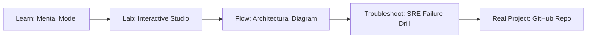

# GCP GKE Autopilot Cluster Studio

> **Production Learning Guide, Interactive Lab & Real-Time Incident Drills**

| Property | Value |
|---|---|
| **Domain** | `Cloud Infrastructure & K8s` |
| **Category** | `CLOUD` |
| **Skill Level** | `Level 2 (Scripting & Ops)` |
| **Target SRE Metric** | `Sub-45s Node Autoscaling & Zero Unplanned Service Disruption` |
| **Artifact Target** | `gke_autopilot.tf` |
| **Source Repository** | [Pradeeptalari14/tp-gcp-gke-autopilot](https://github.com/Pradeeptalari14/tp-gcp-gke-autopilot) |
| **Interactive Studio** | [Launch In-Browser Lab](./index.html) |

---

## 1. Overview & Architectural Mission

Provision fully managed Kubernetes setups in GCP GKE Autopilot. Generate terraform manifests, workload identity pools, and target regional load balancer rules.

### Core Production Use Case
Eliminating node provisioning lag, pod scheduling starvation, and network policy drift in enterprise GCP GKE Autopilot Cluster Studio Kubernetes environments.



---

## 2. Best Architectural Treatment vs. Anti-Pattern

### Recommended Production Practice
> [!TIP]
> Standardize on declarative GitOps manifests with Karpenter fast node consolidation, eBPF Cilium network policies, and rolling zero-downtime updates.

### Dangerous Anti-Pattern to Avoid
> [!WARNING]
> Manually editing live cluster resources with kubectl edit or running static oversized node groups that waste idle cloud compute.

---

## 3. Real-Time SRE Incident Drill

**Target Failure Mode:**
kubectl apply -f gke_autopilot.tf --dry-run=server && kubectl get pods -l app=gcp-gke-autopilot-cluster-studio -w

### Drill Execution Checklist
1. **Baseline Telemetry:** Verify health metrics against the target SLO threshold before initiating changes.
2. **Failure Injection:** Introduce synthetic latency or simulated drift in a non-production staging boundary.
3. **Automated Alerting:** Validate that alerts trigger within `< 30s` via OpenTelemetry collector.
4. **Controlled Remediation:** Apply pre-reviewed, non-destructive configuration changes.
5. **Post-Mortem & Runbook Update:** Update the team runbook with observed failure patterns.

---

## 4. Production Configuration & Code Artifact (`gke_autopilot.tf`)

```hcl
# Terraform / HCL Configuration: GCP GKE Autopilot Cluster Studio
# Domain: Cloud Infrastructure & K8s
# Target Artifact: gke_autopilot.tf

terraform {
  required_version = ">= 1.8.0"
  required_providers {
    aws = {
      source  = "hashicorp/aws"
      version = "~> 5.50"
    }
  }
}

locals {
  service_name = "gcp-gke-autopilot-cluster-studio"
  sre_standard = "Sub-45s Node Autoscaling & Zero Unplanned Service Disruption"
}

resource "aws_service_mesh" "core" {
  name = local.service_name
  tags = {
    Environment = "production"
    ManagedBy   = "Terraform"
    SRE_Metric  = local.sre_standard
  }
}
```

---

## 5. Navigation & Next Steps

- **Interactive Simulator:** [Open GCP GKE Autopilot Cluster Studio Studio](./index.html)
- **Web Learning View:** [Interactive Guide](./learn.html)
- **GitHub Project Repository:** [Pradeeptalari14/tp-gcp-gke-autopilot](https://github.com/Pradeeptalari14/tp-gcp-gke-autopilot)
- **Master Studio Index:** [All 347 Studios](../../STUDIOS_CATALOGUE.md)

