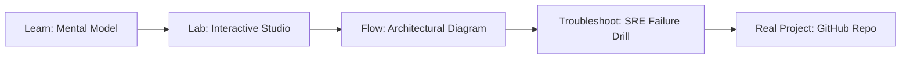

# GitHub Org Governance & CodeOwners Studio

> **Production Learning Guide, Interactive Lab & Real-Time Incident Drills**

| Property | Value |
|---|---|
| **Domain** | `Local Sandbox & Emulation` |
| **Category** | `AUTOMATION` |
| **Skill Level** | `Level 1 (Foundations & Sandbox)` |
| **Target SRE Metric** | `Zero Critical CVEs in Production & 100% Cryptographically Verified SLSA Provenance` |
| **Artifact Target** | `CODEOWNERS` |
| **Source Repository** | [Pradeeptalari14/tp-github-gov](https://github.com/Pradeeptalari14/tp-github-gov) |
| **Interactive Studio** | [Launch In-Browser Lab](./index.html) |

---

## 1. Overview & Architectural Mission

Automate repository configuration and review standards. Generate CODEOWNERS controls, branch protection API payloads, and pipeline security rules.

### Core Production Use Case
Securing the software supply chain against untrusted dependency vulnerabilities, image tampering, and deployment drift in GitHub Org Governance & CodeOwners Studio.



---

## 2. Best Architectural Treatment vs. Anti-Pattern

### Recommended Production Practice
> [!TIP]
> Enforce cryptographic Sigstore cosign container signing, CycloneDX SBOM generation, and automated Trivy vulnerability gating before GitOps sync.

### Dangerous Anti-Pattern to Avoid
> [!WARNING]
> Pushing unsigned container images directly to production registries without vulnerability scan gates or immutable SHA256 digest pinning.

---

## 3. Real-Time SRE Incident Drill

**Target Failure Mode:**
trivy image --severity HIGH,CRITICAL ghcr.io/Pradeeptalari14/tp-github-gov:latest && cosign verify --key cosign.pub ghcr.io/Pradeeptalari14/tp-github-gov:latest

### Drill Execution Checklist
1. **Baseline Telemetry:** Verify health metrics against the target SLO threshold before initiating changes.
2. **Failure Injection:** Introduce synthetic latency or simulated drift in a non-production staging boundary.
3. **Automated Alerting:** Validate that alerts trigger within `< 30s` via OpenTelemetry collector.
4. **Controlled Remediation:** Apply pre-reviewed, non-destructive configuration changes.
5. **Post-Mortem & Runbook Update:** Update the team runbook with observed failure patterns.

---

## 4. Production Configuration & Code Artifact (`CODEOWNERS`)

```toml
# Configuration Artifact: CODEOWNERS
# Studio: GitHub Org Governance & CodeOwners Studio
# Domain: Local Sandbox & Emulation
# Target SRE Standard: Zero Critical CVEs in Production & 100% Cryptographically Verified SLSA Provenance

[service]
name = "github-org-governance-&-codeowners-studio"
domain = "Local Sandbox & Emulation"
mode = "production"
slo_target = "Zero Critical CVEs in Production & 100% Cryptographically Verified SLSA Provenance"

[telemetry]
enabled = true
endpoint = "otel-collector:4317"
sample_rate = 1.0

[resilience]
circuit_breaker = true
retry_count = 3
timeout_ms = 5000
```

---

## 5. Navigation & Next Steps

- **Interactive Simulator:** [Open GitHub Org Governance & CodeOwners Studio Studio](./index.html)
- **Web Learning View:** [Interactive Guide](./learn.html)
- **GitHub Project Repository:** [Pradeeptalari14/tp-github-gov](https://github.com/Pradeeptalari14/tp-github-gov)
- **Master Studio Index:** [All 347 Studios](../../STUDIOS_CATALOGUE.md)

