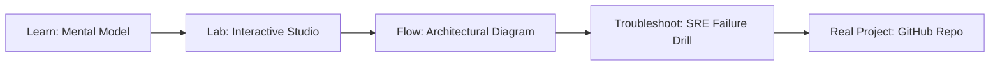

# GitOps Secrets Studio

> **Production Learning Guide, Interactive Lab & Real-Time Incident Drills**

| Property | Value |
|---|---|
| **Domain** | `Zero-Trust Security & DevSecOps` |
| **Category** | `AUTOMATION` |
| **Skill Level** | `Level 3 (Distributed & Compliance)` |
| **Target SRE Metric** | `Zero Plaintext Secrets in Git & Automated 30-Day Key Rotation` |
| **Artifact Target** | `.sops.yaml` |
| **Source Repository** | [Pradeeptalari14/tp-gitops-secrets](https://github.com/Pradeeptalari14/tp-gitops-secrets) |
| **Interactive Studio** | [Launch In-Browser Lab](./index.html) |

---

## 1. Overview & Architectural Mission

Generate Mozilla SOPS configs, Age encrypted keys, and GitOps decryption runners.

### Core Production Use Case
Securing API tokens, database passwords, and cryptographic keys across distributed microservices with automated rotation.



---

## 2. Best Architectural Treatment vs. Anti-Pattern

### Recommended Production Practice
> [!TIP]
> Store credentials in HashiCorp Vault with short-lived dynamic lease times, injecting secrets into pods via ephemeral volume mounts or CSI drivers.

### Dangerous Anti-Pattern to Avoid
> [!WARNING]
> Storing plaintext credentials in Git repositories, unencrypted Kubernetes ConfigMaps, or long-lived environment variables.

---

## 3. Real-Time SRE Incident Drill

**Target Failure Mode:**
vault kv put secret/production/db password="$(openssl rand -hex 24)" && vault kv get secret/production/db

### Drill Execution Checklist
1. **Baseline Telemetry:** Verify health metrics against the target SLO threshold before initiating changes.
2. **Failure Injection:** Introduce synthetic latency or simulated drift in a non-production staging boundary.
3. **Automated Alerting:** Validate that alerts trigger within `< 30s` via OpenTelemetry collector.
4. **Controlled Remediation:** Apply pre-reviewed, non-destructive configuration changes.
5. **Post-Mortem & Runbook Update:** Update the team runbook with observed failure patterns.

---

## 4. Production Configuration & Code Artifact (`.sops.yaml`)

```yaml
# Production Manifest: GitOps Secrets Studio
# Domain: Zero-Trust Security & DevSecOps
# Target Artifact: .sops.yaml
# Target SRE Standard: Zero Plaintext Secrets in Git & Automated 30-Day Key Rotation
apiVersion: apps/v1
kind: Deployment
metadata:
  name: gitops-secrets-studio
  namespace: production
  labels:
    app.kubernetes.io/name: gitops-secrets-studio
    app.kubernetes.io/part-of: engineering-platform
    sre.slo/compliance: "Zero Plaintext Secrets in Git & Automated 30-Day Key Rotation"
spec:
  replicas: 3
  strategy:
    type: RollingUpdate
    rollingUpdate:
      maxSurge: 1
      maxUnavailable: 0
  selector:
    matchLabels:
      app: gitops-secrets-studio
  template:
    metadata:
      labels:
        app: gitops-secrets-studio
    spec:
      containers:
        - name: core
          image: ghcr.io/pradeeptalari14/tp-gitops-secrets:v1.0.0
          imagePullPolicy: IfNotPresent
          resources:
            requests:
              cpu: "500m"
              memory: "1Gi"
            limits:
              cpu: "2000m"
              memory: "4Gi"
          readinessProbe:
            httpGet:
              path: /healthz
              port: 8080
            initialDelaySeconds: 5
            periodSeconds: 10
          livenessProbe:
            httpGet:
              path: /livez
              port: 8080
            initialDelaySeconds: 15
            periodSeconds: 20
```

---

## 5. Navigation & Next Steps

- **Interactive Simulator:** [Open GitOps Secrets Studio Studio](./index.html)
- **Web Learning View:** [Interactive Guide](./learn.html)
- **GitHub Project Repository:** [Pradeeptalari14/tp-gitops-secrets](https://github.com/Pradeeptalari14/tp-gitops-secrets)
- **Master Studio Index:** [All 347 Studios](../../STUDIOS_CATALOGUE.md)

