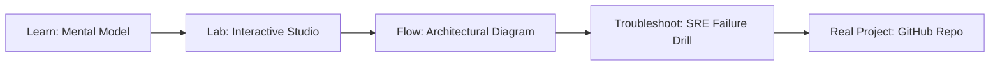

# Go SRE Utility Studio

> **Production Learning Guide, Interactive Lab & Real-Time Incident Drills**

| Property | Value |
|---|---|
| **Domain** | `Incident Triage & Observability` |
| **Category** | `OBSERVABILITY` |
| **Skill Level** | `Level 2 (Scripting & Ops)` |
| **Target SRE Metric** | `100% Trace Coverage & <1.2% Observability Agent CPU Overhead` |
| **Artifact Target** | `main.go` |
| **Source Repository** | [Pradeeptalari14/tp-go-utility](https://github.com/Pradeeptalari14/tp-go-utility) |
| **Interactive Studio** | [Launch In-Browser Lab](./index.html) |

---

## 1. Overview & Architectural Mission

Deploy high-performance Golang script tasks. Generate parallel HTTP health checkers, log parsing engines, or system metrics exporters with concurrent channels, Dockerfiles, and Makefiles.

### Core Production Use Case
Detecting kernel-level socket bottlenecks, memory leak regressions, and microservice trace latency spikes in production Go SRE Utility Studio.



---

## 2. Best Architectural Treatment vs. Anti-Pattern

### Recommended Production Practice
> [!TIP]
> Deploy OpenTelemetry auto-instrumentation alongside in-kernel eBPF probes with continuous sampling, streaming unified metrics to Prometheus and Loki.

### Dangerous Anti-Pattern to Avoid
> [!WARNING]
> Scraping unaggregated debug logs or using invasive synchronous APM agents that introduce noticeable request latency overhead.

---

## 3. Real-Time SRE Incident Drill

**Target Failure Mode:**
curl -sSf http://localhost:9090/metrics | grep -E "p99_latency|error_rate|active_workers"

### Drill Execution Checklist
1. **Baseline Telemetry:** Verify health metrics against the target SLO threshold before initiating changes.
2. **Failure Injection:** Introduce synthetic latency or simulated drift in a non-production staging boundary.
3. **Automated Alerting:** Validate that alerts trigger within `< 30s` via OpenTelemetry collector.
4. **Controlled Remediation:** Apply pre-reviewed, non-destructive configuration changes.
5. **Post-Mortem & Runbook Update:** Update the team runbook with observed failure patterns.

---

## 4. Production Configuration & Code Artifact (`main.go`)

```toml
# Configuration Artifact: main.go
# Studio: Go SRE Utility Studio
# Domain: Incident Triage & Observability
# Target SRE Standard: 100% Trace Coverage & <1.2% Observability Agent CPU Overhead

[service]
name = "go-sre-utility-studio"
domain = "Incident Triage & Observability"
mode = "production"
slo_target = "100% Trace Coverage & <1.2% Observability Agent CPU Overhead"

[telemetry]
enabled = true
endpoint = "otel-collector:4317"
sample_rate = 1.0

[resilience]
circuit_breaker = true
retry_count = 3
timeout_ms = 5000
```

---

## 5. Navigation & Next Steps

- **Interactive Simulator:** [Open Go SRE Utility Studio Studio](./index.html)
- **Web Learning View:** [Interactive Guide](./learn.html)
- **GitHub Project Repository:** [Pradeeptalari14/tp-go-utility](https://github.com/Pradeeptalari14/tp-go-utility)
- **Master Studio Index:** [All 347 Studios](../../STUDIOS_CATALOGUE.md)

