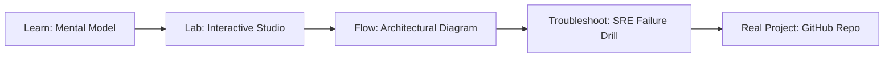

# GPU Scheduler & K8s Allocator Studio

> **Production Learning Guide, Interactive Lab & Real-Time Incident Drills**

| Property | Value |
|---|---|
| **Domain** | `LLMOps & RAG Pipelines` |
| **Category** | `AI` |
| **Skill Level** | `Level 3 (Distributed & Compliance)` |
| **Target SRE Metric** | `Sub-45s Node Autoscaling & Zero Unplanned Service Disruption` |
| **Artifact Target** | `gpu-policy.yaml` |
| **Source Repository** | [Pradeeptalari14/tp-gpu-scheduler](https://github.com/Pradeeptalari14/tp-gpu-scheduler) |
| **Interactive Studio** | [Launch In-Browser Lab](./index.html) |

---

## 1. Overview & Architectural Mission

Optimize multi-instance GPU partitions, configure dynamic resource allocations, and customize Kueue fair-share batch scheduling policies in Kubernetes configurations.

### Core Production Use Case
Eliminating node provisioning lag, pod scheduling starvation, and network policy drift in enterprise GPU Scheduler & K8s Allocator Studio Kubernetes environments.



---

## 2. Best Architectural Treatment vs. Anti-Pattern

### Recommended Production Practice
> [!TIP]
> Standardize on declarative GitOps manifests with Karpenter fast node consolidation, eBPF Cilium network policies, and rolling zero-downtime updates.

### Dangerous Anti-Pattern to Avoid
> [!WARNING]
> Manually editing live cluster resources with kubectl edit or running static oversized node groups that waste idle cloud compute.

---

## 3. Real-Time SRE Incident Drill

**Target Failure Mode:**
kubectl apply -f gpu-policy.yaml --dry-run=server && kubectl get pods -l app=gpu-scheduler---k8s-allocator-studio -w

### Drill Execution Checklist
1. **Baseline Telemetry:** Verify health metrics against the target SLO threshold before initiating changes.
2. **Failure Injection:** Introduce synthetic latency or simulated drift in a non-production staging boundary.
3. **Automated Alerting:** Validate that alerts trigger within `< 30s` via OpenTelemetry collector.
4. **Controlled Remediation:** Apply pre-reviewed, non-destructive configuration changes.
5. **Post-Mortem & Runbook Update:** Update the team runbook with observed failure patterns.

---

## 4. Production Configuration & Code Artifact (`gpu-policy.yaml`)

```yaml
# Production Manifest: GPU Scheduler & K8s Allocator Studio
# Domain: LLMOps & RAG Pipelines
# Target Artifact: gpu-policy.yaml
# Target SRE Standard: Sub-45s Node Autoscaling & Zero Unplanned Service Disruption
apiVersion: apps/v1
kind: Deployment
metadata:
  name: gpu-scheduler-&-k8s-allocator-studio
  namespace: production
  labels:
    app.kubernetes.io/name: gpu-scheduler-&-k8s-allocator-studio
    app.kubernetes.io/part-of: engineering-platform
    sre.slo/compliance: "Sub-45s Node Autoscaling & Zero Unplanned Service Disruption"
spec:
  replicas: 3
  strategy:
    type: RollingUpdate
    rollingUpdate:
      maxSurge: 1
      maxUnavailable: 0
  selector:
    matchLabels:
      app: gpu-scheduler-&-k8s-allocator-studio
  template:
    metadata:
      labels:
        app: gpu-scheduler-&-k8s-allocator-studio
    spec:
      containers:
        - name: core
          image: ghcr.io/pradeeptalari14/tp-gpu-scheduler:v1.0.0
          imagePullPolicy: IfNotPresent
          resources:
            requests:
              cpu: "500m"
              memory: "1Gi"
            limits:
              cpu: "2000m"
              memory: "4Gi"
          readinessProbe:
            httpGet:
              path: /healthz
              port: 8080
            initialDelaySeconds: 5
            periodSeconds: 10
          livenessProbe:
            httpGet:
              path: /livez
              port: 8080
            initialDelaySeconds: 15
            periodSeconds: 20
```

---

## 5. Navigation & Next Steps

- **Interactive Simulator:** [Open GPU Scheduler & K8s Allocator Studio Studio](./index.html)
- **Web Learning View:** [Interactive Guide](./learn.html)
- **GitHub Project Repository:** [Pradeeptalari14/tp-gpu-scheduler](https://github.com/Pradeeptalari14/tp-gpu-scheduler)
- **Master Studio Index:** [All 347 Studios](../../STUDIOS_CATALOGUE.md)

