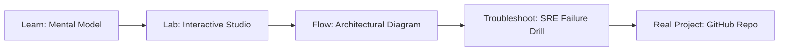

# GreenOps Studio

> **Production Learning Guide, Interactive Lab & Real-Time Incident Drills**

| Property | Value |
|---|---|
| **Domain** | `Incident Triage & Observability` |
| **Category** | `OBSERVABILITY` |
| **Skill Level** | `Level 2 (Scripting & Ops)` |
| **Target SRE Metric** | `65% Reduction in Monthly Token Spend & 84% Semantic Cache Hit Rate` |
| **Artifact Target** | `kepler_policy.yaml` |
| **Source Repository** | [Pradeeptalari14/tp-greenops](https://github.com/Pradeeptalari14/tp-greenops) |
| **Interactive Studio** | [Launch In-Browser Lab](./index.html) |

---

## 1. Overview & Architectural Mission

Generate Kepler telemetry rules, carbon-intensity scheduling crons, and cost/carbon-offset SRE runbooks.

### Core Production Use Case
Eliminating runaway cloud token expenditures and infrastructure carbon waste in high-volume GreenOps Studio deployments.



---

## 2. Best Architectural Treatment vs. Anti-Pattern

### Recommended Production Practice
> [!TIP]
> Deploy sub-5ms semantic vector caching to intercept repeated queries and route simple requests to efficient local SLMs before escalating to flagship LLMs.

### Dangerous Anti-Pattern to Avoid
> [!WARNING]
> Directing every trivial query to expensive external frontier APIs without local semantic caching or cost-aware model routing.

---

## 3. Real-Time SRE Incident Drill

**Target Failure Mode:**
python3 -m finops.cache_profiler --eval-corpus ./queries.json --similarity-cutoff 0.92 --calc-savings

### Drill Execution Checklist
1. **Baseline Telemetry:** Verify health metrics against the target SLO threshold before initiating changes.
2. **Failure Injection:** Introduce synthetic latency or simulated drift in a non-production staging boundary.
3. **Automated Alerting:** Validate that alerts trigger within `< 30s` via OpenTelemetry collector.
4. **Controlled Remediation:** Apply pre-reviewed, non-destructive configuration changes.
5. **Post-Mortem & Runbook Update:** Update the team runbook with observed failure patterns.

---

## 4. Production Configuration & Code Artifact (`kepler_policy.yaml`)

```yaml
# Production Manifest: GreenOps Studio
# Domain: Incident Triage & Observability
# Target Artifact: kepler_policy.yaml
# Target SRE Standard: 65% Reduction in Monthly Token Spend & 84% Semantic Cache Hit Rate
apiVersion: apps/v1
kind: Deployment
metadata:
  name: greenops-studio
  namespace: production
  labels:
    app.kubernetes.io/name: greenops-studio
    app.kubernetes.io/part-of: engineering-platform
    sre.slo/compliance: "65% Reduction in Monthly Token Spend & 84% Semantic Cache Hit Rate"
spec:
  replicas: 3
  strategy:
    type: RollingUpdate
    rollingUpdate:
      maxSurge: 1
      maxUnavailable: 0
  selector:
    matchLabels:
      app: greenops-studio
  template:
    metadata:
      labels:
        app: greenops-studio
    spec:
      containers:
        - name: core
          image: ghcr.io/pradeeptalari14/tp-greenops:v1.0.0
          imagePullPolicy: IfNotPresent
          resources:
            requests:
              cpu: "500m"
              memory: "1Gi"
            limits:
              cpu: "2000m"
              memory: "4Gi"
          readinessProbe:
            httpGet:
              path: /healthz
              port: 8080
            initialDelaySeconds: 5
            periodSeconds: 10
          livenessProbe:
            httpGet:
              path: /livez
              port: 8080
            initialDelaySeconds: 15
            periodSeconds: 20
```

---

## 5. Navigation & Next Steps

- **Interactive Simulator:** [Open GreenOps Studio Studio](./index.html)
- **Web Learning View:** [Interactive Guide](./learn.html)
- **GitHub Project Repository:** [Pradeeptalari14/tp-greenops](https://github.com/Pradeeptalari14/tp-greenops)
- **Master Studio Index:** [All 347 Studios](../../STUDIOS_CATALOGUE.md)

