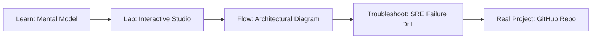

# HashiCorp Boundary Zero-Trust Access Studio

> **Production Learning Guide, Interactive Lab & Real-Time Incident Drills**

| Property | Value |
|---|---|
| **Domain** | `Cloud Infrastructure & K8s` |
| **Category** | `CLOUD` |
| **Skill Level** | `Level 2 (Scripting & Ops)` |
| **Target SRE Metric** | `P99 Query Latency < 12ms & Zero Schema Migration Downtime` |
| **Artifact Target** | `boundary-controller.hcl` |
| **Source Repository** | [Pradeeptalari14/tp-boundary-zerotrust](https://github.com/Pradeeptalari14/tp-boundary-zerotrust) |
| **Interactive Studio** | [Launch In-Browser Lab](./index.html) |

---

## 1. Overview & Architectural Mission

Deploy identity-based zero-trust remote access for EKS clusters and Aurora databases without SSH keys, open bastion ports, or legacy static VPN credentials.

### Core Production Use Case
Preventing connection pool exhaustion, slow unindexed queries, and schema migration locking in mission-critical HashiCorp Boundary Zero-Trust Access Studio databases.



---

## 2. Best Architectural Treatment vs. Anti-Pattern

### Recommended Production Practice
> [!TIP]
> Implement asynchronous connection pooling (PgBouncer/SQLAlchemy), automated zero-downtime Alembic migrations, and pgvector HNSW indexing.

### Dangerous Anti-Pattern to Avoid
> [!WARNING]
> Executing unindexed multi-table JOINs and synchronous blocking DDL alter commands during peak business traffic.

---

## 3. Real-Time SRE Incident Drill

**Target Failure Mode:**
alembic upgrade head && psql -U postgres -d studios_hub -c "EXPLAIN ANALYZE SELECT * FROM pgvector_store LIMIT 10;"

### Drill Execution Checklist
1. **Baseline Telemetry:** Verify health metrics against the target SLO threshold before initiating changes.
2. **Failure Injection:** Introduce synthetic latency or simulated drift in a non-production staging boundary.
3. **Automated Alerting:** Validate that alerts trigger within `< 30s` via OpenTelemetry collector.
4. **Controlled Remediation:** Apply pre-reviewed, non-destructive configuration changes.
5. **Post-Mortem & Runbook Update:** Update the team runbook with observed failure patterns.

---

## 4. Production Configuration & Code Artifact (`boundary-controller.hcl`)

```hcl
# Terraform / HCL Configuration: HashiCorp Boundary Zero-Trust Access Studio
# Domain: Cloud Infrastructure & K8s
# Target Artifact: boundary-controller.hcl

terraform {
  required_version = ">= 1.8.0"
  required_providers {
    aws = {
      source  = "hashicorp/aws"
      version = "~> 5.50"
    }
  }
}

locals {
  service_name = "hashicorp-boundary-zero-trust-access-studio"
  sre_standard = "P99 Query Latency < 12ms & Zero Schema Migration Downtime"
}

resource "aws_service_mesh" "core" {
  name = local.service_name
  tags = {
    Environment = "production"
    ManagedBy   = "Terraform"
    SRE_Metric  = local.sre_standard
  }
}
```

---

## 5. Navigation & Next Steps

- **Interactive Simulator:** [Open HashiCorp Boundary Zero-Trust Access Studio Studio](./index.html)
- **Web Learning View:** [Interactive Guide](./learn.html)
- **GitHub Project Repository:** [Pradeeptalari14/tp-boundary-zerotrust](https://github.com/Pradeeptalari14/tp-boundary-zerotrust)
- **Master Studio Index:** [All 347 Studios](../../STUDIOS_CATALOGUE.md)

