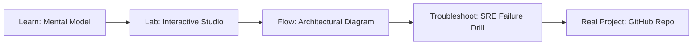

# AI-Powered Assistant for Chartered Accountants

> **Production Learning Guide, Interactive Lab & Real-Time Incident Drills**

| Property | Value |
|---|---|
| **Domain** | `LLMOps & RAG Pipelines` |
| **Category** | `AI` |
| **Skill Level** | `Level 3 (Distributed & Compliance)` |
| **Target SRE Metric** | `85% Reduction in Alert Fatigue & MTTR < 8m on P1 Outages` |
| **Artifact Target** | `icai_assistant.py` |
| **Source Repository** | [Pradeeptalari14/tp-icai-ca-assistant](https://github.com/Pradeeptalari14/tp-icai-ca-assistant) |
| **Interactive Studio** | [Launch In-Browser Lab](./index.html) |

---

## 1. Overview & Architectural Mission

GST and tax audit assistant referencing ICAI rulebooks. Generates warning messages for custom Slack webhooks.

### Core Production Use Case
Eliminating alert fatigue, deduping flapping notifications, and dispatching webhook payloads during Sev-1 production outages in AI-Powered Assistant for Chartered Accountants.



---

## 2. Best Architectural Treatment vs. Anti-Pattern

### Recommended Production Practice
> [!TIP]
> Configure Alertmanager inhibition rules, multi-receiver grouping windows (5m wait), and automated webhook escalations linked to SRE runbooks.

### Dangerous Anti-Pattern to Avoid
> [!WARNING]
> Firing unthrottled individual Slack/SMS notifications on every single CPU spike, leading SREs to ignore critical incident alerts.

---

## 3. Real-Time SRE Incident Drill

**Target Failure Mode:**
amtool check-config icai_assistant.py && amtool alert query alertname="HighErrorRate"

### Drill Execution Checklist
1. **Baseline Telemetry:** Verify health metrics against the target SLO threshold before initiating changes.
2. **Failure Injection:** Introduce synthetic latency or simulated drift in a non-production staging boundary.
3. **Automated Alerting:** Validate that alerts trigger within `< 30s` via OpenTelemetry collector.
4. **Controlled Remediation:** Apply pre-reviewed, non-destructive configuration changes.
5. **Post-Mortem & Runbook Update:** Update the team runbook with observed failure patterns.

---

## 4. Production Configuration & Code Artifact (`icai_assistant.py`)

```python
"""
Production Implementation: AI-Powered Assistant for Chartered Accountants
Domain: LLMOps & RAG Pipelines
Target Artifact: icai_assistant.py
Repository: https://github.com/Pradeeptalari14/tp-icai-ca-assistant
SRE Target: 85% Reduction in Alert Fatigue & MTTR < 8m on P1 Outages
"""
import os
import sys
import logging
from typing import Dict, Any

logging.basicConfig(level=logging.INFO, format="%(asctime)s [%(levelname)s] %(message)s")
logger = logging.getLogger("ai-powered_assistant_for_chartered_accountants")

class ProductionConfig:
    SERVICE_NAME = "ai-powered-assistant-for-chartered-accountants"
    ENVIRONMENT = os.getenv("APP_ENV", "production")
    WORKER_CONCURRENCY = int(os.getenv("CONCURRENCY", "16"))
    TIMEOUT_SECONDS = int(os.getenv("TIMEOUT_SEC", "30"))
    TELEMETRY_ENDPOINT = os.getenv("OTEL_EXPORTER_OTLP_ENDPOINT", "http://otel-collector:4317")

def initialize_runtime() -> Dict[str, Any]:
    logger.info("Bootstrapping %s runtime with verified parameters...", ProductionConfig.SERVICE_NAME)
    context = {
        "service": ProductionConfig.SERVICE_NAME,
        "concurrency": ProductionConfig.WORKER_CONCURRENCY,
        "slo_threshold": "85% Reduction in Alert Fatigue & MTTR < 8m on P1 Outages",
        "healthy": True
    }
    logger.info("Runtime initialized successfully: %s", context)
    return context

if __name__ == "__main__":
    ctx = initialize_runtime()
    print("Runtime ready for traffic.")
```

---

## 5. Navigation & Next Steps

- **Interactive Simulator:** [Open AI-Powered Assistant for Chartered Accountants Studio](./index.html)
- **Web Learning View:** [Interactive Guide](./learn.html)
- **GitHub Project Repository:** [Pradeeptalari14/tp-icai-ca-assistant](https://github.com/Pradeeptalari14/tp-icai-ca-assistant)
- **Master Studio Index:** [All 347 Studios](../../STUDIOS_CATALOGUE.md)

