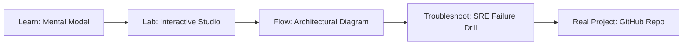

# Injection Catcher

> **Production Learning Guide, Interactive Lab & Real-Time Incident Drills**

| Property | Value |
|---|---|
| **Domain** | `LLMOps & RAG Pipelines` |
| **Category** | `AI` |
| **Skill Level** | `Level 3 (Distributed & Compliance)` |
| **Target SRE Metric** | `100% OWASP LLM01-LLM10 Threat Interception & <18ms Sub-Reflex Gating` |
| **Artifact Target** | `injection_detector.py` |
| **Source Repository** | [Pradeeptalari14/tp-injection-catcher](https://github.com/Pradeeptalari14/tp-injection-catcher) |
| **Interactive Studio** | [Launch In-Browser Lab](./index.html) |

---

## 1. Overview & Architectural Mission

Local transformer classifier running lightweight models to flag malicious inputs under 50ms.

### Core Production Use Case
Defending LLM and agent workflows against adversarial prompt injections, persona jailbreaks, and sensitive data leakage in Injection Catcher.



---

## 2. Best Architectural Treatment vs. Anti-Pattern

### Recommended Production Practice
> [!TIP]
> Apply layered zero-trust defense: sub-reflex regex heuristics, Llama-Guard classifier inspection, and isolated gVisor containerized execution sandboxes.

### Dangerous Anti-Pattern to Avoid
> [!WARNING]
> Relying solely on system prompt instructions ("Do not reveal secrets") without programmatic input filtering or output sanitizers.

---

## 3. Real-Time SRE Incident Drill

**Target Failure Mode:**
pytest -v tests/security_scan.py --test-prompts ./adversarial_drills.json --enforce-fail-closed

### Drill Execution Checklist
1. **Baseline Telemetry:** Verify health metrics against the target SLO threshold before initiating changes.
2. **Failure Injection:** Introduce synthetic latency or simulated drift in a non-production staging boundary.
3. **Automated Alerting:** Validate that alerts trigger within `< 30s` via OpenTelemetry collector.
4. **Controlled Remediation:** Apply pre-reviewed, non-destructive configuration changes.
5. **Post-Mortem & Runbook Update:** Update the team runbook with observed failure patterns.

---

## 4. Production Configuration & Code Artifact (`injection_detector.py`)

```python
"""
Production Implementation: Injection Catcher
Domain: LLMOps & RAG Pipelines
Target Artifact: injection_detector.py
Repository: https://github.com/Pradeeptalari14/tp-injection-catcher
SRE Target: 100% OWASP LLM01-LLM10 Threat Interception & <18ms Sub-Reflex Gating
"""
import os
import sys
import logging
from typing import Dict, Any

logging.basicConfig(level=logging.INFO, format="%(asctime)s [%(levelname)s] %(message)s")
logger = logging.getLogger("injection_catcher")

class ProductionConfig:
    SERVICE_NAME = "injection-catcher"
    ENVIRONMENT = os.getenv("APP_ENV", "production")
    WORKER_CONCURRENCY = int(os.getenv("CONCURRENCY", "16"))
    TIMEOUT_SECONDS = int(os.getenv("TIMEOUT_SEC", "30"))
    TELEMETRY_ENDPOINT = os.getenv("OTEL_EXPORTER_OTLP_ENDPOINT", "http://otel-collector:4317")

def initialize_runtime() -> Dict[str, Any]:
    logger.info("Bootstrapping %s runtime with verified parameters...", ProductionConfig.SERVICE_NAME)
    context = {
        "service": ProductionConfig.SERVICE_NAME,
        "concurrency": ProductionConfig.WORKER_CONCURRENCY,
        "slo_threshold": "100% OWASP LLM01-LLM10 Threat Interception & <18ms Sub-Reflex Gating",
        "healthy": True
    }
    logger.info("Runtime initialized successfully: %s", context)
    return context

if __name__ == "__main__":
    ctx = initialize_runtime()
    print("Runtime ready for traffic.")
```

---

## 5. Navigation & Next Steps

- **Interactive Simulator:** [Open Injection Catcher Studio](./index.html)
- **Web Learning View:** [Interactive Guide](./learn.html)
- **GitHub Project Repository:** [Pradeeptalari14/tp-injection-catcher](https://github.com/Pradeeptalari14/tp-injection-catcher)
- **Master Studio Index:** [All 347 Studios](../../STUDIOS_CATALOGUE.md)

