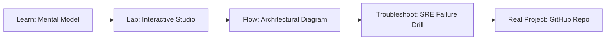

# TypeSafe Jev: System 1 AI Studio

> **Production Learning Guide, Interactive Lab & Real-Time Incident Drills**

| Property | Value |
|---|---|
| **Domain** | `LLMOps & RAG Pipelines` |
| **Category** | `AI` |
| **Skill Level** | `Level 3 (Distributed & Compliance)` |
| **Target SRE Metric** | `<42ms Decision Latency & 78% Reduction in System 2 Flagship Invocations` |
| **Artifact Target** | `jev_engine.py` |
| **Source Repository** | [Pradeeptalari14/tp-typesafe-jev](https://github.com/Pradeeptalari14/tp-typesafe-jev) |
| **Interactive Studio** | [Launch In-Browser Lab](./index.html) |

---

## 1. Overview & Architectural Mission

Orchestrate TypeSafe AI's Jev System 1 model. Configure non-autoregressive sub-100ms reflex routing, calibrated decision thresholds (RLCD), schema-constrained Pydantic triage, and System 2 LLM escalation fallbacks.

### Core Production Use Case
Eliminating costly, sluggish multi-second LLM calls for predictable classification, routing, and schema validation tasks in TypeSafe Jev: System 1 AI Studio.



---

## 2. Best Architectural Treatment vs. Anti-Pattern

### Recommended Production Practice
> [!TIP]
> Deploy non-autoregressive System 1 sub-50ms reflex encoders with calibrated confidence thresholds, escalating to System 2 LLMs only on high ambiguity.

### Dangerous Anti-Pattern to Avoid
> [!WARNING]
> Sending every single high-volume routing or entity extraction request to massive autoregressive models, causing severe queue latency.

---

## 3. Real-Time SRE Incident Drill

**Target Failure Mode:**
python3 -m jev.reflex_engine --input "Production restart required on pod 4" --confidence-threshold 0.85

### Drill Execution Checklist
1. **Baseline Telemetry:** Verify health metrics against the target SLO threshold before initiating changes.
2. **Failure Injection:** Introduce synthetic latency or simulated drift in a non-production staging boundary.
3. **Automated Alerting:** Validate that alerts trigger within `< 30s` via OpenTelemetry collector.
4. **Controlled Remediation:** Apply pre-reviewed, non-destructive configuration changes.
5. **Post-Mortem & Runbook Update:** Update the team runbook with observed failure patterns.

---

## 4. Production Configuration & Code Artifact (`jev_engine.py`)

```python
"""
Production Implementation: TypeSafe Jev: System 1 AI Studio
Domain: LLMOps & RAG Pipelines
Target Artifact: jev_engine.py
Repository: https://github.com/Pradeeptalari14/tp-typesafe-jev
SRE Target: <42ms Decision Latency & 78% Reduction in System 2 Flagship Invocations
"""
import os
import sys
import logging
from typing import Dict, Any

logging.basicConfig(level=logging.INFO, format="%(asctime)s [%(levelname)s] %(message)s")
logger = logging.getLogger("typesafe_jev:_system_1_ai_studio")

class ProductionConfig:
    SERVICE_NAME = "typesafe-jev:-system-1-ai-studio"
    ENVIRONMENT = os.getenv("APP_ENV", "production")
    WORKER_CONCURRENCY = int(os.getenv("CONCURRENCY", "16"))
    TIMEOUT_SECONDS = int(os.getenv("TIMEOUT_SEC", "30"))
    TELEMETRY_ENDPOINT = os.getenv("OTEL_EXPORTER_OTLP_ENDPOINT", "http://otel-collector:4317")

def initialize_runtime() -> Dict[str, Any]:
    logger.info("Bootstrapping %s runtime with verified parameters...", ProductionConfig.SERVICE_NAME)
    context = {
        "service": ProductionConfig.SERVICE_NAME,
        "concurrency": ProductionConfig.WORKER_CONCURRENCY,
        "slo_threshold": "<42ms Decision Latency & 78% Reduction in System 2 Flagship Invocations",
        "healthy": True
    }
    logger.info("Runtime initialized successfully: %s", context)
    return context

if __name__ == "__main__":
    ctx = initialize_runtime()
    print("Runtime ready for traffic.")
```

---

## 5. Navigation & Next Steps

- **Interactive Simulator:** [Open TypeSafe Jev: System 1 AI Studio Studio](./index.html)
- **Web Learning View:** [Interactive Guide](./learn.html)
- **GitHub Project Repository:** [Pradeeptalari14/tp-typesafe-jev](https://github.com/Pradeeptalari14/tp-typesafe-jev)
- **Master Studio Index:** [All 347 Studios](../../STUDIOS_CATALOGUE.md)

