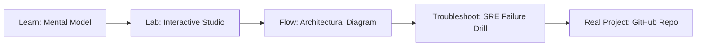

# Moonshot Kimi K1.5 2M Ultra-Long Context Studio

> **Production Learning Guide, Interactive Lab & Real-Time Incident Drills**

| Property | Value |
|---|---|
| **Domain** | `FinOps & Cost Optimization` |
| **Category** | `AI` |
| **Skill Level** | `Level 2 (Scripting & Ops)` |
| **Target SRE Metric** | `4.5x Prefix Prefill Throughput & 88% KV-Cache Hit Ratio` |
| **Artifact Target** | `kimi_long_context_engine.py` |
| **Source Repository** | [Pradeeptalari14/tp-kimi-long-context](https://github.com/Pradeeptalari14/tp-kimi-long-context) |
| **Interactive Studio** | [Launch In-Browser Lab](./index.html) |

---

## 1. Overview & Architectural Mission

Deploy Moonshot Kimi K1.5 2-Million token ultra-long context reasoning engine with hierarchical NVMe KV-cache offload, radix prefix caching, and 100% NIAH accuracy.

### Core Production Use Case
Multi-turn agent swarms and repetitive chain-of-thought workflows where system prompts and tools definitions are repeated across thousands of consecutive LLM calls.



---

## 2. Best Architectural Treatment vs. Anti-Pattern

### Recommended Production Practice
> [!TIP]
> Maintain a Radix Tree KV-cache index across requests, allowing automatic prefix matching, instant KV reuse, and zero recomputation of static prompt prefixes.

### Dangerous Anti-Pattern to Avoid
> [!WARNING]
> Re-tokenizing and running full transformer prefill passes on the exact same 3,000-token system prompt across every single agent step.

---

## 3. Real-Time SRE Incident Drill

**Target Failure Mode:**
python3 -m sglang.launch_server --model-path meta-llama/Llama-3-8B-Instruct --port 30000 --enable-cache-report

### Drill Execution Checklist
1. **Baseline Telemetry:** Verify health metrics against the target SLO threshold before initiating changes.
2. **Failure Injection:** Introduce synthetic latency or simulated drift in a non-production staging boundary.
3. **Automated Alerting:** Validate that alerts trigger within `< 30s` via OpenTelemetry collector.
4. **Controlled Remediation:** Apply pre-reviewed, non-destructive configuration changes.
5. **Post-Mortem & Runbook Update:** Update the team runbook with observed failure patterns.

---

## 4. Production Configuration & Code Artifact (`kimi_long_context_engine.py`)

```python
"""
Production Implementation: Moonshot Kimi K1.5 2M Ultra-Long Context Studio
Domain: FinOps & Cost Optimization
Target Artifact: kimi_long_context_engine.py
Repository: https://github.com/Pradeeptalari14/tp-kimi-long-context
SRE Target: 4.5x Prefix Prefill Throughput & 88% KV-Cache Hit Ratio
"""
import os
import sys
import logging
from typing import Dict, Any

logging.basicConfig(level=logging.INFO, format="%(asctime)s [%(levelname)s] %(message)s")
logger = logging.getLogger("moonshot_kimi_k1.5_2m_ultra-long_context_studio")

class ProductionConfig:
    SERVICE_NAME = "moonshot-kimi-k1.5-2m-ultra-long-context-studio"
    ENVIRONMENT = os.getenv("APP_ENV", "production")
    WORKER_CONCURRENCY = int(os.getenv("CONCURRENCY", "16"))
    TIMEOUT_SECONDS = int(os.getenv("TIMEOUT_SEC", "30"))
    TELEMETRY_ENDPOINT = os.getenv("OTEL_EXPORTER_OTLP_ENDPOINT", "http://otel-collector:4317")

def initialize_runtime() -> Dict[str, Any]:
    logger.info("Bootstrapping %s runtime with verified parameters...", ProductionConfig.SERVICE_NAME)
    context = {
        "service": ProductionConfig.SERVICE_NAME,
        "concurrency": ProductionConfig.WORKER_CONCURRENCY,
        "slo_threshold": "4.5x Prefix Prefill Throughput & 88% KV-Cache Hit Ratio",
        "healthy": True
    }
    logger.info("Runtime initialized successfully: %s", context)
    return context

if __name__ == "__main__":
    ctx = initialize_runtime()
    print("Runtime ready for traffic.")
```

---

## 5. Navigation & Next Steps

- **Interactive Simulator:** [Open Moonshot Kimi K1.5 2M Ultra-Long Context Studio Studio](./index.html)
- **Web Learning View:** [Interactive Guide](./learn.html)
- **GitHub Project Repository:** [Pradeeptalari14/tp-kimi-long-context](https://github.com/Pradeeptalari14/tp-kimi-long-context)
- **Master Studio Index:** [All 347 Studios](../../STUDIOS_CATALOGUE.md)

