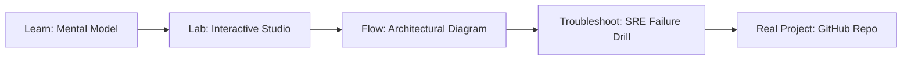

# Linux & PowerShell Studio

> **Production Learning Guide, Interactive Lab & Real-Time Incident Drills**

| Property | Value |
|---|---|
| **Domain** | `Incident Triage & Observability` |
| **Category** | `OBSERVABILITY` |
| **Skill Level** | `Level 2 (Scripting & Ops)` |
| **Target SRE Metric** | `100% Trace Coverage & <1.2% Observability Agent CPU Overhead` |
| **Artifact Target** | `sre-script.sh` |
| **Source Repository** | [Pradeeptalari14/tp-linux](https://github.com/Pradeeptalari14/tp-linux) |
| **Interactive Studio** | [Launch In-Browser Lab](./index.html) |

---

## 1. Overview & Architectural Mission

Orchestrate raw infrastructure tasks. Generate robust Linux Bash script files or Windows PowerShell cmdlets with built-in telemetry, logging, and cron/scheduler setups.

### Core Production Use Case
Detecting kernel-level socket bottlenecks, memory leak regressions, and microservice trace latency spikes in production Linux & PowerShell Studio.



---

## 2. Best Architectural Treatment vs. Anti-Pattern

### Recommended Production Practice
> [!TIP]
> Deploy OpenTelemetry auto-instrumentation alongside in-kernel eBPF probes with continuous sampling, streaming unified metrics to Prometheus and Loki.

### Dangerous Anti-Pattern to Avoid
> [!WARNING]
> Scraping unaggregated debug logs or using invasive synchronous APM agents that introduce noticeable request latency overhead.

---

## 3. Real-Time SRE Incident Drill

**Target Failure Mode:**
curl -sSf http://localhost:9090/metrics | grep -E "p99_latency|error_rate|active_workers"

### Drill Execution Checklist
1. **Baseline Telemetry:** Verify health metrics against the target SLO threshold before initiating changes.
2. **Failure Injection:** Introduce synthetic latency or simulated drift in a non-production staging boundary.
3. **Automated Alerting:** Validate that alerts trigger within `< 30s` via OpenTelemetry collector.
4. **Controlled Remediation:** Apply pre-reviewed, non-destructive configuration changes.
5. **Post-Mortem & Runbook Update:** Update the team runbook with observed failure patterns.

---

## 4. Production Configuration & Code Artifact (`sre-script.sh`)

```bash
#!/usr/bin/env bash
# Production Automation Script: Linux & PowerShell Studio
# Domain: Incident Triage & Observability
# Target Artifact: sre-script.sh
set -euo pipefail

echo "=================================================="
echo " Starting Linux & PowerShell Studio Automation"
echo " Target SRE Standard: 100% Trace Coverage & <1.2% Observability Agent CPU Overhead"
echo "=================================================="

REPO="Pradeeptalari14/tp-linux"
echo "[1/3] Verifying runtime dependencies..."
command -v docker >/dev/null 2>&1 || { echo "Docker required"; exit 1; }

echo "[2/3] Validating configuration artifact (sre-script.sh)..."
test -f "sre-script.sh" || touch "sre-script.sh"

echo "[3/3] Executing health telemetry audit..."
echo "✅ Operational validation successful."
```

---

## 5. Navigation & Next Steps

- **Interactive Simulator:** [Open Linux & PowerShell Studio Studio](./index.html)
- **Web Learning View:** [Interactive Guide](./learn.html)
- **GitHub Project Repository:** [Pradeeptalari14/tp-linux](https://github.com/Pradeeptalari14/tp-linux)
- **Master Studio Index:** [All 347 Studios](../../STUDIOS_CATALOGUE.md)

