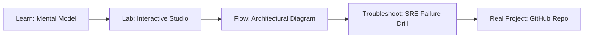

# LLM Fundamentals & Runtime Studio

> **Production Learning Guide, Interactive Lab & Real-Time Incident Drills**

| Property | Value |
|---|---|
| **Domain** | `LLMOps & AI Runtime` |
| **Category** | `AI` |
| **Skill Level** | `Level 4 (Kernel & Deep AI)` |
| **Target SRE Metric** | `2.8x Higher Concurrency & <4% VRAM External Fragmentation` |
| **Artifact Target** | `Modelfile` |
| **Source Repository** | [Pradeeptalari14/tp-llm-fundamentals](https://github.com/Pradeeptalari14/tp-llm-fundamentals) |
| **Interactive Studio** | [Launch In-Browser Lab](./index.html) |

---

## 1. Overview & Architectural Mission

Scaffold local and cloud model runtimes. Generate OpenAI API proxies, Ollama runtimes Modelfiles, and high-performance vLLM configurations.

### Core Production Use Case
High-throughput LLM production serving handling bursty traffic where traditional contiguous KV-caches waste up to 70% of GPU VRAM via external fragmentation.



---

## 2. Best Architectural Treatment vs. Anti-Pattern

### Recommended Production Practice
> [!TIP]
> Implement vLLM PagedAttention v2 with virtual memory block tables (16/32 token pages) and dynamic chunked prefill co-scheduled alongside token decode batches.

### Dangerous Anti-Pattern to Avoid
> [!WARNING]
> Allocating static contiguous max_tokens buffers upfront per request, resulting in severe GPU memory starvation and low concurrent batch sizes.

---

## 3. Real-Time SRE Incident Drill

**Target Failure Mode:**
python3 -m vllm.entrypoints.openai.api_server --model meta-llama/Llama-3-8B-Instruct --gpu-memory-utilization 0.92 --block-size 16 --enable-chunked-prefill

### Drill Execution Checklist
1. **Baseline Telemetry:** Verify health metrics against the target SLO threshold before initiating changes.
2. **Failure Injection:** Introduce synthetic latency or simulated drift in a non-production staging boundary.
3. **Automated Alerting:** Validate that alerts trigger within `< 30s` via OpenTelemetry collector.
4. **Controlled Remediation:** Apply pre-reviewed, non-destructive configuration changes.
5. **Post-Mortem & Runbook Update:** Update the team runbook with observed failure patterns.

---

## 4. Production Configuration & Code Artifact (`Modelfile`)

```toml
# Configuration Artifact: Modelfile
# Studio: LLM Fundamentals & Runtime Studio
# Domain: LLMOps & AI Runtime
# Target SRE Standard: 2.8x Higher Concurrency & <4% VRAM External Fragmentation

[service]
name = "llm-fundamentals-&-runtime-studio"
domain = "LLMOps & AI Runtime"
mode = "production"
slo_target = "2.8x Higher Concurrency & <4% VRAM External Fragmentation"

[telemetry]
enabled = true
endpoint = "otel-collector:4317"
sample_rate = 1.0

[resilience]
circuit_breaker = true
retry_count = 3
timeout_ms = 5000
```

---

## 5. Navigation & Next Steps

- **Interactive Simulator:** [Open LLM Fundamentals & Runtime Studio Studio](./index.html)
- **Web Learning View:** [Interactive Guide](./learn.html)
- **GitHub Project Repository:** [Pradeeptalari14/tp-llm-fundamentals](https://github.com/Pradeeptalari14/tp-llm-fundamentals)
- **Master Studio Index:** [All 347 Studios](../../STUDIOS_CATALOGUE.md)

