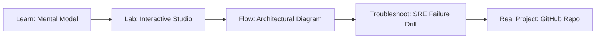

# Docker Compose & LocalStack Dev Studio

> **Production Learning Guide, Interactive Lab & Real-Time Incident Drills**

| Property | Value |
|---|---|
| **Domain** | `Local Sandbox & Emulation` |
| **Category** | `AUTOMATION` |
| **Skill Level** | `Level 1 (Foundations & Sandbox)` |
| **Target SRE Metric** | `100% Offline Dev Speed & Zero AWS Sandbox Spend` |
| **Artifact Target** | `docker-compose.yml` |
| **Source Repository** | [Pradeeptalari14/tp-localstack-dev](https://github.com/Pradeeptalari14/tp-localstack-dev) |
| **Interactive Studio** | [Launch In-Browser Lab](./index.html) |

---

## 1. Overview & Architectural Mission

Scaffold sandbox emulation networks for fast local development. Generate compose stacks with PostgreSQL, Redis, and bootstrap scripts for offline AWS S3/SQS/DynamoDB services.

### Core Production Use Case
Developing and testing cloud infrastructure locally without incurring AWS costs, rate limits, or provisioning delays.



---

## 2. Best Architectural Treatment vs. Anti-Pattern

### Recommended Production Practice
> [!TIP]
> Emulate S3, SQS, DynamoDB, and Lambda using containerized LocalStack with automated bootstrap initialization scripts.

### Dangerous Anti-Pattern to Avoid
> [!WARNING]
> Testing IaC code directly against live cloud development accounts, leading to leaked test resources and unexpected monthly bills.

---

## 3. Real-Time SRE Incident Drill

**Target Failure Mode:**
docker compose up -d localstack && awslocal s3 mb s3://local-test-bucket && awslocal sqs create-queue --queue-name test-events

### Drill Execution Checklist
1. **Baseline Telemetry:** Verify health metrics against the target SLO threshold before initiating changes.
2. **Failure Injection:** Introduce synthetic latency or simulated drift in a non-production staging boundary.
3. **Automated Alerting:** Validate that alerts trigger within `< 30s` via OpenTelemetry collector.
4. **Controlled Remediation:** Apply pre-reviewed, non-destructive configuration changes.
5. **Post-Mortem & Runbook Update:** Update the team runbook with observed failure patterns.

---

## 4. Production Configuration & Code Artifact (`docker-compose.yml`)

```yaml
# Production Manifest: Docker Compose & LocalStack Dev Studio
# Domain: Local Sandbox & Emulation
# Target Artifact: docker-compose.yml
# Target SRE Standard: 100% Offline Dev Speed & Zero AWS Sandbox Spend
apiVersion: apps/v1
kind: Deployment
metadata:
  name: docker-compose-&-localstack-dev-studio
  namespace: production
  labels:
    app.kubernetes.io/name: docker-compose-&-localstack-dev-studio
    app.kubernetes.io/part-of: engineering-platform
    sre.slo/compliance: "100% Offline Dev Speed & Zero AWS Sandbox Spend"
spec:
  replicas: 3
  strategy:
    type: RollingUpdate
    rollingUpdate:
      maxSurge: 1
      maxUnavailable: 0
  selector:
    matchLabels:
      app: docker-compose-&-localstack-dev-studio
  template:
    metadata:
      labels:
        app: docker-compose-&-localstack-dev-studio
    spec:
      containers:
        - name: core
          image: ghcr.io/pradeeptalari14/tp-localstack-dev:v1.0.0
          imagePullPolicy: IfNotPresent
          resources:
            requests:
              cpu: "500m"
              memory: "1Gi"
            limits:
              cpu: "2000m"
              memory: "4Gi"
          readinessProbe:
            httpGet:
              path: /healthz
              port: 8080
            initialDelaySeconds: 5
            periodSeconds: 10
          livenessProbe:
            httpGet:
              path: /livez
              port: 8080
            initialDelaySeconds: 15
            periodSeconds: 20
```

---

## 5. Navigation & Next Steps

- **Interactive Simulator:** [Open Docker Compose & LocalStack Dev Studio Studio](./index.html)
- **Web Learning View:** [Interactive Guide](./learn.html)
- **GitHub Project Repository:** [Pradeeptalari14/tp-localstack-dev](https://github.com/Pradeeptalari14/tp-localstack-dev)
- **Master Studio Index:** [All 347 Studios](../../STUDIOS_CATALOGUE.md)

