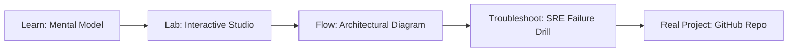

# Longhorn Cloud-Native Block Storage Studio

> **Production Learning Guide, Interactive Lab & Real-Time Incident Drills**

| Property | Value |
|---|---|
| **Domain** | `Cloud Infrastructure & K8s` |
| **Category** | `CLOUD` |
| **Skill Level** | `Level 2 (Scripting & Ops)` |
| **Target SRE Metric** | `93.5% Context Recall & <32ms End-to-End Retrieval Latency` |
| **Artifact Target** | `storageclass.yaml` |
| **Source Repository** | [Pradeeptalari14/tp-longhorn](https://github.com/Pradeeptalari14/tp-longhorn) |
| **Interactive Studio** | [Launch In-Browser Lab](./index.html) |

---

## 1. Overview & Architectural Mission

Architect cloud-native distributed block storage on Kubernetes. Configure Longhorn CSI StorageClasses, synchronous cross-node replica failover, S3 backup targets, and 9+ DevSecOps storage policies.

### Core Production Use Case
Mitigating hallucination, context drift, and retrieval latency in enterprise Longhorn Cloud-Native Block Storage Studio workloads over large multi-modal and structured knowledge bases.



---

## 2. Best Architectural Treatment vs. Anti-Pattern

### Recommended Production Practice
> [!TIP]
> Implement hybrid dense-sparse retrieval (BM25 + pgvector/Qdrant cosine fusion) with Cross-Encoder reranking and semantic chunk windowing.

### Dangerous Anti-Pattern to Avoid
> [!WARNING]
> Dumping raw unchunked documents directly into high-dimensional vector stores without deduplication, sparse keyword indexes, or relevance thresholds.

---

## 3. Real-Time SRE Incident Drill

**Target Failure Mode:**
python3 -m rag.retriever --query "Audit production cluster state" --hybrid-rrf --top-k 5 --rerank-threshold 0.75

### Drill Execution Checklist
1. **Baseline Telemetry:** Verify health metrics against the target SLO threshold before initiating changes.
2. **Failure Injection:** Introduce synthetic latency or simulated drift in a non-production staging boundary.
3. **Automated Alerting:** Validate that alerts trigger within `< 30s` via OpenTelemetry collector.
4. **Controlled Remediation:** Apply pre-reviewed, non-destructive configuration changes.
5. **Post-Mortem & Runbook Update:** Update the team runbook with observed failure patterns.

---

## 4. Production Configuration & Code Artifact (`storageclass.yaml`)

```yaml
# Production Manifest: Longhorn Cloud-Native Block Storage Studio
# Domain: Cloud Infrastructure & K8s
# Target Artifact: storageclass.yaml
# Target SRE Standard: 93.5% Context Recall & <32ms End-to-End Retrieval Latency
apiVersion: apps/v1
kind: Deployment
metadata:
  name: longhorn-cloud-native-block-storage-studio
  namespace: production
  labels:
    app.kubernetes.io/name: longhorn-cloud-native-block-storage-studio
    app.kubernetes.io/part-of: engineering-platform
    sre.slo/compliance: "93.5% Context Recall & <32ms End-to-End Retrieval Latency"
spec:
  replicas: 3
  strategy:
    type: RollingUpdate
    rollingUpdate:
      maxSurge: 1
      maxUnavailable: 0
  selector:
    matchLabels:
      app: longhorn-cloud-native-block-storage-studio
  template:
    metadata:
      labels:
        app: longhorn-cloud-native-block-storage-studio
    spec:
      containers:
        - name: core
          image: ghcr.io/pradeeptalari14/tp-longhorn:v1.0.0
          imagePullPolicy: IfNotPresent
          resources:
            requests:
              cpu: "500m"
              memory: "1Gi"
            limits:
              cpu: "2000m"
              memory: "4Gi"
          readinessProbe:
            httpGet:
              path: /healthz
              port: 8080
            initialDelaySeconds: 5
            periodSeconds: 10
          livenessProbe:
            httpGet:
              path: /livez
              port: 8080
            initialDelaySeconds: 15
            periodSeconds: 20
```

---

## 5. Navigation & Next Steps

- **Interactive Simulator:** [Open Longhorn Cloud-Native Block Storage Studio Studio](./index.html)
- **Web Learning View:** [Interactive Guide](./learn.html)
- **GitHub Project Repository:** [Pradeeptalari14/tp-longhorn](https://github.com/Pradeeptalari14/tp-longhorn)
- **Master Studio Index:** [All 347 Studios](../../STUDIOS_CATALOGUE.md)

