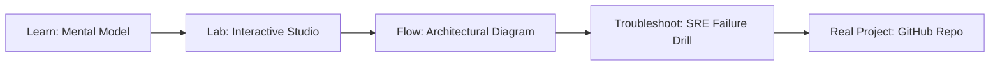

# MCP & Tool Integration Studio

> **Production Learning Guide, Interactive Lab & Real-Time Incident Drills**

| Property | Value |
|---|---|
| **Domain** | `LLMOps & RAG Pipelines` |
| **Category** | `AI` |
| **Skill Level** | `Level 3 (Distributed & Compliance)` |
| **Target SRE Metric** | `100% RBAC Policy Enforcement & <2.1ms Schema Cache Latency` |
| **Artifact Target** | `mcp_tools.json` |
| **Source Repository** | [Pradeeptalari14/tp-mcp-integration](https://github.com/Pradeeptalari14/tp-mcp-integration) |
| **Interactive Studio** | [Launch In-Browser Lab](./index.html) |

---

## 1. Overview & Architectural Mission

Scaffold Model Context Protocol (MCP) ecosystems. Expose custom tools, configure resource routers, and write secure execution handlers.

### Core Production Use Case
Governing heterogeneous multi-agent workflows (Claude, LangGraph, AutoGen) consuming internal microservice tools via Anthropic Model Context Protocol (MCP).



---

## 2. Best Architectural Treatment vs. Anti-Pattern

### Recommended Production Practice
> [!TIP]
> Implement a centralized JSON-RPC 2.0 gateway with dynamic schema discovery, token-bucket rate limiting, and zero-trust RBAC role evaluation per tool invocation.

### Dangerous Anti-Pattern to Avoid
> [!WARNING]
> Granting autonomous agents direct unrestricted database credentials or shell access without an intermediary schema-enforcing proxy.

---

## 3. Real-Time SRE Incident Drill

**Target Failure Mode:**
curl -X POST http://localhost:8080/mcp/v1/tools/call -H "Authorization: Bearer sops_key" -d '{"tool":"k8s_drain_node","params":{"node":"worker-9"}}'

### Drill Execution Checklist
1. **Baseline Telemetry:** Verify health metrics against the target SLO threshold before initiating changes.
2. **Failure Injection:** Introduce synthetic latency or simulated drift in a non-production staging boundary.
3. **Automated Alerting:** Validate that alerts trigger within `< 30s` via OpenTelemetry collector.
4. **Controlled Remediation:** Apply pre-reviewed, non-destructive configuration changes.
5. **Post-Mortem & Runbook Update:** Update the team runbook with observed failure patterns.

---

## 4. Production Configuration & Code Artifact (`mcp_tools.json`)

```json
{
  "$schema": "https://json-schema.org/draft/2020-12/schema",
  "studio": "mcp-&-tool-integration-studio",
  "domain": "LLMOps & RAG Pipelines",
  "targetArtifact": "mcp_tools.json",
  "sreMetric": "100% RBAC Policy Enforcement & <2.1ms Schema Cache Latency",
  "repository": "Pradeeptalari14/tp-mcp-integration",
  "service": {
    "name": "mcp-&-tool-integration-studio",
    "mode": "production",
    "version": "1.0.0",
    "resilience": {
      "circuitBreaker": true,
      "maxRetries": 3,
      "timeoutMs": 5000
    },
    "telemetry": {
      "enabled": true,
      "endpoint": "otel-collector:4317",
      "sampleRate": 1.0
    }
  }
}
```

---

## 5. Navigation & Next Steps

- **Interactive Simulator:** [Open MCP & Tool Integration Studio Studio](./index.html)
- **Web Learning View:** [Interactive Guide](./learn.html)
- **GitHub Project Repository:** [Pradeeptalari14/tp-mcp-integration](https://github.com/Pradeeptalari14/tp-mcp-integration)
- **Master Studio Index:** [All 347 Studios](../../STUDIOS_CATALOGUE.md)

