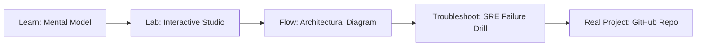

# MetaGuard

> **Production Learning Guide, Interactive Lab & Real-Time Incident Drills**

| Property | Value |
|---|---|
| **Domain** | `LLMOps & RAG Pipelines` |
| **Category** | `AI` |
| **Skill Level** | `Level 3 (Distributed & Compliance)` |
| **Target SRE Metric** | `Sub-10m Developer Onboarding & 100% Golden Path Architectural Adherence` |
| **Artifact Target** | `schema_validation.py` |
| **Source Repository** | [Pradeeptalari14/tp-metaguard](https://github.com/Pradeeptalari14/tp-metaguard) |
| **Interactive Studio** | [Launch In-Browser Lab](./index.html) |

---

## 1. Overview & Architectural Mission

Pydantic schemas validating metadata query templates and rejecting malformed search requests.

### Core Production Use Case
Empowering developers to self-service scaffold production-grade microservices and cloud resources with built-in compliance templates in MetaGuard.



---

## 2. Best Architectural Treatment vs. Anti-Pattern

### Recommended Production Practice
> [!TIP]
> Publish standardized Internal Developer Portal (IDP) templates with golden paths, pre-configured CI/CD pipelines, and security guardrails.

### Dangerous Anti-Pattern to Avoid
> [!WARNING]
> Requiring engineering teams to manually file Jira tickets and wait weeks for DevOps engineers to provision standard infrastructure.

---

## 3. Real-Time SRE Incident Drill

**Target Failure Mode:**
cookiecutter gh:Pradeeptalari14/Pradeeptalari14/tp-metaguard --no-input && cd * && tree .

### Drill Execution Checklist
1. **Baseline Telemetry:** Verify health metrics against the target SLO threshold before initiating changes.
2. **Failure Injection:** Introduce synthetic latency or simulated drift in a non-production staging boundary.
3. **Automated Alerting:** Validate that alerts trigger within `< 30s` via OpenTelemetry collector.
4. **Controlled Remediation:** Apply pre-reviewed, non-destructive configuration changes.
5. **Post-Mortem & Runbook Update:** Update the team runbook with observed failure patterns.

---

## 4. Production Configuration & Code Artifact (`schema_validation.py`)

```python
"""
Production Implementation: MetaGuard
Domain: LLMOps & RAG Pipelines
Target Artifact: schema_validation.py
Repository: https://github.com/Pradeeptalari14/tp-metaguard
SRE Target: Sub-10m Developer Onboarding & 100% Golden Path Architectural Adherence
"""
import os
import sys
import logging
from typing import Dict, Any

logging.basicConfig(level=logging.INFO, format="%(asctime)s [%(levelname)s] %(message)s")
logger = logging.getLogger("metaguard")

class ProductionConfig:
    SERVICE_NAME = "metaguard"
    ENVIRONMENT = os.getenv("APP_ENV", "production")
    WORKER_CONCURRENCY = int(os.getenv("CONCURRENCY", "16"))
    TIMEOUT_SECONDS = int(os.getenv("TIMEOUT_SEC", "30"))
    TELEMETRY_ENDPOINT = os.getenv("OTEL_EXPORTER_OTLP_ENDPOINT", "http://otel-collector:4317")

def initialize_runtime() -> Dict[str, Any]:
    logger.info("Bootstrapping %s runtime with verified parameters...", ProductionConfig.SERVICE_NAME)
    context = {
        "service": ProductionConfig.SERVICE_NAME,
        "concurrency": ProductionConfig.WORKER_CONCURRENCY,
        "slo_threshold": "Sub-10m Developer Onboarding & 100% Golden Path Architectural Adherence",
        "healthy": True
    }
    logger.info("Runtime initialized successfully: %s", context)
    return context

if __name__ == "__main__":
    ctx = initialize_runtime()
    print("Runtime ready for traffic.")
```

---

## 5. Navigation & Next Steps

- **Interactive Simulator:** [Open MetaGuard Studio](./index.html)
- **Web Learning View:** [Interactive Guide](./learn.html)
- **GitHub Project Repository:** [Pradeeptalari14/tp-metaguard](https://github.com/Pradeeptalari14/tp-metaguard)
- **Master Studio Index:** [All 347 Studios](../../STUDIOS_CATALOGUE.md)

