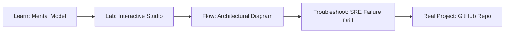

# Nginx Configurator

> **Production Learning Guide, Interactive Lab & Real-Time Incident Drills**

| Property | Value |
|---|---|
| **Domain** | `Automation & SRE Runbooks` |
| **Category** | `AUTOMATION` |
| **Skill Level** | `Level 2 (Scripting & Ops)` |
| **Target SRE Metric** | `<4.5ms Gateway Routing Latency & 100% DoS Burst Mitigation` |
| **Artifact Target** | `nginx.conf` |
| **Source Repository** | [Pradeeptalari14/tp-nginx-config](https://github.com/Pradeeptalari14/tp-nginx-config) |
| **Interactive Studio** | [Launch In-Browser Lab](./index.html) |

---

## 1. Overview & Architectural Mission

Build production-grade nginx.conf files. Configure upstreams, rate limiters, security headers, SSL, compression, and visualize live traffic routing flowcharts via dynamic Mermaid diagrams.

### Core Production Use Case
Terminating TLS, routing high-throughput ingress traffic, and rate-limiting abusive API consumers before reaching backend microservices in Nginx Configurator.



---

## 2. Best Architectural Treatment vs. Anti-Pattern

### Recommended Production Practice
> [!TIP]
> Deploy Envoy/Nginx sidecars with token-bucket rate limiters, active health checks, and circuit-breaking upstream connection pools.

### Dangerous Anti-Pattern to Avoid
> [!WARNING]
> Exposing upstream backend services directly to public ingress without connection limits, TLS termination, or CORS request filters.

---

## 3. Real-Time SRE Incident Drill

**Target Failure Mode:**
nginx -t -c nginx.conf && curl -Iv http://localhost:8080/healthz

### Drill Execution Checklist
1. **Baseline Telemetry:** Verify health metrics against the target SLO threshold before initiating changes.
2. **Failure Injection:** Introduce synthetic latency or simulated drift in a non-production staging boundary.
3. **Automated Alerting:** Validate that alerts trigger within `< 30s` via OpenTelemetry collector.
4. **Controlled Remediation:** Apply pre-reviewed, non-destructive configuration changes.
5. **Post-Mortem & Runbook Update:** Update the team runbook with observed failure patterns.

---

## 4. Production Configuration & Code Artifact (`nginx.conf`)

```toml
# Configuration Artifact: nginx.conf
# Studio: Nginx Configurator
# Domain: Automation & SRE Runbooks
# Target SRE Standard: <4.5ms Gateway Routing Latency & 100% DoS Burst Mitigation

[service]
name = "nginx-configurator"
domain = "Automation & SRE Runbooks"
mode = "production"
slo_target = "<4.5ms Gateway Routing Latency & 100% DoS Burst Mitigation"

[telemetry]
enabled = true
endpoint = "otel-collector:4317"
sample_rate = 1.0

[resilience]
circuit_breaker = true
retry_count = 3
timeout_ms = 5000
```

---

## 5. Navigation & Next Steps

- **Interactive Simulator:** [Open Nginx Configurator Studio](./index.html)
- **Web Learning View:** [Interactive Guide](./learn.html)
- **GitHub Project Repository:** [Pradeeptalari14/tp-nginx-config](https://github.com/Pradeeptalari14/tp-nginx-config)
- **Master Studio Index:** [All 347 Studios](../../STUDIOS_CATALOGUE.md)

