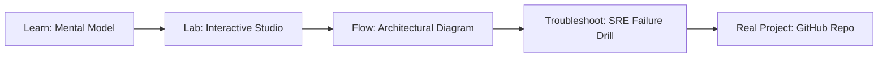

# OPAL & OPA Policy Controller

> **Production Learning Guide, Interactive Lab & Real-Time Incident Drills**

| Property | Value |
|---|---|
| **Domain** | `LLMOps & RAG Pipelines` |
| **Category** | `AI` |
| **Skill Level** | `Level 3 (Distributed & Compliance)` |
| **Target SRE Metric** | `100% Deterministic State Recovery & Zero Unbounded Delegation Cascades` |
| **Artifact Target** | `policy.rego` |
| **Source Repository** | [Pradeeptalari14/tp-opal-opa](https://github.com/Pradeeptalari14/tp-opal-opa) |
| **Interactive Studio** | [Launch In-Browser Lab](./index.html) |

---

## 1. Overview & Architectural Mission

Open Policy Agent integration templates. Evaluates document visibility policies as code in real-time.

### Core Production Use Case
Orchestrating autonomous multi-agent tool execution in OPAL & OPA Policy Controller while preventing infinite delegation loops, cascading errors, and unbounded API costs.



---

## 2. Best Architectural Treatment vs. Anti-Pattern

### Recommended Production Practice
> [!TIP]
> Deploy deterministic LangGraph state machine graphs with checkpointed PostgreSQL state persistence, human-in-the-loop gates, and bounded tool execution steps.

### Dangerous Anti-Pattern to Avoid
> [!WARNING]
> Allowing unconstrained recursive agent dispatch without max-iteration budgets, structured schema constraints, or circuit-breakers.

---

## 3. Real-Time SRE Incident Drill

**Target Failure Mode:**
python3 -m agents.runner --graph-config policy.rego --max-steps 8 --verify-tool-schemas --trace-otel

### Drill Execution Checklist
1. **Baseline Telemetry:** Verify health metrics against the target SLO threshold before initiating changes.
2. **Failure Injection:** Introduce synthetic latency or simulated drift in a non-production staging boundary.
3. **Automated Alerting:** Validate that alerts trigger within `< 30s` via OpenTelemetry collector.
4. **Controlled Remediation:** Apply pre-reviewed, non-destructive configuration changes.
5. **Post-Mortem & Runbook Update:** Update the team runbook with observed failure patterns.

---

## 4. Production Configuration & Code Artifact (`policy.rego`)

```toml
# Configuration Artifact: policy.rego
# Studio: OPAL & OPA Policy Controller
# Domain: LLMOps & RAG Pipelines
# Target SRE Standard: 100% Deterministic State Recovery & Zero Unbounded Delegation Cascades

[service]
name = "opal-&-opa-policy-controller"
domain = "LLMOps & RAG Pipelines"
mode = "production"
slo_target = "100% Deterministic State Recovery & Zero Unbounded Delegation Cascades"

[telemetry]
enabled = true
endpoint = "otel-collector:4317"
sample_rate = 1.0

[resilience]
circuit_breaker = true
retry_count = 3
timeout_ms = 5000
```

---

## 5. Navigation & Next Steps

- **Interactive Simulator:** [Open OPAL & OPA Policy Controller Studio](./index.html)
- **Web Learning View:** [Interactive Guide](./learn.html)
- **GitHub Project Repository:** [Pradeeptalari14/tp-opal-opa](https://github.com/Pradeeptalari14/tp-opal-opa)
- **Master Studio Index:** [All 347 Studios](../../STUDIOS_CATALOGUE.md)

