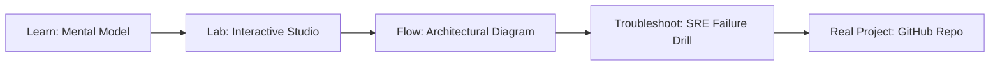

# Open Monitor AI Agent Monitoring

> **Production Learning Guide, Interactive Lab & Real-Time Incident Drills**

| Property | Value |
|---|---|
| **Domain** | `FinOps & Cost Optimization` |
| **Category** | `AI` |
| **Skill Level** | `Level 2 (Scripting & Ops)` |
| **Target SRE Metric** | `100% Deterministic State Recovery & Zero Unbounded Delegation Cascades` |
| **Artifact Target** | `grafana_dashboard.json` |
| **Source Repository** | [Pradeeptalari14/tp-open-monitor-agent](https://github.com/Pradeeptalari14/tp-open-monitor-agent) |
| **Interactive Studio** | [Launch In-Browser Lab](./index.html) |

---

## 1. Overview & Architectural Mission

Open-source Prometheus observability stack mapping agent token costs, latency, and response accuracy in real-time.

### Core Production Use Case
Orchestrating autonomous multi-agent tool execution in Open Monitor AI Agent Monitoring while preventing infinite delegation loops, cascading errors, and unbounded API costs.



---

## 2. Best Architectural Treatment vs. Anti-Pattern

### Recommended Production Practice
> [!TIP]
> Deploy deterministic LangGraph state machine graphs with checkpointed PostgreSQL state persistence, human-in-the-loop gates, and bounded tool execution steps.

### Dangerous Anti-Pattern to Avoid
> [!WARNING]
> Allowing unconstrained recursive agent dispatch without max-iteration budgets, structured schema constraints, or circuit-breakers.

---

## 3. Real-Time SRE Incident Drill

**Target Failure Mode:**
python3 -m agents.runner --graph-config grafana_dashboard.json --max-steps 8 --verify-tool-schemas --trace-otel

### Drill Execution Checklist
1. **Baseline Telemetry:** Verify health metrics against the target SLO threshold before initiating changes.
2. **Failure Injection:** Introduce synthetic latency or simulated drift in a non-production staging boundary.
3. **Automated Alerting:** Validate that alerts trigger within `< 30s` via OpenTelemetry collector.
4. **Controlled Remediation:** Apply pre-reviewed, non-destructive configuration changes.
5. **Post-Mortem & Runbook Update:** Update the team runbook with observed failure patterns.

---

## 4. Production Configuration & Code Artifact (`grafana_dashboard.json`)

```json
{
  "$schema": "https://json-schema.org/draft/2020-12/schema",
  "studio": "open-monitor-ai-agent-monitoring",
  "domain": "FinOps & Cost Optimization",
  "targetArtifact": "grafana_dashboard.json",
  "sreMetric": "100% Deterministic State Recovery & Zero Unbounded Delegation Cascades",
  "repository": "Pradeeptalari14/tp-open-monitor-agent",
  "service": {
    "name": "open-monitor-ai-agent-monitoring",
    "mode": "production",
    "version": "1.0.0",
    "resilience": {
      "circuitBreaker": true,
      "maxRetries": 3,
      "timeoutMs": 5000
    },
    "telemetry": {
      "enabled": true,
      "endpoint": "otel-collector:4317",
      "sampleRate": 1.0
    }
  }
}
```

---

## 5. Navigation & Next Steps

- **Interactive Simulator:** [Open Open Monitor AI Agent Monitoring Studio](./index.html)
- **Web Learning View:** [Interactive Guide](./learn.html)
- **GitHub Project Repository:** [Pradeeptalari14/tp-open-monitor-agent](https://github.com/Pradeeptalari14/tp-open-monitor-agent)
- **Master Studio Index:** [All 347 Studios](../../STUDIOS_CATALOGUE.md)

