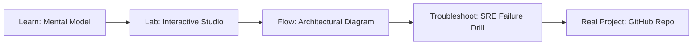

# OpenAI Compute & Quota Broker Studio

> **Production Learning Guide, Interactive Lab & Real-Time Incident Drills**

| Property | Value |
|---|---|
| **Domain** | `LLMOps & RAG Pipelines` |
| **Category** | `AI` |
| **Skill Level** | `Level 3 (Distributed & Compliance)` |
| **Target SRE Metric** | `99.95% Availability SLO & 100% Audited Reproducibility` |
| **Artifact Target** | `broker-policy.json` |
| **Source Repository** | [Pradeeptalari14/tp-openai-marketplace-broker](https://github.com/Pradeeptalari14/tp-openai-marketplace-broker) |
| **Interactive Studio** | [Launch In-Browser Lab](./index.html) |

---

## 1. Overview & Architectural Mission

Quota-aware routing across OpenAI and Azure OpenAI deployments using TPM/RPM headroom, priority tiers, data residency and Retry-After backoff.

### Core Production Use Case
Production engineering: Deploying resilient, schema-validated OpenAI Compute & Quota Broker Studio services with audited compliance and zero-drift operational reliability.



---

## 2. Best Architectural Treatment vs. Anti-Pattern

### Recommended Production Practice
> [!TIP]
> Standardize on version-controlled declarations (broker-policy.json), enforce automated validation before commit, and monitor runtime telemetry against target SLOs.

### Dangerous Anti-Pattern to Avoid
> [!WARNING]
> Manual ad-hoc configuration adjustments in live environments without versioned state manifests or automated rollback testing.

---

## 3. Real-Time SRE Incident Drill

**Target Failure Mode:**
bash scripts/validate.sh --manifest broker-policy.json --verify-health --environment production

### Drill Execution Checklist
1. **Baseline Telemetry:** Verify health metrics against the target SLO threshold before initiating changes.
2. **Failure Injection:** Introduce synthetic latency or simulated drift in a non-production staging boundary.
3. **Automated Alerting:** Validate that alerts trigger within `< 30s` via OpenTelemetry collector.
4. **Controlled Remediation:** Apply pre-reviewed, non-destructive configuration changes.
5. **Post-Mortem & Runbook Update:** Update the team runbook with observed failure patterns.

---

## 4. Production Configuration & Code Artifact (`broker-policy.json`)

```json
{
  "$schema": "https://json-schema.org/draft/2020-12/schema",
  "studio": "openai-compute-&-quota-broker-studio",
  "domain": "LLMOps & RAG Pipelines",
  "targetArtifact": "broker-policy.json",
  "sreMetric": "99.95% Availability SLO & 100% Audited Reproducibility",
  "repository": "Pradeeptalari14/tp-openai-marketplace-broker",
  "service": {
    "name": "openai-compute-&-quota-broker-studio",
    "mode": "production",
    "version": "1.0.0",
    "resilience": {
      "circuitBreaker": true,
      "maxRetries": 3,
      "timeoutMs": 5000
    },
    "telemetry": {
      "enabled": true,
      "endpoint": "otel-collector:4317",
      "sampleRate": 1.0
    }
  }
}
```

---

## 5. Navigation & Next Steps

- **Interactive Simulator:** [Open OpenAI Compute & Quota Broker Studio Studio](./index.html)
- **Web Learning View:** [Interactive Guide](./learn.html)
- **GitHub Project Repository:** [Pradeeptalari14/tp-openai-marketplace-broker](https://github.com/Pradeeptalari14/tp-openai-marketplace-broker)
- **Master Studio Index:** [All 347 Studios](../../STUDIOS_CATALOGUE.md)

