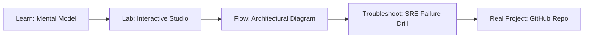

# PromptSecurity (Firewall)

> **Production Learning Guide, Interactive Lab & Real-Time Incident Drills**

| Property | Value |
|---|---|
| **Domain** | `Zero-Trust Security & AI Safety` |
| **Category** | `AI` |
| **Skill Level** | `Level 3 (Distributed & Compliance)` |
| **Target SRE Metric** | `<4.5ms Gateway Routing Latency & 100% DoS Burst Mitigation` |
| **Artifact Target** | `firewall_config.json` |
| **Source Repository** | [Pradeeptalari14/tp-prompt-security-firewall](https://github.com/Pradeeptalari14/tp-prompt-security-firewall) |
| **Interactive Studio** | [Launch In-Browser Lab](./index.html) |

---

## 1. Overview & Architectural Mission

JSON-configured proxy firewall auditing raw prompts for bypass patterns and jailbreak attempts.

### Core Production Use Case
Terminating TLS, routing high-throughput ingress traffic, and rate-limiting abusive API consumers before reaching backend microservices in PromptSecurity (Firewall).



---

## 2. Best Architectural Treatment vs. Anti-Pattern

### Recommended Production Practice
> [!TIP]
> Deploy Envoy/Nginx sidecars with token-bucket rate limiters, active health checks, and circuit-breaking upstream connection pools.

### Dangerous Anti-Pattern to Avoid
> [!WARNING]
> Exposing upstream backend services directly to public ingress without connection limits, TLS termination, or CORS request filters.

---

## 3. Real-Time SRE Incident Drill

**Target Failure Mode:**
nginx -t -c firewall_config.json && curl -Iv http://localhost:8080/healthz

### Drill Execution Checklist
1. **Baseline Telemetry:** Verify health metrics against the target SLO threshold before initiating changes.
2. **Failure Injection:** Introduce synthetic latency or simulated drift in a non-production staging boundary.
3. **Automated Alerting:** Validate that alerts trigger within `< 30s` via OpenTelemetry collector.
4. **Controlled Remediation:** Apply pre-reviewed, non-destructive configuration changes.
5. **Post-Mortem & Runbook Update:** Update the team runbook with observed failure patterns.

---

## 4. Production Configuration & Code Artifact (`firewall_config.json`)

```json
{
  "$schema": "https://json-schema.org/draft/2020-12/schema",
  "studio": "promptsecurity-(firewall)",
  "domain": "Zero-Trust Security & AI Safety",
  "targetArtifact": "firewall_config.json",
  "sreMetric": "<4.5ms Gateway Routing Latency & 100% DoS Burst Mitigation",
  "repository": "Pradeeptalari14/tp-prompt-security-firewall",
  "service": {
    "name": "promptsecurity-(firewall)",
    "mode": "production",
    "version": "1.0.0",
    "resilience": {
      "circuitBreaker": true,
      "maxRetries": 3,
      "timeoutMs": 5000
    },
    "telemetry": {
      "enabled": true,
      "endpoint": "otel-collector:4317",
      "sampleRate": 1.0
    }
  }
}
```

---

## 5. Navigation & Next Steps

- **Interactive Simulator:** [Open PromptSecurity (Firewall) Studio](./index.html)
- **Web Learning View:** [Interactive Guide](./learn.html)
- **GitHub Project Repository:** [Pradeeptalari14/tp-prompt-security-firewall](https://github.com/Pradeeptalari14/tp-prompt-security-firewall)
- **Master Studio Index:** [All 347 Studios](../../STUDIOS_CATALOGUE.md)

