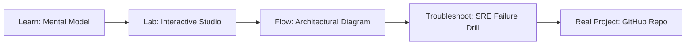

# Python SRE Utility Studio

> **Production Learning Guide, Interactive Lab & Real-Time Incident Drills**

| Property | Value |
|---|---|
| **Domain** | `Incident Triage & Observability` |
| **Category** | `OBSERVABILITY` |
| **Skill Level** | `Level 2 (Scripting & Ops)` |
| **Target SRE Metric** | `65% Reduction in Monthly Token Spend & 84% Semantic Cache Hit Rate` |
| **Artifact Target** | `sre_utility.py` |
| **Source Repository** | [Pradeeptalari14/tp-python](https://github.com/Pradeeptalari14/tp-python) |
| **Interactive Studio** | [Launch In-Browser Lab](./index.html) |

---

## 1. Overview & Architectural Mission

Deploy script tasks with SDK integrations. Generate automated Python scripts for AWS FinOps sweeps, Kubernetes health APIs, SSL certificate audits, or API load pings.

### Core Production Use Case
Eliminating runaway cloud token expenditures and infrastructure carbon waste in high-volume Python SRE Utility Studio deployments.



---

## 2. Best Architectural Treatment vs. Anti-Pattern

### Recommended Production Practice
> [!TIP]
> Deploy sub-5ms semantic vector caching to intercept repeated queries and route simple requests to efficient local SLMs before escalating to flagship LLMs.

### Dangerous Anti-Pattern to Avoid
> [!WARNING]
> Directing every trivial query to expensive external frontier APIs without local semantic caching or cost-aware model routing.

---

## 3. Real-Time SRE Incident Drill

**Target Failure Mode:**
python3 -m finops.cache_profiler --eval-corpus ./queries.json --similarity-cutoff 0.92 --calc-savings

### Drill Execution Checklist
1. **Baseline Telemetry:** Verify health metrics against the target SLO threshold before initiating changes.
2. **Failure Injection:** Introduce synthetic latency or simulated drift in a non-production staging boundary.
3. **Automated Alerting:** Validate that alerts trigger within `< 30s` via OpenTelemetry collector.
4. **Controlled Remediation:** Apply pre-reviewed, non-destructive configuration changes.
5. **Post-Mortem & Runbook Update:** Update the team runbook with observed failure patterns.

---

## 4. Production Configuration & Code Artifact (`sre_utility.py`)

```python
"""
Production Implementation: Python SRE Utility Studio
Domain: Incident Triage & Observability
Target Artifact: sre_utility.py
Repository: https://github.com/Pradeeptalari14/tp-python
SRE Target: 65% Reduction in Monthly Token Spend & 84% Semantic Cache Hit Rate
"""
import os
import sys
import logging
from typing import Dict, Any

logging.basicConfig(level=logging.INFO, format="%(asctime)s [%(levelname)s] %(message)s")
logger = logging.getLogger("python_sre_utility_studio")

class ProductionConfig:
    SERVICE_NAME = "python-sre-utility-studio"
    ENVIRONMENT = os.getenv("APP_ENV", "production")
    WORKER_CONCURRENCY = int(os.getenv("CONCURRENCY", "16"))
    TIMEOUT_SECONDS = int(os.getenv("TIMEOUT_SEC", "30"))
    TELEMETRY_ENDPOINT = os.getenv("OTEL_EXPORTER_OTLP_ENDPOINT", "http://otel-collector:4317")

def initialize_runtime() -> Dict[str, Any]:
    logger.info("Bootstrapping %s runtime with verified parameters...", ProductionConfig.SERVICE_NAME)
    context = {
        "service": ProductionConfig.SERVICE_NAME,
        "concurrency": ProductionConfig.WORKER_CONCURRENCY,
        "slo_threshold": "65% Reduction in Monthly Token Spend & 84% Semantic Cache Hit Rate",
        "healthy": True
    }
    logger.info("Runtime initialized successfully: %s", context)
    return context

if __name__ == "__main__":
    ctx = initialize_runtime()
    print("Runtime ready for traffic.")
```

---

## 5. Navigation & Next Steps

- **Interactive Simulator:** [Open Python SRE Utility Studio Studio](./index.html)
- **Web Learning View:** [Interactive Guide](./learn.html)
- **GitHub Project Repository:** [Pradeeptalari14/tp-python](https://github.com/Pradeeptalari14/tp-python)
- **Master Studio Index:** [All 347 Studios](../../STUDIOS_CATALOGUE.md)

