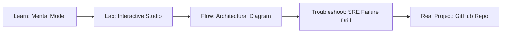

# SGLang RadixAttention & Prefix-Caching Studio

> **Production Learning Guide, Interactive Lab & Real-Time Incident Drills**

| Property | Value |
|---|---|
| **Domain** | `LLMOps & AI Runtime` |
| **Category** | `AI` |
| **Skill Level** | `Level 4 (Kernel & Deep AI)` |
| **Target SRE Metric** | `4.5x Prefix Prefill Throughput & 88% KV-Cache Hit Ratio` |
| **Artifact Target** | `SGLang KV-Cache` |
| **Source Repository** | [Pradeeptalari14/tp-sglang-radix-attention](https://github.com/Pradeeptalari14/tp-sglang-radix-attention) |
| **Interactive Studio** | [Launch In-Browser Lab](./index.html) |

---

## 1. Overview & Architectural Mission

Simulate high-throughput Radix Tree KV-cache sharing across multi-turn agent chats, hierarchical system prompts, and tree-search decodings.

### Core Production Use Case
Multi-turn agent swarms and repetitive chain-of-thought workflows where system prompts and tools definitions are repeated across thousands of consecutive LLM calls.



---

## 2. Best Architectural Treatment vs. Anti-Pattern

### Recommended Production Practice
> [!TIP]
> Maintain a Radix Tree KV-cache index across requests, allowing automatic prefix matching, instant KV reuse, and zero recomputation of static prompt prefixes.

### Dangerous Anti-Pattern to Avoid
> [!WARNING]
> Re-tokenizing and running full transformer prefill passes on the exact same 3,000-token system prompt across every single agent step.

---

## 3. Real-Time SRE Incident Drill

**Target Failure Mode:**
python3 -m sglang.launch_server --model-path meta-llama/Llama-3-8B-Instruct --port 30000 --enable-cache-report

### Drill Execution Checklist
1. **Baseline Telemetry:** Verify health metrics against the target SLO threshold before initiating changes.
2. **Failure Injection:** Introduce synthetic latency or simulated drift in a non-production staging boundary.
3. **Automated Alerting:** Validate that alerts trigger within `< 30s` via OpenTelemetry collector.
4. **Controlled Remediation:** Apply pre-reviewed, non-destructive configuration changes.
5. **Post-Mortem & Runbook Update:** Update the team runbook with observed failure patterns.

---

## 4. Production Configuration & Code Artifact (`SGLang KV-Cache`)

```toml
# Configuration Artifact: SGLang KV-Cache
# Studio: SGLang RadixAttention & Prefix-Caching Studio
# Domain: LLMOps & AI Runtime
# Target SRE Standard: 4.5x Prefix Prefill Throughput & 88% KV-Cache Hit Ratio

[service]
name = "sglang-radixattention-&-prefix-caching-studio"
domain = "LLMOps & AI Runtime"
mode = "production"
slo_target = "4.5x Prefix Prefill Throughput & 88% KV-Cache Hit Ratio"

[telemetry]
enabled = true
endpoint = "otel-collector:4317"
sample_rate = 1.0

[resilience]
circuit_breaker = true
retry_count = 3
timeout_ms = 5000
```

---

## 5. Navigation & Next Steps

- **Interactive Simulator:** [Open SGLang RadixAttention & Prefix-Caching Studio Studio](./index.html)
- **Web Learning View:** [Interactive Guide](./learn.html)
- **GitHub Project Repository:** [Pradeeptalari14/tp-sglang-radix-attention](https://github.com/Pradeeptalari14/tp-sglang-radix-attention)
- **Master Studio Index:** [All 347 Studios](../../STUDIOS_CATALOGUE.md)

