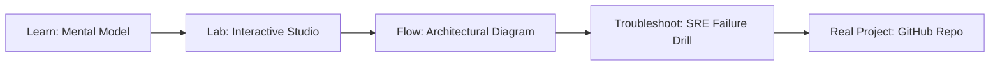

# SharePoint Document Permissions Pipeline

> **Production Learning Guide, Interactive Lab & Real-Time Incident Drills**

| Property | Value |
|---|---|
| **Domain** | `LLMOps & RAG Pipelines` |
| **Category** | `AI` |
| **Skill Level** | `Level 3 (Distributed & Compliance)` |
| **Target SRE Metric** | `Zero Critical CVEs in Production & 100% Cryptographically Verified SLSA Provenance` |
| **Artifact Target** | `entra_permissions.json` |
| **Source Repository** | [Pradeeptalari14/tp-sharepoint-permissions-pipeline](https://github.com/Pradeeptalari14/tp-sharepoint-permissions-pipeline) |
| **Interactive Studio** | [Launch In-Browser Lab](./index.html) |

---

## 1. Overview & Architectural Mission

Ingestion pipeline propagating SharePoint ACL metadata and Entra ID object identifiers for secure search.

### Core Production Use Case
Securing the software supply chain against untrusted dependency vulnerabilities, image tampering, and deployment drift in SharePoint Document Permissions Pipeline.



---

## 2. Best Architectural Treatment vs. Anti-Pattern

### Recommended Production Practice
> [!TIP]
> Enforce cryptographic Sigstore cosign container signing, CycloneDX SBOM generation, and automated Trivy vulnerability gating before GitOps sync.

### Dangerous Anti-Pattern to Avoid
> [!WARNING]
> Pushing unsigned container images directly to production registries without vulnerability scan gates or immutable SHA256 digest pinning.

---

## 3. Real-Time SRE Incident Drill

**Target Failure Mode:**
trivy image --severity HIGH,CRITICAL ghcr.io/Pradeeptalari14/tp-sharepoint-permissions-pipeline:latest && cosign verify --key cosign.pub ghcr.io/Pradeeptalari14/tp-sharepoint-permissions-pipeline:latest

### Drill Execution Checklist
1. **Baseline Telemetry:** Verify health metrics against the target SLO threshold before initiating changes.
2. **Failure Injection:** Introduce synthetic latency or simulated drift in a non-production staging boundary.
3. **Automated Alerting:** Validate that alerts trigger within `< 30s` via OpenTelemetry collector.
4. **Controlled Remediation:** Apply pre-reviewed, non-destructive configuration changes.
5. **Post-Mortem & Runbook Update:** Update the team runbook with observed failure patterns.

---

## 4. Production Configuration & Code Artifact (`entra_permissions.json`)

```json
{
  "$schema": "https://json-schema.org/draft/2020-12/schema",
  "studio": "sharepoint-document-permissions-pipeline",
  "domain": "LLMOps & RAG Pipelines",
  "targetArtifact": "entra_permissions.json",
  "sreMetric": "Zero Critical CVEs in Production & 100% Cryptographically Verified SLSA Provenance",
  "repository": "Pradeeptalari14/tp-sharepoint-permissions-pipeline",
  "service": {
    "name": "sharepoint-document-permissions-pipeline",
    "mode": "production",
    "version": "1.0.0",
    "resilience": {
      "circuitBreaker": true,
      "maxRetries": 3,
      "timeoutMs": 5000
    },
    "telemetry": {
      "enabled": true,
      "endpoint": "otel-collector:4317",
      "sampleRate": 1.0
    }
  }
}
```

---

## 5. Navigation & Next Steps

- **Interactive Simulator:** [Open SharePoint Document Permissions Pipeline Studio](./index.html)
- **Web Learning View:** [Interactive Guide](./learn.html)
- **GitHub Project Repository:** [Pradeeptalari14/tp-sharepoint-permissions-pipeline](https://github.com/Pradeeptalari14/tp-sharepoint-permissions-pipeline)
- **Master Studio Index:** [All 347 Studios](../../STUDIOS_CATALOGUE.md)

