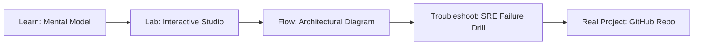

# Local SLM Studio

> **Production Learning Guide, Interactive Lab & Real-Time Incident Drills**

| Property | Value |
|---|---|
| **Domain** | `LLMOps & RAG Pipelines` |
| **Category** | `AI` |
| **Skill Level** | `Level 3 (Distributed & Compliance)` |
| **Target SRE Metric** | `100% Non-Root Process Isolation & Sub-2s Daemon Bootstrap Latency` |
| **Artifact Target** | `Modelfile` |
| **Source Repository** | [Pradeeptalari14/tp-slm](https://github.com/Pradeeptalari14/tp-slm) |
| **Interactive Studio** | [Launch In-Browser Lab](./index.html) |

---

## 1. Overview & Architectural Mission

Build high-performance, containerized or edge environments for Small Models. Generate customized Ollama Modelfiles, systemd service units, and edge bootstrapping scripts.

### Core Production Use Case
Hardening host OS runtime, optimizing daemon lifecycle management, and isolating microservice container processes in Local SLM Studio.



---

## 2. Best Architectural Treatment vs. Anti-Pattern

### Recommended Production Practice
> [!TIP]
> Standardize on lightweight distroless container images, non-root systemd service cgroup limits, and read-only root filesystems.

### Dangerous Anti-Pattern to Avoid
> [!WARNING]
> Running container processes as root with unrestricted host PID/network namespaces and mutable disk volumes.

---

## 3. Real-Time SRE Incident Drill

**Target Failure Mode:**
systemctl status local-slm-studio --no-pager || docker inspect --format '{{.State.Status}}' container_app

### Drill Execution Checklist
1. **Baseline Telemetry:** Verify health metrics against the target SLO threshold before initiating changes.
2. **Failure Injection:** Introduce synthetic latency or simulated drift in a non-production staging boundary.
3. **Automated Alerting:** Validate that alerts trigger within `< 30s` via OpenTelemetry collector.
4. **Controlled Remediation:** Apply pre-reviewed, non-destructive configuration changes.
5. **Post-Mortem & Runbook Update:** Update the team runbook with observed failure patterns.

---

## 4. Production Configuration & Code Artifact (`Modelfile`)

```toml
# Configuration Artifact: Modelfile
# Studio: Local SLM Studio
# Domain: LLMOps & RAG Pipelines
# Target SRE Standard: 100% Non-Root Process Isolation & Sub-2s Daemon Bootstrap Latency

[service]
name = "local-slm-studio"
domain = "LLMOps & RAG Pipelines"
mode = "production"
slo_target = "100% Non-Root Process Isolation & Sub-2s Daemon Bootstrap Latency"

[telemetry]
enabled = true
endpoint = "otel-collector:4317"
sample_rate = 1.0

[resilience]
circuit_breaker = true
retry_count = 3
timeout_ms = 5000
```

---

## 5. Navigation & Next Steps

- **Interactive Simulator:** [Open Local SLM Studio Studio](./index.html)
- **Web Learning View:** [Interactive Guide](./learn.html)
- **GitHub Project Repository:** [Pradeeptalari14/tp-slm](https://github.com/Pradeeptalari14/tp-slm)
- **Master Studio Index:** [All 347 Studios](../../STUDIOS_CATALOGUE.md)

