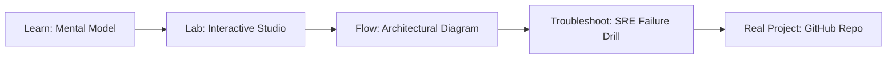

# tclp Text Fingerprinting

> **Production Learning Guide, Interactive Lab & Real-Time Incident Drills**

| Property | Value |
|---|---|
| **Domain** | `LLMOps & RAG Pipelines` |
| **Category** | `AI` |
| **Skill Level** | `Level 3 (Distributed & Compliance)` |
| **Target SRE Metric** | `Zero Certificate Expiration Outages & 100% Automated 60-Day Renewal` |
| **Artifact Target** | `fingerprint_utils.rs` |
| **Source Repository** | [Pradeeptalari14/tp-tclp](https://github.com/Pradeeptalari14/tp-tclp) |
| **Interactive Studio** | [Launch In-Browser Lab](./index.html) |

---

## 1. Overview & Architectural Mission

High-performance text deduplication utility written in Rust. Supports MinHash, LSH, SimHash, and TLSH.

### Core Production Use Case
Automating wildcard SSL/TLS certificate issuance, renewal, and DNS record validation without human intervention or certificate expiry outages in tclp Text Fingerprinting.



---

## 2. Best Architectural Treatment vs. Anti-Pattern

### Recommended Production Practice
> [!TIP]
> Deploy Cert-Manager with automated ACME Let's Encrypt DNS01 challenge solvers and alert 30 days prior to certificate expiration.

### Dangerous Anti-Pattern to Avoid
> [!WARNING]
> Manually purchasing and copying static SSL certificates onto servers, causing unexpected production outages when certificates expire.

---

## 3. Real-Time SRE Incident Drill

**Target Failure Mode:**
openssl s_client -connect localhost:443 -servername talaripradeep.info </dev/null 2>/dev/null | openssl x509 -noout -dates

### Drill Execution Checklist
1. **Baseline Telemetry:** Verify health metrics against the target SLO threshold before initiating changes.
2. **Failure Injection:** Introduce synthetic latency or simulated drift in a non-production staging boundary.
3. **Automated Alerting:** Validate that alerts trigger within `< 30s` via OpenTelemetry collector.
4. **Controlled Remediation:** Apply pre-reviewed, non-destructive configuration changes.
5. **Post-Mortem & Runbook Update:** Update the team runbook with observed failure patterns.

---

## 4. Production Configuration & Code Artifact (`fingerprint_utils.rs`)

```toml
# Configuration Artifact: fingerprint_utils.rs
# Studio: tclp Text Fingerprinting
# Domain: LLMOps & RAG Pipelines
# Target SRE Standard: Zero Certificate Expiration Outages & 100% Automated 60-Day Renewal

[service]
name = "tclp-text-fingerprinting"
domain = "LLMOps & RAG Pipelines"
mode = "production"
slo_target = "Zero Certificate Expiration Outages & 100% Automated 60-Day Renewal"

[telemetry]
enabled = true
endpoint = "otel-collector:4317"
sample_rate = 1.0

[resilience]
circuit_breaker = true
retry_count = 3
timeout_ms = 5000
```

---

## 5. Navigation & Next Steps

- **Interactive Simulator:** [Open tclp Text Fingerprinting Studio](./index.html)
- **Web Learning View:** [Interactive Guide](./learn.html)
- **GitHub Project Repository:** [Pradeeptalari14/tp-tclp](https://github.com/Pradeeptalari14/tp-tclp)
- **Master Studio Index:** [All 347 Studios](../../STUDIOS_CATALOGUE.md)

