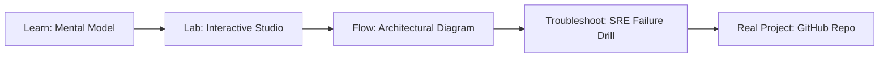

# Apache Tomcat Tuning Studio

> **Production Learning Guide, Interactive Lab & Real-Time Incident Drills**

| Property | Value |
|---|---|
| **Domain** | `Automation & SRE Runbooks` |
| **Category** | `AUTOMATION` |
| **Skill Level** | `Level 2 (Scripting & Ops)` |
| **Target SRE Metric** | `P99 Query Latency < 12ms & Zero Schema Migration Downtime` |
| **Artifact Target** | `server.xml` |
| **Source Repository** | [Pradeeptalari14/tp-tomcat](https://github.com/Pradeeptalari14/tp-tomcat) |
| **Interactive Studio** | [Launch In-Browser Lab](./index.html) |

---

## 1. Overview & Architectural Mission

Tune and optimize Apache Tomcat middleware services. Generate server.xml connectors, JNDI database connection pools in context.xml, and JVM memory setenv.sh configurations.

### Core Production Use Case
Preventing connection pool exhaustion, slow unindexed queries, and schema migration locking in mission-critical Apache Tomcat Tuning Studio databases.



---

## 2. Best Architectural Treatment vs. Anti-Pattern

### Recommended Production Practice
> [!TIP]
> Implement asynchronous connection pooling (PgBouncer/SQLAlchemy), automated zero-downtime Alembic migrations, and pgvector HNSW indexing.

### Dangerous Anti-Pattern to Avoid
> [!WARNING]
> Executing unindexed multi-table JOINs and synchronous blocking DDL alter commands during peak business traffic.

---

## 3. Real-Time SRE Incident Drill

**Target Failure Mode:**
alembic upgrade head && psql -U postgres -d studios_hub -c "EXPLAIN ANALYZE SELECT * FROM pgvector_store LIMIT 10;"

### Drill Execution Checklist
1. **Baseline Telemetry:** Verify health metrics against the target SLO threshold before initiating changes.
2. **Failure Injection:** Introduce synthetic latency or simulated drift in a non-production staging boundary.
3. **Automated Alerting:** Validate that alerts trigger within `< 30s` via OpenTelemetry collector.
4. **Controlled Remediation:** Apply pre-reviewed, non-destructive configuration changes.
5. **Post-Mortem & Runbook Update:** Update the team runbook with observed failure patterns.

---

## 4. Production Configuration & Code Artifact (`server.xml`)

```toml
# Configuration Artifact: server.xml
# Studio: Apache Tomcat Tuning Studio
# Domain: Automation & SRE Runbooks
# Target SRE Standard: P99 Query Latency < 12ms & Zero Schema Migration Downtime

[service]
name = "apache-tomcat-tuning-studio"
domain = "Automation & SRE Runbooks"
mode = "production"
slo_target = "P99 Query Latency < 12ms & Zero Schema Migration Downtime"

[telemetry]
enabled = true
endpoint = "otel-collector:4317"
sample_rate = 1.0

[resilience]
circuit_breaker = true
retry_count = 3
timeout_ms = 5000
```

---

## 5. Navigation & Next Steps

- **Interactive Simulator:** [Open Apache Tomcat Tuning Studio Studio](./index.html)
- **Web Learning View:** [Interactive Guide](./learn.html)
- **GitHub Project Repository:** [Pradeeptalari14/tp-tomcat](https://github.com/Pradeeptalari14/tp-tomcat)
- **Master Studio Index:** [All 347 Studios](../../STUDIOS_CATALOGUE.md)

